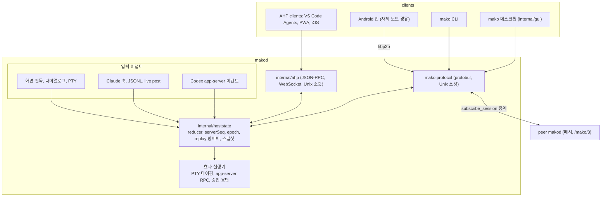
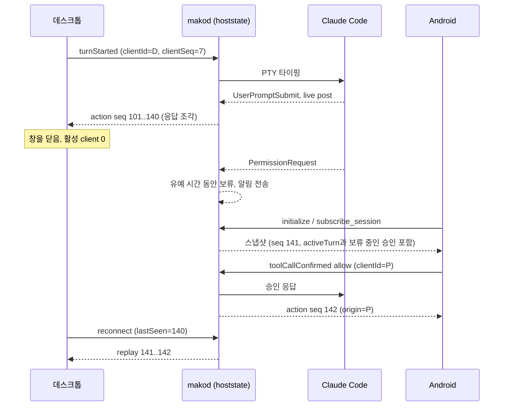

# Agent Host Protocol 도입과 클라이언트 간 Seamless Handoff 계획

작성 기준일: 2026년 11월 28일. 분석 기준 커밋: `main` @ `148b43e` (`protocol.Revision` 52). 상태: 기획. 첫 단계(`read_agent`)와 두 번째 단계(session host, `subscribe_session`) 구현 중, Phase 0 (검증) 대기.

이 문서는 Microsoft의 [Agent Host Protocol](https://microsoft.github.io/agent-host-protocol/) (이하 AHP)을 mako에 도입하는 계획이다. 목표는 세션을 `makod`가 들고 있는 동안 클라이언트가 바뀌어도 작업이 끊기지 않는 것이다. 데스크톱 창, CLI, Android 앱, 그리고 VS Code Agents 창이나 웹 클라이언트 같은 외부 AHP 클라이언트가 모두 대상이다.

---

## 1. 목표와 범위

### 1.1 목표

사용자는 한 클라이언트에서 하던 세션을 다른 클라이언트에서 그대로 이어받는다. 이어받은 클라이언트는 다음을 그대로 본다.

- 대화 전체와 지금 작성 중인 응답 (턴 도중이라도)
- 답을 기다리는 승인, 질문, 다이얼로그
- 다른 클라이언트에서 쓰던 초안
- 에이전트가 바쁠 때 보낸 대기 메시지
- 읽음 상태와 터미널 화면

그리고 다음 조건을 지킨다.

- 재접속이나 재전송 때문에 프롬프트가 두 번 입력되지 않는다.
- 클라이언트가 바뀌는 사이에 승인이 터미널로 넘어가 버리지 않는다.
- 클라이언트 종류와 무관하게 모든 상태의 원본은 `makod` 하나다.

### 1.2 범위 밖

- 하네스 사이의 대화 이전 (예: Claude Code 대화를 Codex로 넘기기). 별도 과제로 다룬다.
- 데몬 사이 프로토콜(`/mako/3`, libp2p)을 AHP로 바꾸는 일. 메시는 지금 프로토콜을 유지한다.
- 데스크톱 앱이 스스로 띄우는 내장 데몬을 AHP host로 만드는 일. 창을 닫으면 세션도 끝나므로 handoff 대상이 아니다 (D1 참고).

### 1.3 용어

| 용어 | 뜻 |
|---|---|
| host | 세션을 실행하고 상태의 원본을 가진 서버. 이 문서에서는 `makod`다. |
| client | 상태를 구독해서 그리고, 액션을 보내는 프로그램. mako 창, CLI, Android 앱, AHP 클라이언트. |
| handoff | 한 client에서 하던 세션을 다른 client가 이어받는 일. 두 client가 동시에 붙어 있는 경우도 포함한다. |
| 액션 (action) | 상태를 바꾸는 사건 하나. 예: 응답 조각 도착, 승인 응답. |
| reducer | 이전 상태와 액션으로 다음 상태를 만드는 순수 함수. |
| serverSeq | host가 액션마다 붙이는 증가 순번. 재접속 지점을 가리킨다. |
| 스냅샷 | 어떤 serverSeq 시점의 상태 전체. |

---

## 2. AHP 요약

AHP는 host 하나와 client 여럿 사이의 상태 동기화 프로토콜이다. ACP 같은 에이전트 프로토콜을 대체하지 않고, 그 위에 얹는 client 쪽 층이다. AHP 문서는 이 관계를 "ACP 위의 mutex"라고 설명한다. chat 하나에서는 한 번에 한 턴만 돈다는 뜻이다.

### 2.1 핵심 개념

| 개념 | AHP의 정의 |
|---|---|
| 메시지 형식 | JSON-RPC 2.0. 신뢰성 있고 순서가 보장되는 양방향 스트림이면 무엇이든 된다. 원격은 WebSocket, 텍스트 프레임 하나에 메시지 하나. |
| 채널 | `ahp-root://`, `ahp-session:/<uuid>`, `ahp-chat:/<id>`, `ahp-terminal:/<id>` 등. 모든 요청의 `params.channel`에 채널 URI가 들어간다. |
| 상태 변경 | 채널마다 상태 트리가 있고, 액션과 reducer로만 바뀐다. |
| 순서 | host가 모든 액션에 `serverSeq`를 붙여 구독자 전원에게 `action` 알림으로 보낸다. 전체 순서는 `serverSeq`로 정해진다. |
| 쓰기 | client는 `dispatchAction`(`clientSeq` 포함)을 보낸다. host가 검증하고 `origin: {clientId, clientSeq}`를 붙여 방송한다. 거부된 액션은 `rejectionReason`과 함께 돌아온다. |
| 접속 | `initialize`에 `protocolVersions`, `clientId`, `initialSubscriptions`를 보내고, 스냅샷과 `serverSeq`를 받는다. |
| 재접속 | `reconnect`에 `clientId`, `lastSeenServerSeq`, `subscriptions`를 보낸다. 결과는 `{type: 'replay', actions, missing}` 또는 `{type: 'snapshot', snapshots}`다. |
| 승인 | 도구 호출이 `pending-confirmation` 상태가 되고, 어느 client든 `chat/toolCallConfirmed`를 보낼 수 있다. 먼저 온 하나만 반영된다. |
| 질문 | `InputRequestResponsePart`. `chat/inputRequested`, `chat/inputAnswerChanged`(모든 client가 합쳐진 답을 봄), `chat/inputCompleted` 순서로 진행한다. |
| 초안 | `ChatState.draft`는 chat마다 하나이고 client 사이에 공유된다. `chat/draftChanged`가 통째로 바꾼다. |
| 대기 메시지 | `chat/pendingMessageSet`(`kind`: `queued` 또는 `steering`), `chat/pendingMessageRemoved`, `chat/queuedMessagesReordered`. 턴이 끝나면 host가 첫 `queued`를 꺼내 다음 턴을 시작한다. |
| 활성 client | `SessionState.activeClients`. client가 `session/activeClientSet`으로 등록하고, host는 연결이 끊긴 뒤 제때 재접속하지 않으면 `session/activeClientRemoved`로 지운다. |

`SessionStatus`는 비트 집합이다: `Idle` 1, `Error` 2, `InProgress` 8, `InputNeeded` 24 (`InProgress` 비트 포함), `IsRead` 32, `IsArchived` 64.

### 2.2 버전과 안정성

- 버전은 SemVer다. 릴리스는 `1.0.0`, `1.1.0`이고, `1.2.0`은 draft다. host는 `>=1.0.0 <2.0.0`(또는 `>=0.9.0 <0.10.0`) 범위에서 client가 제시한 가장 높은 버전을 고른다.
- 모르는 필드와 액션 타입은 무시해야 한다. 새 동작은 capability로 먼저 켜고, 나중 버전에서 필수가 된다.
- 안정성 등급: root, session, chat, terminal, resource-watch는 Stable. changeset, MCP는 RC. TCP, search, automation은 Early. canvas는 Experimental.
- 프로젝트는 아직 활발히 바뀌고 있고, 와이어 타입과 액션, 상태 모양이 깨지는 변경이 예고되어 있다.

### 2.3 구현체

- 서버: VS Code의 agent host(참조 구현, `microsoft/vscode`의 `src/vs/platform/agentHost/node/`), pi-ahp, ahpd, hydra-ahp, AHP-ACP Gateway, AgentConnect. Go 서버는 없다.
- 클라이언트 라이브러리: TypeScript, Rust, Kotlin, Swift, Go(`github.com/microsoft/agent-host-protocol/clients/go`, 패키지 `ahptypes`, `ahp`, `ahpws`).

### 2.4 스펙에서 정하지 않았거나 서로 어긋나는 부분

Phase 0에서 참조 구현을 읽고 정한다.

| 항목 | 상태 |
|---|---|
| replay 버퍼 크기와 보존 기간 | 정하지 않음 |
| host 재시작 뒤 `serverSeq`를 이어야 하는지 | 정하지 않음. 재시작하면 진행 중인 턴은 실패로 본다는 말만 있다. |
| 누가 어떤 채널에 쓸 수 있는지, 누가 질문에 답할 수 있는지 | 정하지 않음 |
| 터미널 크기를 누가 정하는지 | 정하지 않음. `terminal/resized`는 양쪽이 보낼 수 있다. |
| `createSession` 결과 | 본문은 스냅샷을 준다고 하고, 레퍼런스는 `null`이다. |
| `chat/turnStarted`의 `startedAt` | 레퍼런스는 필수, 본문 예시에는 없다. |
| `disposeChat` | chat 채널 본문은 없다고 하고, 메시지 목록에는 있다. |
| 활성 턴 도중의 `chat/turnStarted` | 검증 규칙에 없다. `pendingMessageSet`의 `steering`이 의도된 경로로 보인다. |
| VS Code가 제3자 host에 붙는 방법 | 문서에 없다. `code agent host`(토큰 보호, `--tunnel`)와 SSH, Dev Tunnels 경로만 있다. |

---

## 3. 현황 진단

### 3.1 지금 구조

`docs/protocol.md` 기준으로 mako는 PTY를 중심에 둔다.

- front-end는 자기 기계의 데몬 하나에 Unix 소켓으로 붙고, 다른 노드의 세션은 데몬이 메시로 중계한다.
- 세션은 PTY 프로그램이다. `attach`는 `replay` 스냅샷 뒤에 PTY 출력을 그대로 흘린다.
- 대화는 에이전트 로그에서 읽는다(`read_chat`). 클라이언트가 `digest`와 `patch`로 폴링하고, 작성 중인 응답은 `watch_chat`의 `ChatLive`로 따로 받는다 (`internal/daemon/live.go`). 데스크톱은 따라가는 동안에도 15초마다 다시 읽는다 (`internal/gui/link.go`의 `watchedPollInterval`).
- 변경 통지는 `watch`의 `changed` 플래그뿐이고, client가 다시 요청해서 읽는다.
- 프롬프트는 `send`가 PTY에 타이핑한다.
- 승인은 `PermissionRequest` 훅이 데몬에 보류한다. 단, front-end가 watch 중이거나 15초 안에 목록을 읽었을 때만이다. 아니면 에이전트 자신의 터미널 프롬프트로 넘어간다 (`internal/daemon/approvals.go`의 `approvalWatch`).
- 상태 순번은 이미 일부 있다. `SessionInfo`의 `state_seq`, `attention_seq`, `seen_seq`가 상태와 승인 변경, 읽음을 노드 사이에 맞춘다.

하네스마다 구조화 정보의 양이 다르다.

| 하네스 | 구조화 정보의 출처 | 입력 경로 |
|---|---|---|
| Codex | 관리형 app-server. TUI는 `--remote`로 같은 app-server에 붙는다 (`buildCodexRemoteTUICommand`). `turn/started`, `turn/completed`, `item/started`, `item/completed`, `item/agentMessage/delta`, `item/reasoning/summaryTextDelta`, `thread/status/changed`, `thread/tokenUsage/updated` | `TurnStart`, `TurnSteer`, `ThreadQueueAdd`, `TurnInterrupt`, `ThreadRead`, `ThreadRollback` (`internal/agent/codex/appserver.go`) |
| Claude Code | 훅(`UserPromptSubmit`, `Stop`, `PermissionRequest`, `SubagentStop`, `PreCompact`, `Notification`, `SessionStart`, `SessionEnd`), JSONL 로그, mod의 live post | PTY 타이핑 |
| agy, OpenCode, pi 등 | 일부 sidecar와 로그, 화면 판독 | sidecar 또는 PTY 타이핑 |
| shell | 없음 | PTY |

### 3.2 handoff가 끊기는 지점

| 지점 | 현재 | 필요한 것 |
|---|---|---|
| 변경 통지 | `changed` 플래그 후 다시 읽기 | 액션 스트림과 serverSeq, 재접속 때 replay 또는 스냅샷 |
| 작성 중인 응답 | `ChatLive`로 따로 오고, 로그에 쓰이면 사라짐 | 진행 중인 턴(activeTurn)을 상태 트리에 포함 |
| 초안 | client마다 로컬 | host에 chat마다 하나 |
| 프롬프트 전송 | 재전송하면 PTY에 두 번 타이핑됨 | `(clientId, clientSeq)`로 중복 제거 |
| 승인 보류 | 마지막 watch 뒤 15초 | 활성 client와 유예 시간 기준. 그동안 푸시 알림. |
| 바쁠 때 보낸 메시지 | 에이전트 사이 메시지만 inbox에 쌓임 (`internal/daemon/agent_delivery.go`) | 사용자 프롬프트도 host 큐 |
| 터미널 크기 | PTY 하나에 크기 하나, 마지막 `resize`가 이김 | 크기를 정하는 client를 명시 |
| 액션 출처 | 기록 없음 | 액션마다 `origin.clientId` |
| 외부 client | 없음. mako protobuf를 말하는 client만 붙음 | AHP endpoint |

---

## 4. 설계 결정

### D1. `makod`가 AHP host다

세션이 client보다 오래 살아야 handoff가 성립한다. 그래서 host는 독립 실행되는 `makod`다. 데스크톱 앱이 내장 데몬으로 돌 때는 AHP endpoint를 열지 않는다. 앱은 내장 데몬으로 세션을 시작할 때 "창을 닫으면 세션이 끝난다"고 알리고, `makod`로 옮기는 버튼을 준다. Android 앱의 노드도 host가 아니다. 그 노드는 아무도 들이지 않으므로, 컴퓨터의 `makod`에 붙는 client로만 동작한다.

### D2. 내부 상태 저장소가 먼저이고, AHP는 그 위의 어댑터다

`makod` 안에 세션 상태 저장소(`internal/hoststate`)를 만든다. 저장소는 AHP의 의미를 거의 1:1로 따른다: 채널별 상태 트리, 액션, 순수 reducer, serverSeq, replay 링버퍼, 스냅샷. AHP endpoint(`internal/ahp`)는 이 저장소를 JSON-RPC로 내보내는 얇은 변환 층이다.

AHP 타입을 내부 모델로 바로 쓰지 않는 이유는 세 가지다.

1. mako 프로토콜은 protobuf 필드 추가와 `revision`으로 호환성을 지킨다. Android 앱과 메시가 거기에 의존한다. AHP는 아직 깨지는 변경이 예고된 draft다.
2. 메시는 libp2p 위에서 protobuf 프레임을 중계한다. 메시 너머의 세션도 같은 저장소 모델로 다루려면 내부 표현이 protobuf여야 한다.
3. mako에는 AHP에 없는 개념이 있다: 승인의 `terminal` 결정, rewind, goal, fast mode, worktree, 화면 다이얼로그. 이것들을 내부 모델에 두고, AHP에는 `_meta`로 내보낸다.

### D3. 두 가지 입구, 하나의 저장소

- mako 자체 client(데스크톱, CLI, Android)는 새 protobuf 요청 `subscribe_session`으로 저장소를 구독한다. 기존 `read_chat`, `watch_chat`, `watch`는 그대로 두고, 새 client부터 옮긴다.
- 외부 client는 AHP(JSON-RPC over WebSocket)로 같은 저장소를 구독한다.

두 입구가 같은 액션 로그를 읽으므로, 데스크톱에서 보낸 승인이 VS Code에 보이고 그 반대도 된다.

### D4. 세션이 있는 노드가 원본이다

serverSeq와 스냅샷은 세션을 실행하는 노드의 저장소가 만든다. 다른 노드의 세션을 보여 주는 로컬 `makod`는 원본 노드의 구독을 메시로 중계하고, 자기 연결에 맞게 순번을 다시 매긴다 (Phase 4).

### D5. AHP endpoint는 기본으로 꺼져 있고, 로컬에서만 연다

- `config.json`의 `ahp.listen`으로 켠다. 기본값은 꺼짐.
- 열리는 곳은 실행 디렉터리의 Unix 소켓(`ahp.sock`, 모드 `0600`)과 loopback WebSocket이다.
- loopback WebSocket은 연결 토큰을 요구한다. 토큰은 WebSocket upgrade 단계에서 확인한다 (AHP 권고와 같음).
- 원격 접속은 SSH 터널이나 Tailscale 같은 기존 경로를 쓴다. 공인 인터페이스에 직접 열지 않는다.

### D6. 재시작 뒤에는 epoch를 바꾸고 스냅샷을 준다

스펙이 정하지 않았으므로 mako가 정한다. 저장소는 `epoch`(재시작마다 1씩 늘어나는 세대 값)를 디스크에 둔다. AHP의 `reconnect`에는 epoch 필드가 없으므로 epoch를 serverSeq 안에 넣는다: `serverSeq = epoch × 2^32 + n`. 이 값은 JavaScript 안전 정수(2^53) 안에 들어간다 (epoch는 2^21 미만). 그러면 이전 epoch에서 받은 `lastSeenServerSeq`는 항상 현재 epoch의 시작값보다 작으므로, host는 그것만 보고 replay 대신 스냅샷을 준다. mako client도 같은 규칙을 쓴다. 진행 중이던 턴은 스펙대로 실패로 표시하되, 에이전트 프로세스가 살아 있으면 로그에서 이어 읽어 복구한다.

---

## 5. 아키텍처

### 5.1 상태 모델

새 schema는 `proto/mako/v2/host.proto`에 둔다. 모양은 AHP를 따르고, 값은 기존 `SessionInfo`와 `Chat`에서 채운다.

| 내부 상태 | 채우는 출처 | AHP 대응 |
|---|---|---|
| `HostSession` | `SessionInfo`의 `id`, `node_id`, `agent`, `project`, `name`, `title`, `status`, `controls`, `worktree` | `SessionState` |
| `HostSession.clients` | 구독 중인 client와 마지막 접속 시각 | `activeClients` |
| `HostChat` (메인 대화) | `conversation_id`와 에이전트 로그 | `ahp-chat:/<id>`, `session.defaultChat` |
| `HostChat` (서브에이전트마다) | `Chat.agents` (`SubAgent`) | 같은 세션의 다른 chat (`session/chatAdded`) |
| `Turn` | 로그의 user 메시지부터 다음 user 메시지 전까지 | `MaterializedTurn` |
| `activeTurn` | `ChatLive` 블록, Codex `item/*/delta` | `activeTurn.responseParts` |
| `PendingInput` | `approval`, `approval.questions`, `dialog` | `pending-confirmation` 도구 호출, `InputRequestResponsePart` |
| `draft` | client의 `draft_changed` 액션 | `ChatState.draft` |
| `queue` | client의 대기 메시지, Codex 큐 | `queuedMessages` |
| `read` | `seen_seq`와 `attention_seq` | `SessionStatus.IsRead`, `chat/isReadChanged` |
| `terminal` | PTY의 크기, 제목, 종료 | `ahp-terminal:/<id>`, `TerminalState` |

오래된 턴은 상태 트리에 본문 없이 둔다(AHP의 `DeferredTurn`). client가 스크롤하면 `fetchTurns`로 받는다. 내부적으로는 지금의 `read_chat`의 `before`/`after` 페이지 읽기를 쓴다.

### 5.2 액션, 순번, 보존

- serverSeq는 `makod`마다 하나의 단조 증가 카운터이고, 상위 비트에 epoch가 들어간다 (D6). 세션마다 따로 두지 않는 이유는 AHP의 `lastSeenServerSeq`가 연결 단위 값이기 때문이다.
- 링버퍼는 처음에 세션마다 최근 4,096개 액션 또는 4 MiB 중 먼저 닿는 쪽으로 잡고, Phase 1에서 측정해 조정한다. 범위를 벗어난 재접속은 스냅샷을 받는다.
- 응답 조각(`delta`)은 replay 비용이 크다. 턴이 끝나면 조각들을 하나의 완성된 응답 부분으로 접고(compaction), 링버퍼에서는 접힌 결과만 남긴다.
- 디스크에는 액션 로그를 쓰지 않는다. 대화의 원본은 여전히 에이전트 로그다. 저장소가 디스크에 두는 것은 로그로 되살릴 수 없는 것뿐이다: 초안, 큐, client 목록, epoch. `sessions.json` 옆의 `host.pb`에 둔다.

### 5.3 입력 어댑터

어댑터는 하네스별 사건을 내부 액션으로 바꾼다. 어댑터 순서는 구조화 정보가 많은 쪽부터다.

1. Codex. app-server 알림을 그대로 옮긴다. `turn/started`는 턴 시작, `item/agentMessage/delta`는 응답 조각, `item/started`와 `item/completed`는 도구 호출의 시작과 끝, `turn/completed`는 턴 종료다. 턴 ID와 아이템 ID가 있으므로 짝짓기 문제가 없다. 승인은 지금처럼 Codex 훅으로 받는다. mako의 app-server 연결은 서버 요청(`item/commandExecution/requestApproval`)에 답하지 않고, 그 요청은 `--remote`로 붙은 TUI가 처리하기 때문이다.
2. Claude Code. `UserPromptSubmit` 훅이 턴 시작, live post가 응답 조각, `PermissionRequest`가 승인, `Stop`이 턴 종료다. 완성된 메시지는 JSONL에서 읽어 확정한다. 메시지 ID는 JSONL의 `uuid`를 쓴다.
3. 그 외. 화면 판독 상태(`working`, `waiting`, `done`)와 다이얼로그만 내보내고, 대화 채널은 로그를 읽을 수 있는 하네스만 연다. 대화를 못 읽는 세션은 AHP에서 터미널만 있는 세션으로 보인다.

### 5.4 쓰기 경로

client 액션은 다음 순서로 처리한다.

1. 검증: 세션 상태와 맞는지 확인한다. 예: 이미 답한 승인에 대한 응답은 거부한다.
2. 중복 확인: `(clientId, clientSeq)`를 세션마다 최근 1,024개 기억한다. 이미 처리한 쌍이면 처리하지 않고 이전 결과를 다시 알린다.
3. 순번 부여와 방송: serverSeq를 붙여 모든 구독자에게 보낸다.
4. 효과 실행: 하네스에 실제로 전달한다.

| client 액션 | Codex | Claude Code | 그 외 |
|---|---|---|---|
| 새 턴 (`chat/turnStarted`) | `TurnStart` | 프롬프트에 있을 때 PTY 타이핑 | PTY 타이핑 |
| 대기 메시지 (`queued`) | `ThreadQueueAdd` | host 큐에 두었다가 idle이 되면 타이핑 (`agent_delivery.go`의 settle, quiet 규칙 재사용) | 같음 |
| 끼어들기 (`steering`) | `TurnSteer` | 즉시 타이핑 (Claude Code가 자체 큐에 넣음) | 지원 안 함으로 거부 |
| 중단 (`chat/turnCancelled`) | `TurnInterrupt` | Esc 입력 | Ctrl-C 입력 |
| 승인 (`chat/toolCallConfirmed`) | `PermissionRequest` 훅, `answer_approval`와 같은 경로 | `PermissionRequest` 훅, `answer_approval`와 같은 경로 | `answer_dialog` |
| 질문 답 | `answer_question` (`request_user_input` 다이얼로그) | 승인의 `answers` | `answer_dialog` |
| 설정 (`chat/configChanged`) | 기존 `configure_agent` | 기존 `configure_agent` | 거부 |

효과가 실패하면 저장소는 실패 액션(예: 턴 오류)을 방송한다. 액션을 조용히 버리지 않는다.

Claude Code는 PTY에 타이핑한 프롬프트가 나중에 `UserPromptSubmit`과 JSONL에 나타난다. 그래서 client의 턴과 실제 턴을 짝지어야 한다. 타이핑 직전에 "이 client의 이 턴이 다음 `UserPromptSubmit`을 기다린다"는 예약을 걸고, 다음 훅이 오면 텍스트 비교로 확인해 `origin`을 붙인다. 텍스트가 다르면(사용자가 터미널에서 직접 입력한 경우) `origin` 없는 턴으로 기록하고, client의 턴은 대기 메시지로 되돌린다.

---

## 6. Handoff 동작

### 6.1 client 식별

- mako client는 설치마다 `clientId`를 한 번 만들어 설정 폴더에 저장한다. 데스크톱은 `gui.json`, Android는 앱 private 파일에 둔다. CLI는 설정 폴더에 새 파일을 하나 만든다.
- AHP client는 `initialize`의 `clientId`를 그대로 쓴다.
- `clientInfo`(이름, 기기)는 표시용이다. 예: "Android (Pixel 9)에서 승인함".

### 6.2 재접속

- client는 마지막으로 적용한 serverSeq와 epoch를 기억한다.
- 같은 epoch이고 링버퍼 안이면 빠진 액션을 replay로 받는다. 아니면 스냅샷을 받는다.
- 메시 너머 세션은 원본 노드가 같은 판단을 하고, 로컬 `makod`가 결과를 전달한다.

### 6.3 승인과 질문 보류

지금의 15초 규칙(`approvalWatch`)을 다음 규칙으로 바꾼다.

1. 세션에 활성 client가 하나라도 있으면 승인을 보류한다.
2. 마지막 활성 client가 떠난 뒤에도 유예 시간(처음에는 120초, `config.json`으로 조정) 동안 보류한다. 그동안 Android 앱으로 알림을 보낸다.
3. 유예 시간이 지나면 지금처럼 에이전트의 터미널 프롬프트로 넘긴다. 넘긴 사실도 액션으로 남겨, 나중에 붙은 client가 "터미널에서 답해야 함"을 본다.
4. 여러 client가 답하면 먼저 처리된 하나만 반영한다. 나머지는 거부되고, 그 client는 누가 답했는지 보여 준다.

P1-5 권한 정책(#12)이 머지되면, 정책 선평가는 이 보류보다 먼저 돈다. 정책이 자동으로 허용하거나 막은 승인은 client에 보류되지 않고 결과 액션만 남는다.

### 6.4 초안

- 초안은 chat마다 하나이고 마지막에 쓴 client가 이긴다.
- client는 입력이 500ms 멈추거나 포커스를 잃을 때 보낸다.
- 다른 client의 초안 변경을 받았을 때, 자기 입력란에 포커스가 있고 편집 중이면 덮어쓰지 않고 "다른 기기에서 초안이 바뀜"을 보여 준다.
- 보낸 프롬프트는 초안을 비우는 액션과 같은 serverSeq 묶음으로 처리한다. 그래야 다른 client에 보낸 글이 초안으로 남지 않는다.

### 6.5 터미널 크기

PTY는 크기가 하나뿐이다. 크기는 "마지막으로 입력한 client"가 정한다. 화면만 보는 client는 크기를 바꾸지 않고, 자기 화면에 맞게 축소하거나 잘라서 그린다. 사용자가 명시적으로 "여기서 이어서 하기"를 누르면 그 client가 크기를 가져간다. AHP에서는 `TerminalClaim`의 `{kind: 'client', clientId}`로 표현하고, 실제 크기는 host가 `terminal/resized`로 알린다.

AHP의 `terminal/data`는 JSON 문자열이므로, UTF-8이 아닌 바이트와 Kitty 그래픽을 온전히 담지 못한다. AHP client의 터미널은 최선 노력으로 제공하고, mako client는 기존 `attach`를 계속 쓴다.

### 6.6 읽음 상태

`seen_seq`를 그대로 쓴다. 한 client에서 읽으면 `IsRead`가 모든 client에 반영된다.

### 6.7 사용자 경험

- 데스크톱: 다른 client가 크기를 가져가면 터미널 위에 "Android에서 이어서 하는 중"을 보여 주고, "여기서 이어서 하기" 버튼을 둔다.
- Android: 알림을 누르면 그 세션의 현재 상태(초안, 보류 중인 승인 포함)로 바로 열린다.
- 모든 client: 승인 카드와 메시지에 출처 client를 작게 표시한다.

### 6.8 예시: 턴 도중 데스크톱에서 폰으로

---

## 7. AHP endpoint (`internal/ahp`)

### 7.1 구현 순서

| 단계 | 메서드와 액션 |
|---|---|
| 최소 | `initialize`, `reconnect`, `ping`, `listSessions`, `subscribe`, `unsubscribe`, `dispatchAction`, `fetchTurns`. 액션: `chat/turnStarted`, `chat/turnCancelled`, `chat/toolCallConfirmed`, `chat/inputAnswerChanged`, `chat/draftChanged`, `chat/pendingMessageSet`, `chat/pendingMessageRemoved`, `chat/isReadChanged`, `session/activeClientSet` |
| 다음 | `createSession`, `disposeSession`, `chat/configChanged`, 터미널 채널(`terminal/data`, `terminal/input`, `terminal/resized`, `terminal/claimed`) |
| 나중 | `resource*`(파일 읽기와 쓰기, 기존 파일 요청에 연결), `authenticate`, changeset(기존 diff와 리뷰에 연결) |

### 7.2 값 매핑

| mako | AHP |
|---|---|
| `status` `idle`, `done` | `SessionStatus.Idle` |
| `status` `working`, `compacting` | `SessionStatus.InProgress` |
| `status` `waiting`, 보류 중인 승인, 다이얼로그 | `SessionStatus.InputNeeded` |
| `auth_error` | `SessionStatus.Error` |
| `seen_seq >= attention_seq` | `SessionStatus.IsRead` 비트 |
| `state` `starting` / 그 외 | `lifecycle` `creating` / `ready` |
| `answer_approval` `allow`, `deny` | `chat/toolCallConfirmed` |
| `answer_approval` `terminal` | `_meta.mako.decision = "terminal"` |
| rewind, goal, fast mode, worktree | `_meta.mako.*` |

### 7.3 라이브러리와 버전

- AHP 서버 부분(JSON-RPC, 채널, reducer, serverSeq, replay, 버전 협상)은 mako에 묶지 않은 범용 Go 라이브러리 [`gosuda/go-ahp`](https://github.com/gosuda/go-ahp)로 만든다. `internal/ahp`는 그 라이브러리의 backend interface를 `internal/hoststate`에 연결하는 층이 된다.
- 공식 Go 클라이언트의 `ahptypes`를 서버 쪽 타입으로 쓸 수 있는지 Phase 0에서 확인한다. 라이선스와 서버 쪽 사용 가능성을 본다. 안 되면 공식 schema에서 타입을 생성하고, 생성한 코드를 커밋한다 (mako의 protobuf 방식과 같음).
- 허용 버전은 `>=1.0.0 <2.0.0`이다. 모르는 필드와 액션은 무시한다.
- AHP 변경이 다른 패키지로 번지지 않도록, AHP 타입은 `internal/ahp` 밖으로 내보내지 않는다.

---

## 8. 메시 연동 (Phase 4)

- 새 요청 `subscribe_session`은 다른 요청처럼 `node_id`로 라우팅된다. 원본 노드가 스냅샷과 액션 스트림을 주고, 중간 데몬은 그대로 전달한다 (`attach`와 같은 방식).
- 로컬 `makod`의 AHP endpoint는 peer 노드의 세션도 `listSessions`에 포함한다. 그 세션의 액션은 로컬 serverSeq로 다시 매겨 보낸다. 원본 노드와의 연결이 끊겼다 붙으면, 로컬은 원본에서 스냅샷을 받아 AHP client에 스냅샷을 다시 보낸다.
- 신뢰 모델은 그대로다. 노드를 들이는 키가 세션 구독 권한도 정한다.
- 이 단계 뒤에 로드맵 P2-1의 PWA와 iOS를 AHP client로 만든다. 원격 접속 토큰은 기존 QR 페어링(Settings ▸ Access ▸ Pairing)으로 발급한다.

---

## 9. 보안

- AHP endpoint는 기본으로 꺼져 있다. 켜도 Unix 소켓(`0600`)과 loopback에서만 연다.
- loopback WebSocket은 연결 토큰을 요구한다. 토큰은 설정 폴더에 `0600`으로 둔다. 브라우저 client를 위해 `Origin` 헤더를 허용 목록으로 확인한다. 이것은 다른 웹 페이지가 loopback 포트에 붙는 공격(DNS rebinding 등)을 막는다.
- `dispatchAction`은 세션마다 속도 제한을 둔다 (지금 `agentui` 블록 이벤트의 속도 제한과 같은 방식).
- 상태 트리, 로그, 오류 메시지에 토큰과 자격 증명을 넣지 않는다 (AHP 권고와 같음).
- AHP client가 보낸 프롬프트와 승인도 기존 front-end와 같은 정책 엔진과 감사 로그를 거친다.

---

## 10. 단계별 계획

### 첫 단계. 같은 프로젝트의 다른 에이전트 세션 읽기 (`read_agent`)

전체 AHP에 앞서, 에이전트가 같은 프로젝트의 다른 에이전트 세션을 읽는 API를 먼저 만든다. 이것은 AHP의 session 채널과 chat 채널을 읽기 전용으로, 한 번 읽는 형태다.

- MCP 도구 `read_agent`(`session_id`, `turns`)와 같은 기능의 `mako-msg inspect`를 추가한다.
- 결과는 `session`(상태, 기다리는 승인이나 질문, 브랜치, 백그라운드 작업, 서브에이전트, context 사용량)과 `turns`(사용자 메시지와 응답 부분, `complete` 또는 `in_progress`)다. 모양은 AHP의 `SessionState`, `MaterializedTurn`, `responseParts`를 따른다.
- 읽을 수 있는 세션은 `list_agents`가 보여 주는 세션과 같다: 같은 노드의 같은 프로젝트, 그리고 같은 프로젝트의 다른 노드.
- 다른 노드의 세션은 새 프로토콜 메시지 없이, 그 노드가 보낸 상태와 기존 `read_chat` 라우팅으로 읽는다.
- 자세한 필드와 한도는 [`docs/agent-mcp.md`](agent-mcp.md)의 "Reading another agent"를 따른다.

다음 단계에서 이 읽기를 구독(`subscribe_session`)으로 바꾸면, 같은 view가 액션 스트림으로 이어진다.

### 두 번째 단계. session host와 `subscribe_session` (AHP 없이)

AHP 어댑터 없이, 1절 목표의 handoff를 mako 자체 프로토콜로 먼저 만든다. Phase 1과 Phase 2의 핵심을 한 번에 담고, reducer 대신 daemon 안의 session host가 상태를 들고 있다. 프로토콜은 [`docs/protocol.md`](protocol.md)의 "Session host"에 적었다 (revision 54).

- `proto/mako/v2/host.proto`: `SubscribeSession`, `HostSubscribed`, `HostEvent`, `HostState`, `SessionAction`, `SessionActionResult`. envelope 필드 170부터 174까지.
- `internal/daemon/host.go`: 세션마다 host 하나. 구독자가 처음 올 때 시작하고, 마지막 구독자가 떠나고 10분 뒤에 멈춘다 (큐가 비어 있을 때만).
  - 상태: `info`, `chat` (최신 메시지), `live` (스트리밍 중인 응답), `draft`, `queue`, `clients`.
  - 순번: daemon 전체에서 하나. 상위 32비트가 실행 번호(epoch)이고, `host.json`에 저장해 재시작마다 올린다. 이전 실행의 seq는 스냅샷을 받는다 (D6).
  - 링버퍼: 2048개 또는 4 MiB. replay에서는 뒤의 이벤트가 덮어쓰는 이벤트(전체 값을 담는 종류)를 뺀다. 너무 뒤처진 구독자는 같은 스트림에서 스냅샷을 다시 받는다.
  - 대화: live hub가 로그가 자랐다고 하면 다시 읽고, 이전 대화와 비교한 patch(`drop`, `keep`, `messages`)를 보낸다.
  - 중복 제거: client마다 마지막 256개의 `client_seq` 결과를 기억한다. 같은 액션이 다시 오면 처음 결과와 `duplicate`를 준다.
  - 초안: 마지막에 쓴 것이 이긴다. `host.json`에 저장해 daemon 재시작 뒤에도 남는다.
  - 큐: `send_prompt`의 `queue`로 넣고, 에이전트가 프롬프트에서 멈추면 mako 메시지 배달과 같은 규칙으로 하나씩 입력한다. 누가 넣었는지(`origin`)가 `prompt` 이벤트에 남는다.
  - 승인 유예: `approvals`로 구독한 client가 떠나도 그 세션의 승인은 2분 동안 창에서 답을 기다린다 (`approvals.holdSession`). handoff 중에 승인이 터미널로 빠지지 않는다.
  - 메시: `subscribe_session`은 `attach`처럼 `relayToPeer`로, `session_action`은 `serve`로 세션의 노드에 전달된다 (D4).
- `internal/client/host.go`: `SubscribeSession`, `FollowSession` (상태를 들고 재접속 때 replay를 받는다), `SessionAction`.
- 데스크톱 (`internal/gui/sessionhost.go`): 대화 화면이 열려 있는 동안 host를 구독한다.
  - composer 초안을 400ms 뒤에 host로 보낸다. 다른 client가 쓴 초안은, 이 창에서 3초 안에 입력한 적이 없으면 composer에 보인다.
  - 프롬프트는 `session_action`으로 보내고, 응답이 없으면 같은 `client_seq`로 한 번 더 보낸다.
  - composer 위에 같은 세션을 연 다른 client를 보여 준다.

남은 일은 다음과 같다.

- 대화 화면은 아직 `read_chat`과 `watch_chat`으로 그린다. host의 `chat`과 `live`로 옮기는 일은 따로 한다.
- 터미널 크기 규칙 (6.5절)과 읽음 상태 (6.6절).
- Android 앱을 `subscribe_session`으로 옮기는 일.
- `internal/e2e`의 6.8절 시나리오.
- AHP 어댑터 (Phase 3).

### Phase 0. 검증

- 2.4절의 미정 항목을 VS Code 참조 구현에서 확인한다.
- `ahptypes` 재사용 가능성과 라이선스를 확인한다.
- VS Code Agents 창이 제3자 host에 붙는 방법을 확인한다 (`chat.agentHost.remoteConnections` 설정, `code agent host`의 연결 토큰 방식). 방법이 없으면 첫 외부 client는 공식 TypeScript 클라이언트 기반 테스트 도구와 AHPX로 한다.
- Codex 세션 하나로 `initialize`, `subscribe`, `chat/turnStarted`만 되는 최소 host를 브랜치에서 만들어 본다.
- 완료 기준: 미정 항목마다 결정과 근거를 이 문서에 적는다.

### Phase 1. `internal/hoststate`

- `proto/mako/v2/host.proto`, reducer, serverSeq, epoch, 링버퍼, 스냅샷, `host.pb`.
- Codex와 Claude Code 입력 어댑터.
- `subscribe_session` 요청과 `revision` 증가.
- 데스크톱 대화 화면을 `read_chat` 폴링과 `watch_chat`에서 `subscribe_session`으로 옮긴다. 기존 요청은 남겨서 이전 client가 계속 동작하게 한다.
- 완료 기준: 턴 도중 client를 강제로 끝냈다 다시 켜도 메시지 누락과 중복이 없다. 링버퍼 크기를 실제 세션으로 측정해 정한다.

### Phase 2. handoff 동작

- 초안, `(clientId, clientSeq)` 중복 제거, 활성 client와 승인 유예, 사용자 프롬프트 큐, 터미널 크기 규칙, 출처 표시.
- Android 앱을 `subscribe_session`으로 옮긴다.
- 완료 기준: `internal/e2e`에 6.8절 시나리오를 넣고 통과한다. 데스크톱에서 쓴 초안이 폰에 보이고, 폰에서 한 승인이 데스크톱에 반영되고, 재전송한 프롬프트가 한 번만 입력된다.

### Phase 3. `internal/ahp`

- JSON-RPC 처리, WebSocket과 Unix 소켓, 연결 토큰, 7.1절의 최소 메서드.
- 하네스 순서: Codex, Claude Code, 그 외(터미널과 상태만).
- 완료 기준: 공식 TypeScript와 Go 클라이언트로 접속, 구독, 턴, 승인, 재접속 시험을 통과한다. Phase 0에서 VS Code 연결 방법을 찾았다면 VS Code Agents 창에서도 같은 시험을 통과한다.

### Phase 4. 메시와 원격

- `subscribe_session`의 메시 라우팅, AHP endpoint의 peer 세션 노출, 순번 다시 매기기.
- PWA와 iOS client, QR 페어링 토큰.
- 완료 기준: 노트북 A의 세션을 노트북 B의 VS Code(또는 테스트 client)와 폰에서 동시에 보고, 6.8절 시나리오가 노드를 건너서도 통과한다.

---

## 11. 테스트 전략

- reducer는 순수 함수이므로 표 기반 단위 테스트로 검증한다.
- 재접속 속성 테스트: 임의의 액션 열과 임의의 끊김 지점을 만들고, "끊김 없이 받은 상태"와 "replay 또는 스냅샷으로 받은 상태"가 같은지 확인한다.
- 중복 제거 테스트: 같은 `(clientId, clientSeq)`를 여러 번 보내도 효과가 한 번만 실행되는지 확인한다.
- 장애 주입: 턴 도중 `makod` 재시작, peer 연결 끊김, 에이전트 프로세스 종료.
- AHP 적합성: 공식 클라이언트 라이브러리로 만든 시험 client를 CI에서 돌린다. AHP 새 버전이 나오면 같은 시험을 새 버전으로도 돌린다.

---

## 12. 위험과 대응

| 위험 | 대응 |
|---|---|
| AHP의 깨지는 변경 | AHP 타입을 `internal/ahp`에 가둔다. 버전 범위를 고정하고, 적합성 시험을 CI에 둔다. |
| Claude Code 턴 짝짓기 실패 (같은 텍스트 연속 전송, 터미널 직접 입력) | 예약과 텍스트 비교를 함께 쓰고, 실패하면 `origin` 없는 턴으로 기록한다. 짝짓기 실패율을 로그로 남긴다. |
| 응답 조각 replay 비용 | 턴이 끝나면 조각을 접는다. 링버퍼 크기를 측정해 정한다. |
| 내부 모델과 AHP 모델의 차이 | 차이는 `_meta.mako.*`로만 내보내고, 매핑 표(7.2절)를 테스트로 고정한다. |
| VS Code가 제3자 host를 지원하지 않음 | 첫 외부 client를 PWA와 공식 라이브러리 기반 도구로 잡는다. VS Code 연결은 지원 경로가 생기면 붙인다. |
| 기존 client와 새 client 공존 | 기존 요청(`read_chat`, `watch_chat`, `watch`)을 유지하고, `revision`으로 새 기능을 알린다. 옛 client가 붙어 있는 동안에도 승인 보류 규칙은 새 규칙을 따른다. |

---

## 13. 참고 자료

- [What is AHP](https://microsoft.github.io/agent-host-protocol/guide/what-is-ahp.html)
- [AHP Specification Overview](https://microsoft.github.io/agent-host-protocol/draft/specification/overview.html)
- [AHP Doctrine](https://microsoft.github.io/agent-host-protocol/guide/doctrine.html)
- [AHP and ACP](https://microsoft.github.io/agent-host-protocol/draft/guide/ahp-and-acp.html)
- [AHP Implementations](https://microsoft.github.io/agent-host-protocol/draft/guide/implementations.html)
- [VS Code: Agent Host architecture](https://code.visualstudio.com/docs/agents/concepts/agent-host)
- [VS Code: Remote agent sessions](https://code.visualstudio.com/docs/agents/run/remote-agent-sessions)
- mako: [`docs/protocol.md`](protocol.md), [`docs/workspace-sync-plan.md`](workspace-sync-plan.md)
- 로드맵 번호(P1-5, P2-1)는 `docs/competitive-roadmap` 브랜치의 `docs/competitive-roadmap-plan.md`를 따른다. 그 문서는 아직 `main`에 없다.
