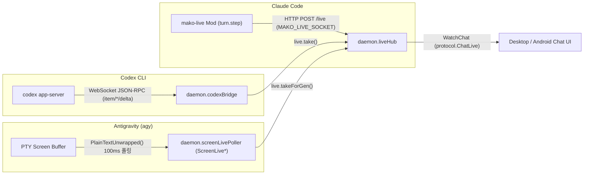
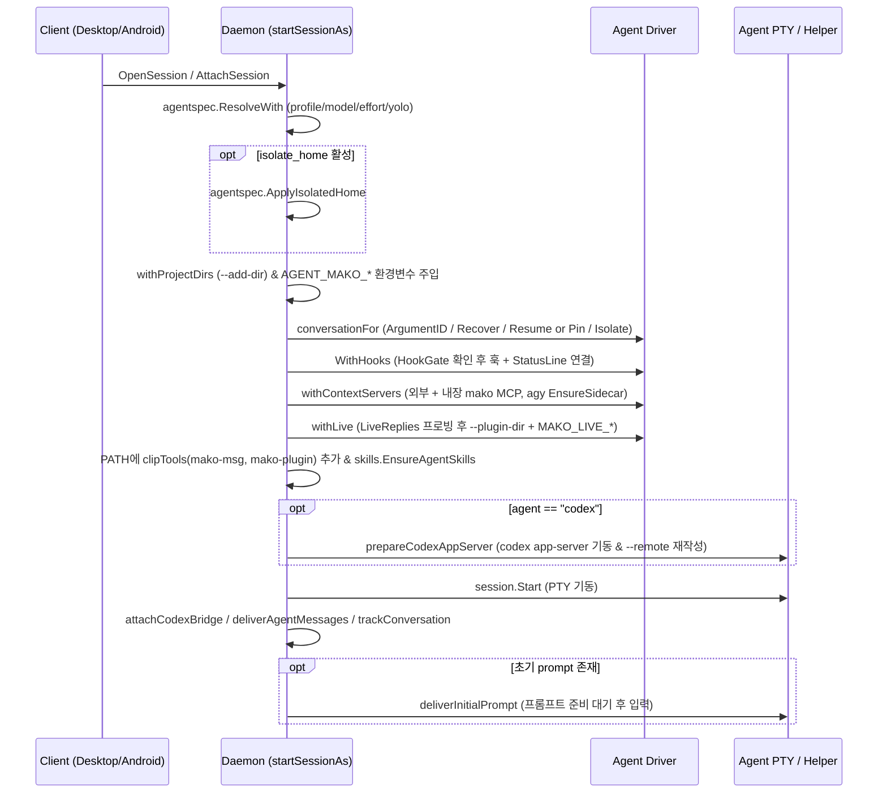

# Mako 에이전트 통합 아키텍처 & 공통 인터페이스 설계

이 문서는 Mako가 다양한 코딩 에이전트 CLI(`claude`, `codex`, `agy`, `pi`, `omp`, `omo`, `opencode`)를 하나의 통합된 세션·채팅·승인·멀티에이전트 워크플로우로 다루기 위해 설계한 공통 드라이버 인터페이스와 데몬 파이프라인을 설명합니다.

## 개별 에이전트 통합 문서

- [Antigravity CLI (`agy`) 통합 상세](agy/README.md) — `mako-bridge` 사이드카, `agentapi` 네이티브 푸시, `hooks.json` + `SubAgentHooks`, `statusLine` 이중 이벤트, PTY `ScreenLive` 추출, 격리 홈
- [Codex CLI (`codex`) 통합 상세](codex/README.md) — `codex app-server` + `--remote` JSON-RPC 브리지, 신뢰 해시 기반 `-c hooks.*`, `thread/queue/add` 네이티브 전달, Rollout 로그 & `KeyedAnswers`
- [Claude Code (`claude`) 통합 상세](claude/README.md) — 내장 `mako-live` Mod(`MAKO_LIVE_SOCKET`), `--settings` 훅/상태줄 병합, `PermissionRequest` 승인 옵션 및 질문 응답, Sidechain 서브에이전트 & `BackgroundTasks`
- [기타 에이전트 (`pi`, `omp`, `omo`, `opencode`) 통합 상세](other/README.md) — 동적 JS 확장(`--extension`) 및 OpenCode 플러그인 기반 로그 미러링

---

## 1. 핵심 설계 원칙: Capability 기반 드라이버 모델

Mako의 에이전트 추상화는 `internal/agent/agent.go`에 정의되어 있으며, 모든 등록 드라이버는 `internal/agents/agents.go`에 집약됩니다.

- **최소 필수 계약 (`agent.Driver`)**: 모든 에이전트가 반드시 구현해야 하는 메서드는 `Info() agent.Info` 하나뿐입니다(이름, 실행 바이너리 목록 `Programs`, 기본 명령어 `Command`, 설치 탐색 경로 `Dirs`, 아이콘/색상).
- **선택적 능력 인터페이스 (Capability Interfaces)**: 나머지 기능(대화 ID 고정/재개, 훅, MCP 서버 주입, 로그 디코딩, 실시간 스트리밍, 서브에이전트 추적, 화면 감지, TUI 제어 등)은 개별 Go 인터페이스로 분리되어 있습니다.
- **런타임 기능 조회 (`agents.As[T](name)`)**: 데몬과 세션 계층은 특정 에이전트 이름을 하드코딩하는 대신 `agents.As[agent.Hooks](name)`, `agents.As[agent.ScreenLive](name)`처럼 타입 단언으로 능력을 확인하고, 구현된 범위만큼 자동으로 기능을 활성화합니다.
- **프로토콜 능력 비트 (`agent.Caps`)**: 클라이언트에 전달되는 `SessionInfo.Caps`는 드라이버가 구현한 핵심 인터페이스를 비트마스크로 요약합니다.
  - `CapChat` (`agent.Logs`)
  - `CapHooks` (`agent.Hooks`)
  - `CapSubAgents` (`agent.SubAgents`)
  - `CapAnswerKeys` (`agent.KeyedAnswers`)
- **네이티브 실행 판별 (`agents.Native`)**: 사용자가 래퍼 스크립트 등을 지정해 실행 바이너리가 드라이버의 `Programs`와 다를 경우, 플래그 구조가 보장되지 않으므로 대화 ID 고정/재개나 Codex App-Server 전환 같은 네이티브 전용 동작을 안전하게 건너뜁니다.

---

## 2. 등록 에이전트별 Capability 매트릭스

`internal/agents/agents.go`에 등록된 7개 드라이버의 인터페이스 구현 현황입니다.

| Capability / 통합 메커니즘 | `claude` | `codex` | `agy` | `pi` | `omp` | `omo` | `opencode` |
| --- | :---: | :---: | :---: | :---: | :---: | :---: | :---: |
| `Launcher` (Pin / Resume / Isolate) | Pin + Resume | Resume + `--no-daemon` | Resume | Pin + Resume | Resume | Pin + Resume | Resume |
| `Prompter` / `DirTaker` | 위치 인자 / `--add-dir=` | 위치 인자 / `--add-dir` | `--prompt-interactive` / `--add-dir` | 위치 인자 / — | 위치 인자 / `--add-dir` | 위치 인자 / — | `--prompt` / — |
| `ModelFlag` / `EffortFlag` | `--model` / `--effort` | `--model` / `-c model_reasoning_effort` | `--model` / `--effort` (+ Normalizer) | `--model` / — | `--model` / — | `--model` / — | `--model` / — |
| `YoloFlag` | `--dangerously-skip-permissions` | `--dangerously-bypass-approvals-and-sandbox` | `--dangerously-skip-permissions` | — | `--yolo` | — | `OPENCODE_CONFIG_CONTENT` `permission.*=allow` |
| `Servers` (MCP 주입) | `--mcp-config=<file>` (HTTP/stdio) | `-c mcp_servers.*` (HTTP/stdio) | `~/.gemini/config/mcp_config.json` (stdio/HTTP) | `--extension pi-mcp-*.js` (stdio) | — | `--extension pi-mcp-*.js` (stdio) | `OPENCODE_CONFIG_CONTENT` `mcp` (stdio) |
| `Hooks` / `HookGate` | `--settings` JSON 병합 | `-c hooks.*` + 신뢰 해시 (`HookGate`) | `~/.gemini/config/hooks.json` | `--extension *-hooks.js` | `--extension *-hooks.js` | `--extension *-hooks.js` | `OPENCODE_CONFIG_CONTENT` `plugin` |
| `SubAgentHooks` | `agent_id` 필드 필터 | `agent_id` 필드 필터 | `IsSubAgent` 3중 판별 | — | — | — | 플러그인 `parentID` 필터 |
| `StatusLine` / `StatusLineEvents` | `StatusLine` | — | `StatusLine` + `StatusLineEvents` | — | — | — | — |
| `ApprovalOptions` / `HookAnswers` | 둘 다 지원 (`PermissionRequest`) | 기본 Allow/Deny (`PermissionRequest`) | — | — | — | — | — |
| `KeyedAnswers` | — | 지원 (`request_user_input` 키 입력) | — | — | — | — | — |
| 실시간 스트리밍 경로 | `LiveReplies` (`mako-live` Mod) | `codex app-server` WebSocket 푸시 | `ScreenLive*` (PTY 화면 폴링) | — (로그 tail) | — (로그 tail) | — (로그 tail) | — (플러그인 JSONL tail) |
| 네이티브 메시지 전달 | `mako-live` `/messages/poll` + `$.prompt.submit` | `codexBridge` `thread/queue/add` | `agy-sidecar` → `agentapi send-message` | PTY / `mako-msg` | PTY / `mako-msg` | PTY / `mako-msg` | PTY / `mako-msg` |
| `Logs` / `Folders` / `LogStatus` | `Logs` | `Logs` + `LogStatus` | `Logs` + `Folders` | `Logs` | `Logs` | `Logs` | `Logs` (플러그인 생성) |
| `SubAgents` / `SubAgentLogs` | `SubAgents` + `SubAgentLogs` | `SubAgents` | `SubAgents` | — | — | — | — |
| `BackgroundTasks` | 지원 (`Bash` background) | — | — | — | — | — | — |
| `Screen` / `Recaller` | 둘 다 지원 | 둘 다 지원 | `Screen` | — | — | — | — |
| `Modes` / `Models` | 둘 다 지원 (+ `ConfirmKeys`) | — | 둘 다 지원 | — | — | — | — |
| `ModelCatalog` | `cache/model-catalog/*-cc.json` | `models_cache.json` + `app-server --stdio` | `agy models` (5분 캐시) | — | — | — | — |
| `OneShot` (`mako.ask` 등) | `--print --no-session-persistence` | `codex exec --ephemeral` | `--print --output-format` | `--no-session -p` | `--no-session -p` | `--no-session -p` | `opencode run` |
| 격리 홈 (`agentspec/isolate.go`) | `CLAUDE_CONFIG_DIR` | `CODEX_HOME` | `HOME` 심볼릭 링크 트리 (Unix) | `PI_CODING_AGENT_DIR` | `PI_CODING_AGENT_DIR` | `OMO_CODING_AGENT_DIR` | `XDG_DATA_HOME` |
| 내장 스킬 자동 동기화 | `~/.claude/skills` | `~/.codex/skills` | `~/.gemini/config/skills` | `~/.pi/agent/skills` | — | — | `~/.config/opencode/skills` |

---

## 3. 공통 인터페이스 분류 및 상세 계약

### 3.1 실행·대화 바인딩·옵션 (`internal/agent/agent.go`, `flags.go`)

- **`Launcher`**:
  - `ArgumentID(cmd)`: 명령줄에 명시된 대화 ID를 추출합니다(단, `--fork` 원본 ID는 새 세션의 ID가 아니므로 빈 문자열 반환).
  - `Picks(cmd)`: `--continue`, `--resume`, `--last` 등 사용자가 이미 대화를 선택하는 플래그를 주었는지 판별합니다.
  - `Pin(cmd, id)`: 에이전트가 로그를 쓰기 전에 Mako가 생성한 UUID를 `--session-id` 등으로 선점합니다(`claude`, `pi`, `omo` 지원; `codex`, `agy`, `omp`, `opencode`는 에이전트가 자체 ID를 발급).
  - `Resume(cmd, id)`: 저장된 세션을 재개할 때 모델·설정 플래그는 유지하면서 초기 프롬프트(`Inputs`)와 이전 대화 피커 플래그는 제거해 초기 작업이 재실행되지 않도록 합니다.
  - `Isolate()`: 로그 작성 프로세스를 세션 프로세스 트리 안에 묶어 두는 플래그(예: Codex의 `--no-daemon`)를 반환합니다.
- **`agent.Flags`**: 대부분의 CLI 드라이버는 `agent.Flags` 테이블을 임베드해 `Launcher`, `Prompter`, `DirTaker`, `ModelFlag`, `EffortFlag`를 선언적으로 구현합니다.
- **`ModelEffortNormalizer`**: `agy`처럼 모델 ID 자체에 effort 접미사가 포함될 수 있는 경우(`gemini-4-neon-high` + `--effort high`), CLI 충돌을 막기 위해 실행 전 `(model, effort)` 쌍을 정규화합니다.
- **`OneShot`**: 프롬프트 템플릿의 `mako.ask`나 단발성 비대화형 호출을 위해 `PrepareOneShot(l, req, workDir, tempDir)`로 명령어·`Stdin`·출력 파서·정리 함수를 준비합니다.

### 3.2 훅·승인·상태줄 (`internal/agent/hooks.go`, `internal/daemon/hook.go`)

Mako 바이너리 자체는 멀티콜(multicall) 진입점 `daemon.HookMain()`을 제공하여 에이전트가 외부 셸 명령으로 Mako 바이너리를 직접 호출할 수 있습니다.

| 서브커맨드 (`mako <arg> ...`) | 역할 | 대상 소켓 |
| --- | --- | --- |
| `mako hook <hooks.sock> [EventName]` | 에이전트 라이프사이클 훅 및 `PermissionRequest` 승인 중계 | `hooks.sock` |
| `mako statusline <hooks.sock> <agent>` | 상태줄 JSON 수집 후 사용자 기존 statusLine 명령 포워딩 | `hooks.sock` |
| `mako agent-mcp <agents.sock>` | stdio 전용 에이전트용 내장 `mako` MCP 브리지 | `agents.sock` |
| `mako agent-msg <agent-cli.sock> <subcmd>` | `mako-msg` 셸 CLI (`wait`/`read`/`send`/`list`/`profiles`) | `agent-cli.sock` |
| `mako agent-plugin <agent-cli.sock> <subcmd>` | `mako-plugin` 셸 CLI (`list`/`help`/`call`) | `agent-cli.sock` |
| `mako agy-sidecar <agent-cli.sock>` | Antigravity 사이드카 슈퍼바이저용 메시지 푸시 브리지 | `agent-cli.sock` |
| `mako clip <hooks.sock>` | 세션 클립보드 심(shim) | `hooks.sock` |

- **`hooks.sock` 세션 인증**: 위 `hook`/`statusline`/`clip`은 `MAKO_SESSION` 세션의 토큰을 실어 보냅니다. 토큰은 데몬이 시작할 때마다 새로 만드는 랜덤 32바이트 시크릿으로 생성한 `HMAC-SHA256(sessionID)`이며, 데몬이 세션 시작 전에 소켓 옆 `hook-tokens/<SHA-256(sessionID) 앞 16바이트 hex>` 파일(0600)에 씁니다. 환경변수나 명령줄에는 넣지 않습니다(macOS에서는 같은 사용자의 프로세스가 샌드박스 안에서도 다른 프로세스의 환경변수를 읽을 수 있음). 토큰이 없거나 다른 세션의 토큰이면 `serveHook`이 연결을 거부하고 1분에 최대 한 번 로그를 남깁니다.
- **공통 이벤트 모델 (`agent.EventKind`)**: `Started`, `Prompted`, `ToolDone`, `Approval`, `Compacting`, `Waiting`, `Stopped`, `Ended`, `Idle`, `ChildStarted`, `ChildStopped`.
- **`HookGate`**: 에이전트 버전에 따라 훅 지원 여부가 다를 때(예: `codex features list`의 `hooks`) 실행 전 1회 프로빙(캐시)합니다.
- **`SubAgentHooks`**: `agent_id` 필드를 훅 페이로드에 포함하지 않는 에이전트(`agy`)의 서브에이전트/Swarm 워커 훅이 부모 세션의 `conversation_id`나 상태를 덮어쓰지 않도록 `IsSubAgent(parentID, parentLog, childID, childLog)`로 필터링합니다.
- **`PermissionRequest` 승인 생명주기**: `runHook`은 `PermissionRequest` 이벤트 시 데몬 응답을 무제한 대기(에이전트 타임아웃 `ApprovalTimeout = 24h`에 위임)하며, 사용자가 터미널에서 직접 응답해 훅 프로세스가 종료되면 `serveHook`이 소켓 EOF를 감지해 GUI 승인 카드를 즉시 철회합니다.
- **`StatusLine` & `StatusLineEvents`**: 상태줄 페이로드에서 토큰/컨텍스트 윈도우/레이트리밋(`Status`)을 수집하며, `StatusLineEvents`를 구현한 드라이버(`agy`)는 훅이 발생하지 않는 도구 승인 대기(`tool_confirmation_pending`)나 작업 상태도 함께 반영합니다.

### 3.3 실시간 응답 스트리밍 3가지 경로 (`internal/daemon/live.go`, `live_screen.go`, `codex_appserver.go`)

Mako의 `liveHub`는 클라이언트의 `WatchChat` 스트림에 아직 디스크 로그에 기록되지 않은 진행 중 블록(`text`, `thinking`, `tool`, `input`)을 100ms(`liveTick`) 주기로 전달합니다. 에이전트 특성에 따라 3가지 공급 경로를 사용합니다.

1. **Mod 푸시 (`agent.LiveReplies` — Claude Code)**: `--plugin-dir`로 주입된 `mako-live` Mod가 `live.sock`(`/live`)으로 HMAC 토큰(`MAKO_LIVE_TOKEN`)을 실어 스트리밍 조각을 푸시합니다. 로그 파일 크기가 커지면 기록 완료된 블록을 자동으로 비웁니다.
2. **App-Server WebSocket 푸시 (Codex)**: 데몬이 관리하는 `codex app-server`의 JSON-RPC 알림(`turn/started`, `item/started`, `item/agentMessage/delta`, `item/reasoning/*Delta`, `turn/completed`)을 `codexBridge`가 직접 `liveHub.take`로 전달합니다.
3. **PTY 화면 추출 (`agent.ScreenLive*` — Antigravity)**: `WatchChat` 구독자가 있을 때만 `screenLivePoller`가 PTY 출력이나 로그 크기가 변한 틱에 한해 언래핑된 화면에서 응답 텍스트(`ExtractLive`), 직전 턴 기준선(`ExtractBaseline`), 스피너 라벨(`ExtractStatus`), 백그라운드 Swarm/Agent 활동 행(`ExtractActivity`)을 추출합니다.

### 3.4 멀티에이전트 메시징 및 도구 전달 계층 (`internal/daemon/agent_delivery.go`, `agent_cli.go`, `mcp.go`)

모든 에이전트 세션에는 다음 표준 환경변수가 주입됩니다(`internal/daemon/saved_sessions.go`):
- `AGENT_MAKO_SESSION`: 현재 Mako 세션 ID
- `AGENT_MAKO_PROJECT`: 정규화된 프로젝트 경로
- `AGENT_MAKO_MODE`: `main` 또는 `subagent`
- `AGENT_MAKO_NODE`: 현재 노드 ID
- `AGENT_MAKO_PROFILE`: 사용 중인 프로필명 (설정 시)
- `AGENT_MAKO_PARENT`: 부모 세션 ID (서브에이전트/스폰 시)
- `AGENT_MAKO_SOCKET`, `MAKO_AGENT_MCP_TOKEN`: 메시징/CLI 인증용 (`agent-cli.sock` + 세션별 토큰)
- `PATH`: 데몬 `clipTools` 디렉터리가 선두에 추가되어 `mako-msg`, `mako-plugin` CLI 및 클립보드 심을 즉시 호출 가능

**메시지 전달 우선순위 (`deliverAgentMessages`)**:
1. **네이티브 푸시**:
   - `codex`: `codexBridge.deliverMessage` (`thread/queue/add` → `-32600` 시 `turn/start`)
   - `agy`: 연결된 `agy-sidecar` 경유 `agentapi send-message` → 실패 시 데몬 직접 `agy.DeliverMessage`
   - `claude`: `mako-live` Mod가 `/messages/poll` 롱폴링 중 `addCLIWaiter` + `markModActive(3s)`로 PTY 타이핑을 억제하고 `$.prompt.submit`으로 직접 제출
2. **백그라운드 CLI 대기자 억제**: 에이전트가 `mako-msg wait`를 실행 중이면(`hasCLIWaiter`) 중복 전달을 막기 위해 PTY 타이핑을 보류합니다.
3. **PTY 폴백 타이핑**: 에이전트가 프롬프트에서 1초(`deliverySettle`) 이상 대기 중이고 사용자 키 입력이 2초(`deliveryQuiet`) 이상 없을 때 최대 64KiB 배치를 프롬프트에 입력합니다.

> [!NOTE]
> 플러그인 기여 도구(Contributed Tools)는 MCP 스키마 비대화를 막기 위해 MCP에 등록하지 않고 **`mako-plugin` CLI 전용**(`mako-plugin list` / `help` / `call`)으로 노출되며, 세션 스코프(`global`/`session`/`project`/`space`) 및 `AGENT_MAKO_PLUGINS` 환경변수 필터가 적용됩니다.

### 3.5 로그·사용량·도구·서브에이전트·화면 제어

- **`Logs` & `Folders`**: JSONL 로그 파일 위치(`Place`), 파일명 글롭(`LogName`), 소유자 식별(`Identity`), 채팅 디코더(`NewDecoder`), 토큰 집계(`NewUsage`)를 정의합니다. 대화 ID가 파일명이 아니라 디렉터리명에 있는 에이전트(`agy`)는 `Folders`(`LogPath`, `Whose`)를 추가 구현합니다.
- **`LogStatus`**: `Stop` 훅 없이 인터럽트/취소가 발생하는 경우를 보완하기 위해 로그 라인 자체에서 턴 경계 상태를 읽습니다(`codex`의 `task_started`/`task_complete`/`turn_aborted`).
- **`Tools`**: 에이전트별 상이한 도구명과 인자 스키마를 Mako의 정규 `protocol.Tool*` 종류(`shell`, `edit`, `multi_edit`, `write`, `read`, `search`, `patch`, `todo`, `plan`, `exit_plan`, `fetch`, `web_search`, `task`, `question`)와 표준 출력/종료 코드로 변환합니다.
- **`SubAgents` & `SubAgentLogs` & `BackgroundTasks`**: 에이전트가 내부적으로 생성한 서브에이전트 로그와 백그라운드 셸 태스크를 증분(`agent.Tail`) 스캔해 Chat UI에 실시간 표시합니다.
- **`Screen`, `Interrupter`, `Recaller`, `KeyedAnswers`, `Modes`, `Models`**: 훅이 보고하지 않는 TUI 다이얼로그(신뢰 프롬프트, 권한/질문 창, 상세 트랜스크립트 오버레이)를 감지하고 키 입력으로 안전하게 복귀하거나 모드/모델을 전환합니다.

### 3.6 격리 홈 & 내장 스킬 자동 동기화

- **격리 홈 (`internal/agentspec/isolate.go`)**: 전역 `isolate_home` 옵션이 켜지면 각 에이전트의 설정·대화 데이터를 `$MAKO_HOME/home/<agent>`(기본 `~/.mako/home/<agent>`)로 분리합니다.
  - `Place().RootEnv`가 있는 에이전트(`claude`=`CLAUDE_CONFIG_DIR`, `codex`=`CODEX_HOME`, `pi`/`omp`=`PI_CODING_AGENT_DIR`, `omo`=`OMO_CODING_AGENT_DIR`, `opencode`=`XDG_DATA_HOME`)는 해당 환경변수만 격리 디렉터리로 지정합니다.
  - 전용 루트 환경변수가 없는 `agy`(Unix)는 `HOME` 자체를 격리 디렉터리로 바꾸되 `.gemini`와 `.mako`를 제외한 실제 홈의 모든 최상위 항목을 심볼릭 링크해 `git`/`ssh`/클라우드 CLI가 정상 동작하게 유지합니다.
- **내장 스킬 자동 동기화 (`internal/skills/skills.go`)**: 데몬 시작, 격리 홈 초기화, 세션 시작 시 `mako-template`과 `mako-plugin` 스킬을 각 에이전트의 스킬 디렉터리에 원자적으로 설치/갱신합니다. 파일 내 `<!-- mako-managed-skill -->` 마커가 없는 사용자 수정 파일은 절대 덮어쓰지 않습니다.

---

## 4. 세션 시작 전체 파이프라인

---

## 5. 새 에이전트 드라이버 추가 가이드

1. `internal/agent/<name>/` 패키지를 생성하고 `agent.Driver`(`Info()`)를 구현합니다.
2. `internal/agent.Flags`를 임베드해 `Launcher`/`Prompter`/`DirTaker`/`ModelFlag`를 구성하고, `Logs` + `Tools`를 구현해 Chat UI와 토큰 집계를 활성화합니다.
3. 라이프사이클 훅(`Hooks`) 및 MCP 서버 주입(`Servers`)을 구현합니다. 훅 페이로드가 Claude Code 형식과 같으면 `agent.CommonHooks`를 임베드할 수 있습니다.
4. `internal/agents/agents.go`의 `all` 슬라이스에 드라이버를 등록합니다.
5. 필요 시 격리 홈(`internal/agentspec/isolate.go`) 및 내장 스킬 경로(`internal/skills/skills.go`)를 추가하고 단위 테스트를 작성합니다.
