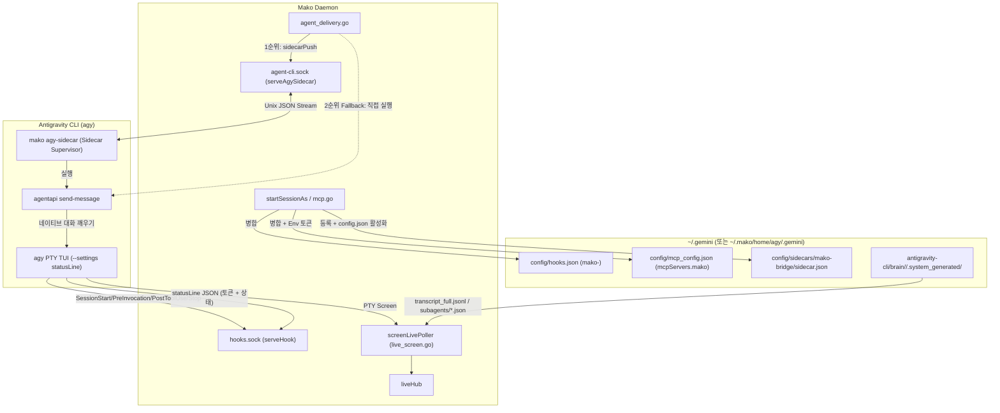
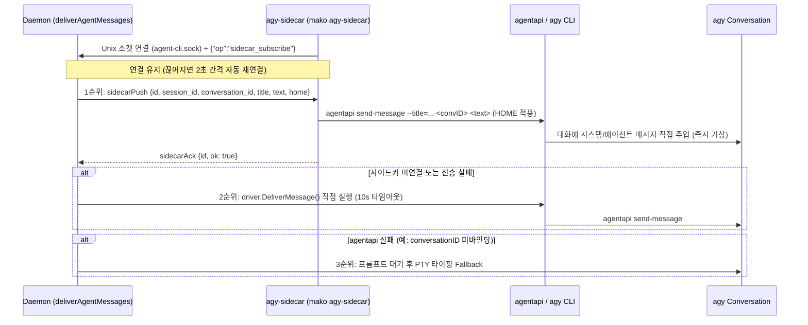

# Antigravity CLI (`agy`) 통합 상세

`internal/agent/agy` 드라이버는 Antigravity CLI(`agy`)를 Mako에 통합합니다. `agy`는 설정을 전역 파일(`~/.gemini/config/*`)에서 읽고 대화별 폴더(`~/.gemini/antigravity-cli/brain/<id>`)에 로그를 저장하며, Mako는 **사이드카 + `agentapi` 네이티브 메시지 푸시**, **전역 `hooks.json` + 서브에이전트 필터링**, **인라인 `--settings` 상태줄 이중 활용**, **PTY 화면 기반 실시간 스트리밍(`ScreenLive*`)** 을 조합해 깊은 통합을 제공합니다.

상위 공통 설계는 [공통 인터페이스 설계 문서](../README.md)를 참고하세요.

---

## 1. 통합 아키텍처 개요



---

## 2. 구현된 Capability 요약

| 인터페이스 | 구현 파일 | 핵심 동작 |
| --- | --- | --- |
| `Driver`, `Launcher`, `Prompter`, `DirTaker`, `ModelFlag`, `EffortFlag` | `agy.go` (`agent.Flags`) | `--prompt-interactive`, `--conversation`/`--resume`/`-r` 재개, `--add-dir`, `--model`, `--effort` |
| `ModelEffortNormalizer`, `ModelCatalog` | `catalog.go` | `agy models` 파싱(5분 캐시), 변형 ID(`*-high`)와 `--effort` 충돌 정규화 |
| `YoloFlag`, `OneShot` | `oneshot.go` | `--dangerously-skip-permissions`, `--print --output-format json --json-schema` |
| `MessageDeliverer` + 사이드카 | `sidecar.go`, `daemon/agent_cli.go` | `mako-bridge` 사이드카 + `agentapi send-message` 네이티브 푸시 |
| `Hooks`, `SubAgentHooks` | `hooks.go` | `~/.gemini/config/hooks.json` 병합, 3중 서브에이전트 훅 하이재킹 방지 |
| `StatusLine`, `StatusLineEvents` | `statusline.go` | `--settings` 인라인 statusLine 주입, 쿼터/토큰 + 실시간 대기/작업 상태 보강 |
| `Screen`, `ScreenLive`, `ScreenLiveBaseline`, `ScreenLiveTurn`, `ScreenLiveStatus`, `ScreenLiveActivity` | `screen.go`, `live.go` | PTY 화면에서 실시간 응답(불릿·유니코드 테두리/무테두리 GFM 테이블 변환)·기준선·턴 앵커·스피너 라벨·Swarm/Agent/백그라운드 Task 행 추출 |
| `Recaller` | `recall.go` | `/skills`·`/resume` 등 `Keyboard:` 모달/대체 화면 오버레이에서 `Esc`로 프롬프트 복귀 |
| `KeyedAnswers` | `questions.go` | `ask_question` 다중 질문·복수 선택(`is_multi_select`)·`Write-in...` 폼 응답 키 시퀀스 입력 |
| `Modes`, `Models` | `controls.go` | `shift+tab` 실행 모드 순환(`auto`/`acceptEdits`/`plan`, 기본 모드 및 스택 `statusLine` 허용), `/model`·`/effort` |
| `Logs`, `Folders`, `Tools` | `log.go`, `tools.go` | `brain/<id>/.system_generated/logs/transcript_full.jsonl` + `history.jsonl`, `update_steps` → `ToolPlan` |
| `SubAgents` | `subagents.go` | `.system_generated/subagents/*.json` + `swarm/members.json` 기반 워커 추적 |
| `Servers` | `servers.go` | `~/.gemini/config/mcp_config.json` 병합 + 환경변수 세션 자격증명 |
| `Commands` | `commands.go` | 내장 슬래시 커맨드 + `~/.gemini/config/skills` + `.agents`/`.agent` 스킬 |

---

## 3. 사이드카(`mako-bridge`) 및 네이티브 메시지 전달

`agy` 세션은 PTY에 텍스트를 억지로 입력하거나 `read_messages` 폴링 루프를 돌지 않고, Antigravity의 사이드카 슈퍼바이저와 `agentapi`를 통해 메시지를 **반응형(reactive)으로 네이티브 푸시**합니다.

### 3.1 사이드카 매니페스트 자동 등록 (`EnsureSidecar`)
세션에 내장 `mako` MCP가 활성화되면(`internal/daemon/mcp.go`), `agy.EnsureSidecar`가 다음 두 파일을 관리합니다(`HOME` 환경변수 존중):
1. `~/.gemini/config/sidecars/mako-bridge/sidecar.json`:
   ```json
   {
     "display_name": "Mako Agent Bridge",
     "description": "Bridges Mako multi-agent messages and notifications directly into Antigravity conversations via agentapi.",
     "command": "<mako-binary>",
     "args": ["agy-sidecar", "<runDir>/agent-cli.sock"],
     "restart_policy": "always"
   }
   ```
2. `~/.gemini/config/config.json`: `sidecars["mako-bridge"]` 항목이 없을 때만 `{"enabled": true}`를 추가하며, 사용자가 이미 설정했거나 파일이 손상된 경우 그대로 보존합니다.

### 3.2 데몬 ↔ 사이드카 ↔ `agentapi` 3단계 전달 흐름



- **`agentapi` 바이너리 탐색 (`resolveAgentAPI`)**: `$HOME/.gemini/antigravity-cli/bin/agentapi` 실행 가능 래퍼를 최우선으로 사용하고, 없으면 `PATH`의 `agy` 바이너리에 `agy agentapi send-message`를 호출합니다.
- **격리 홈 호환**: `sidecarPush.Home`에 세션의 `HOME`을 실어 보내므로, 격리 홈(`~/.mako/home/agy`)에서 실행 중인 `agy` 대화에도 정확한 `agentapi`와 대화 저장소를 대상으로 전달됩니다.

---

## 4. 훅(`hooks.json`)과 서브에이전트 하이재킹 방지

### 4.1 전역 `hooks.json` 병합 (`hooks.go`)
`agy`는 CLI 플래그로 훅을 받지 않고 전역 `~/.gemini/config/hooks.json`을 읽습니다.
- Mako는 훅 명령어의 SHA-256 앞 4바이트로 생성한 고유 키 `mako-<hex8>` 아래에 4개 이벤트를 병합하며, 사용자의 기존 항목과 BOM(UTF-8)을 보존합니다.
  - `SessionStart` → `agent.Started`
  - `PreInvocation` → `agent.Prompted`
  - `PostToolUse` (`matcher: "*"`) → `agent.ToolDone`
  - `Stop` → `agent.Stopped`
- `agy` 훅 stdin JSON에는 이벤트명이 들어있지 않으므로, 각 핸들러 명령어 끝에 이벤트명(`... hook <sock> PreInvocation`)을 인자로 붙이고 `daemon.runHook`의 `namedEvent()`가 `hook_event_name`을 주입합니다.
- Mako 외부에서 실행된 `agy`도 전역 훅을 실행하지만, `MAKO_SESSION` 환경변수가 없으면 `runHook`이 stdin만 비우고 즉시 종료하므로 무해합니다.

### 4.2 `SubAgentHooks.IsSubAgent` 3중 방어
`agy`의 서브에이전트 및 `/swarm` 워커는 부모와 같은 프로세스 환경(`MAKO_SESSION`)을 상속받지만, 훅 페이로드에 명시적인 `agent_id` 대신 **자신만의 `conversationId`** 를 담아 발송하는 경우가 있습니다. 이를 방치하면 워커의 `SessionStart`/`Stop` 훅이 부모 세션의 바인딩된 대화와 작업 상태를 덮어쓰게(하이재킹) 됩니다.

Mako는 `agy.Agent.IsSubAgent(parentID, parentLog, childID, childLog)`로 3단계 검증을 수행합니다:
1. **1차 신호 (메타데이터 파일)**: `<brainDir>/<parentID>/.system_generated/subagents/<childID>.json` 존재 여부 확인.
2. **2차 신호 (Swarm 로스터)**: `<brainDir>/<parentID>/.system_generated/swarm/members.json`에 `"<childID>"` 포함 여부 확인.
3. **3차 폴백 (트랜스크립트 첫 줄)**: 자식 로그 첫 줄이 `SYSTEM_MESSAGE`(또는 `source: "SYSTEM"`)이고 `content`에 `sender=<parentID>`가 포함되어 있는지 확인.

서브에이전트로 판별되면 `serveHook`은 부모 대화/상태를 절대 변경하지 않고 `Started`/`Stopped`만 `s.ReportSubagent(...)`로 전달해 서브에이전트 활성 카운트만 갱신합니다.

---

## 5. `statusLine` 이중 활용 (`StatusLine` + `StatusLineEvents`)

`agy`의 `hooks.json`에는 권한 승인 대기(`PermissionRequest`/`Notification`) 훅이 없으며, 로그 파일에는 계정 쿼터나 모델 컨텍스트 윈도우 크기가 기록되지 않습니다. Mako는 `--settings` 플래그로 `statusLine`을 인라인 주입해 두 문제를 동시에 해결합니다.

- **비파괴적 `--settings` 주입 (`attachSettingsStatusLine`)**: 디스크의 `settings.json`을 수정하지 않고, 실행 명령어에 `--settings '{"statusLine":{"type":"command","command":"...","enabled":true,"stack_with_default":true}}'`를 추가하거나 기존 `--settings`(파일 경로 또는 인라인 JSON)에 병합합니다(이미 `statusLine`이 있으면 존중).
- **사용자 기존 `statusLine` 포워딩**: `UserStatusLine`이 `~/.gemini/antigravity-cli/settings.json`에서 활성화된 사용자 커맨드를 읽어 `runStatusLine`이 그 출력을 그대로 stdout에 중계합니다.
- **사용량 & 쿼터 파싱 (`Status`)**:
  - `context_window` (`total_input_tokens`, `total_output_tokens`, `context_window_size`, `current_usage` 또는 `used_percentage`/`remaining_percentage`), `model`(`display_name`/`id`, `effort`), `cycle_mode`(`auto`/`accept-edits`/`plan`), `cost.total_usd`를 파싱합니다. (`--dangerously-skip-permissions`로 시작된 세션은 `plan` 모드가 아닌 한 Mako UI에 `bypassPermissions`로 표시됩니다.)
  - `rate_limits`(`five_hour`, `seven_day`) 및 `quota`/`quotas` 맵에서 현재 모델 계열(`claude`/`gpt`/`gemini`)과 가장 잘 맞는 버킷(`5h`/`sprint`, `7d`/`week`, `24h`/`daily`)을 점수화해 Mako의 `RateLimit`으로 매핑합니다.
- **실시간 상태 보강 (`StatusHookEvent`)**:
  - `tool_confirmation_pending == true` 또는 `agent_state == "reviewing"` → `agent.Waiting` (도구 승인 대기 감지)
  - `agent_state == "working" | "tool_use"` → `agent.Prompted` (`AgentWorking`)
  - `agent_state == "idle"` → `agent.Idle` (기존 `AgentDone` 미읽음 완료 상태는 덮어쓰지 않음)
  - `conversation_id` / `transcript_path`가 아직 미바인딩이면 즉시 대화를 바인딩합니다.

---

## 6. PTY 화면 기반 실시간 스트리밍 (`ScreenLive*`) & 화면 감지

`agy`는 외부 스트리밍 Mod를 지원하지 않으므로, Mako는 `screenLivePoller`(`internal/daemon/live_screen.go`)와 `internal/agent/agy/live.go`를 통해 PTY 언래핑 버퍼(`PlainTextUnwrapped()`)에서 진행 중인 응답과 활동을 정밀 추출합니다.

### 6.1 5개 `ScreenLive*` 인터페이스 동작
1. **`ExtractLive(screen, lastLogged)`**:
   - **게이트 검사**: `screenRules`가 `Blocked`/`Idle`/`Hold`(오버레이)이거나 하단 10줄에 `? for shortcuts`·다이얼로그·`Keyboard:` 오버레이 푸터가 있으면 즉시 중단합니다. 반드시 작업 증거(`esc to cancel` 푸터 또는 점자 스피너)가 있을 때만 추출합니다.
   - **정제 및 마크다운 복원**: 하단 크롬(푸터, 스택 statusLine, 입력 박스 하단의 백그라운드 Task/Swarm 도크 및 `↓ N more` 오버플로, 프롬프트 입력 박스, 단계 체크리스트 `⎿ ✓/●/○`, Swarm 바, Tip 2줄 배너, 스피너) 제거 → 마지막 사용자 프롬프트(`> `) 이후 현재 턴 위치 탐색 → 도구 호출·세부 출력·접힘/펼침 사고 블록(`▸/▾/○ Thought for ...`)·접힌 액션 요약(`… N more actions ...`)·`─── Conversation compacted ───` 구분선·질문 에코(`? ...`)·일반 테두리 박스 건너뛰기 → 유니코드 박스 테이블(`┌──┬──┐`, `╭──┬──╮`) 및 `agy` 1.5.18+ 무테두리 테이블(`컬럼 │ 설명` / `───┼───`, 다중 줄 셀 포함)을 GFM 파이프 테이블로 변환 → 유니코드 불릿(`•`/`◦` 등)을 중첩 마크다운 `- ` 리스트로 정규화하고 한글 2셀 폭 및 토큰 경계(`.`,`-`,`/`, 경로 중간 절단)를 고려해 재결합 → 코드 블록 밖 `<hash>`/`<id>` 등 원시 `<tag>` 플레이스홀더 이스케이프.
   - **로그 중복 억제**: `transcript_full.jsonl`의 마지막 256KiB에서 읽은 `lastLogged`와 비교(`<br>`·`file://` 확장 경로·`\<` 이스케이프 정규화 포함)해 일치하면 중복 방출을 차단합니다.
2. **`ExtractBaseline(screen)`**: 세션이 Idle일 때 화면에 남아 있는 직전 턴의 완료 응답을 스냅샷해 두어, 새 프롬프트 제출 직후 TUI가 리페인트되기 전 짧은 틈에 이전 응답이 반짝이는 현상을 방지합니다(뷰포트가 1–2줄 이동해도 양방향 포함·중첩 비교로 억제 유지).
3. **`ExtractTurn(screen)`**: 대화 본문에 렌더링된 사용자 프롬프트 턴 수와 마지막 프롬프트 텍스트를 반환해(다이얼로그·오버레이 화면 제외), `transcript_full.jsonl`에 새 `USER_INPUT`이 기록된 뒤 아직 TUI에 새 `> 프롬프트`가 그려지기 전 구간에서 이전 턴 응답이 임시 렌더로 노출되지 않도록 차단합니다.
4. **`ExtractStatus(screen)`**: 작업 중 하단 점자 스피너 옆 라벨(예: `1/3 steps · Editing files… 1m 56s`, `Reading file…`, `Running command…`, `Thinking…`; 부분 리드로로 붙은 중복 스피너 정리 포함)과 활성 `Swarm(...)`/`Agent(...)`/`Task(...)` 행을 추출해 `thinking` 라이브 블록으로 전달합니다.
5. **`ExtractActivity(screen)`**: 메인 코디네이터가 `Idle` 상태여도 하단 도크/크롬에 남아 있는 백그라운드 `Swarm(...)` / `Agent(...)` 및 `● [HH:MM:SS] <cmd> running` → `Task(<cmd>) · running · <HH:MM:SS>` 활성 행(`Done`/`Killed` 등 완료 상태 및 `alt+s board` 같은 단축키 힌트 제거)을 추출해 Chat 컴포저 위의 라이브 활동 카드로 표시합니다.

### 6.2 `ScreenRules`, `Recaller` 및 TUI 제어 (`screen.go`, `recall.go`, `controls.go`)
- **화면 상태 감지**: `overlay_view`(`Hold: true`, `Keyboard:` + `esc Cancel`/`esc Go back` 등), `permission_prompt`(`tab amend`), `question_prompt`(`esc skip`, `space toggle`, `write-in`, `enter Submit All`), `trust_prompt`, `legacy_permission_prompt`, `slash_menu`(`tab complete`), `esc_cancel_footer_working`, `spinner_working`, `prompt_footer`(`? for shortcuts`)를 우선순위 기반으로 판별합니다. 하단 영역은 `Bottom(5)` 이상을 스캔해 스택된 사용자 `statusLine`이나 하단 도크가 있어도 감지가 깨지지 않습니다.
- **오버레이 복귀 (`Recaller`)**: `/skills`, `/resume` 등 `Keyboard:` 모달 오버레이가 열려 있으면 프롬프트 전송·모드 전환 전에 `Esc`를 보내 프롬프트로 돌아갑니다.
- **모드/모델 제어**: `ModeKey()`는 `Shift+Tab` (`\x1b[Z`), `ScreenMode()`는 하단 6줄의 `? for shortcuts` 푸터에서 `auto`/`acceptEdits`/`plan`/`bypassPermissions` 및 모드 접두사가 생략된 기본 모드(`default`)를 읽습니다. 모델 및 effort 변경은 `/model <id>`, `/effort <level>`로 수행하며 별도 확인 모달이 없습니다(`ConfirmKeys` = `nil`).

---

## 7. 로그·서브에이전트·MCP·격리 홈·카탈로그 세부사항

### 7.1 대화 로그 (`Folders`) 및 도구 정규화 (`log.go`, `tools.go`)
- **로그 경로**: `<root>/brain/<id>/.system_generated/logs/transcript_full.jsonl` (`transcript.jsonl`은 긴 필드가 잘리므로 `transcript_full.jsonl`을 사용).
- **워크스페이스 역추적 (`Whose`)**: 로그 각 줄에 `cwd`가 없으므로 `<root>/history.jsonl`에서 해당 `conversationId`의 `workspace` 필드를 조회합니다.
- **레코드 디코딩**: `USER_INPUT`(`<USER_REQUEST>` 내부 추출, `<ADDITIONAL_METADATA>` 제거), `PLANNER_RESPONSE`(텍스트 + `tool_calls`, 호출 ID는 `<step_index>.<idx>`), `GENERIC`(선입선출 `pending` 큐와 매칭해 도구 결과로 변환), `CHECKPOINT`(요약).
- **도구 정규화**: `run_command`, `edit_file`/`replace_file_content`, `multi_replace_file_content`, `write_file`/`write_to_file`, `read_file`/`view_file`, `grep_search`/`find_by_name`/`list_dir`, `read_url_content`, `search_web`, `invoke_subagent`, `ask_question`(`is_multi_select` 포함), `update_steps`(`ToolPlan` → 컴포저 상단 진행 체크리스트 연동)를 표준 `protocol.Tool*`로 변환하고 타임스탬프·줄번호·`[diff_block_start]` 래퍼를 벗겨냅니다.

### 7.2 네이티브 서브에이전트 & Swarm 스캔 (`subagents.go`)
- 부모 대화의 `<brainDir>/<parentID>/.system_generated/subagents/*.json` 메타파일을 디렉터리/파일 mtime 캐싱으로 증분 스캔합니다.
- `state == "SUBAGENT_STATE_ALIVE"`이면서 `.system_generated/swarm/members.json`에서 `killed: true` 또는 `phase: "KILLED"`가 아닌 항목을 `Running: true`로 표시합니다.
- 각 워커의 `spawnStepIndex`를 부모 메시지의 `<step>.<i>` 호출 ID(`invoke_subagent` 또는 `swarm` 우선)와 연결하고, 자식 `transcript_full.jsonl`을 `agent.Tail`로 추적해 도구 호출 수와 최신 도구를 실시간 표시합니다.

### 7.3 MCP 서버 주입 (`servers.go`)
- 전역 `~/.gemini/config/mcp_config.json`의 `mcpServers` 객체에 병합합니다(동시성 보호 `mcpMu` + 사용자 기존 항목 보존).
- **동시 세션 격리 트릭**: 내장 `mako` 서버는 파일에 토큰을 쓰지 않고 정적 stdio 엔트리(`command`/`args`)만 기록한 뒤, 세션별 자격증명(`MAKO_SESSION`, `MAKO_AGENT_MCP_TOKEN`)을 프로세스 환경변수(`l.Env`)로 넘겨 여러 `agy` 세션이 같은 `mcp_config.json`을 안전하게 공유합니다.

### 7.4 격리 홈 (`EnsureAgyIsolatedHome`)
- `agy`는 `CLAUDE_CONFIG_DIR` 같은 전용 루트 환경변수가 없으므로, Unix에서 `isolate_home` 활성화 시 `HOME=~/.mako/home/agy`로 실행합니다(`internal/agentspec/isolate.go`).
- `.gemini/antigravity-cli`와 `.gemini/config`는 독립 디렉터리로 생성하고, `.gemini`와 `.mako`를 제외한 실제 `$HOME`의 모든 항목(`.gitconfig`, `.ssh`, `.aws`, `.kube` 등)을 심볼릭 링크하며 깨진(dangling) 심볼릭 링크를 자동 정리합니다.

### 7.5 모델 카탈로그 & OneShot (`catalog.go`, `oneshot.go`)
- **`Catalog`**: `agy models`의 탭 구분 출력을 파싱해 `HOME`별로 5분(`catalogCacheTTL`) 캐시합니다. 동일 베이스 모델에 2개 이상의 effort 티어(`low`, `medium`, `high`, `xhigh`, `max`)가 있으면 하나의 모델 항목과 `Efforts` 목록으로 묶어 보여주고, 단일 고정 변형(예: `gpt-oss-120b-medium`)은 그대로 유지합니다.
- **`NormalizeModelEffort`**: 레거시 프로필이 변형 ID(`gemini-4-neon-high`)와 `--effort`를 동시에 넘길 때 충돌을 막기 위해 같은 티어면 `--effort`를 제거하고, 다른 티어면 베이스 ID로 정규화합니다.
- **`OneShot`**: `--output-format text|json` + 선택적 `--json-schema` + `--print <prompt>`로 실행하고 JSON 응답의 `structured_output` → `result` → `response` 순으로 추출합니다.
