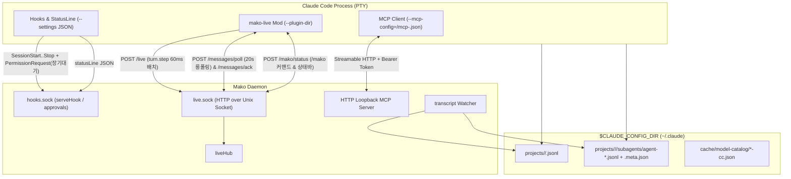
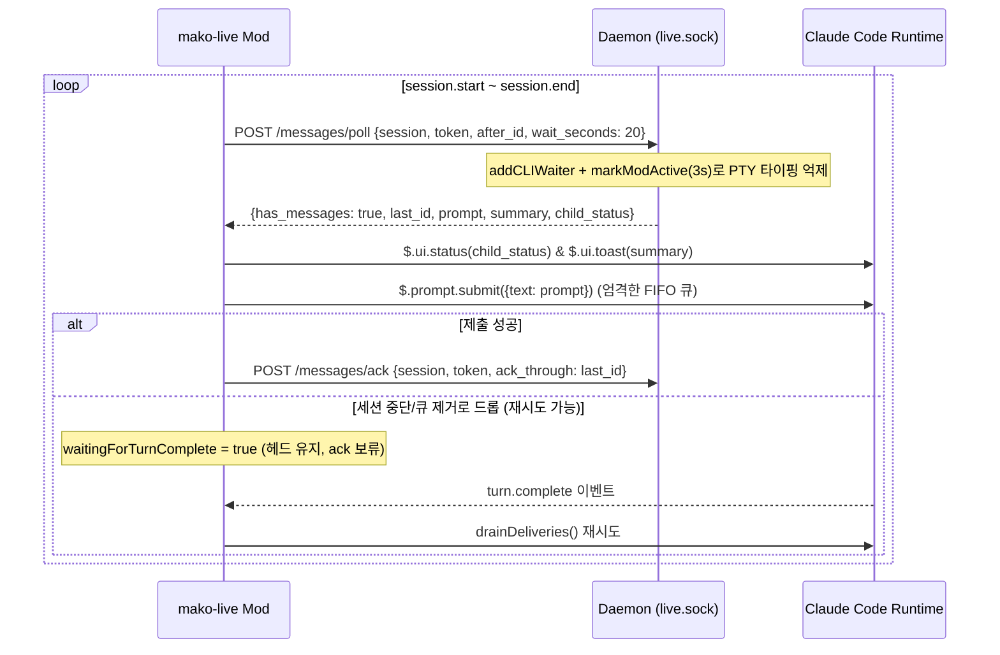

# Claude Code (`claude`) 통합 상세

`internal/agent/claude` 드라이버는 Mako에서 가장 풍부한 네이티브 계약을 구현합니다. **`--plugin-dir`로 주입되는 내장 `mako-live` Mod(`MAKO_LIVE_SOCKET`)**, **`--settings` JSON 병합 훅 & 상태줄**, **`PermissionRequest` 훅 기반 다중 승인 옵션(`ApprovalOptions`) 및 질문 직접 응답(`HookAnswers`)**, **Sidechain 서브에이전트 및 `BackgroundTasks` 파싱**까지 전 영역을 지원합니다.

상위 공통 설계는 [공통 인터페이스 설계 문서](../README.md)를 참고하세요.

---

## 1. 통합 아키텍처 개요

---

## 2. 구현된 Capability 요약

| 인터페이스 | 구현 파일 | 핵심 동작 |
| --- | --- | --- |
| `Driver`, `Launcher`, `Prompter`, `DirTaker`, `ModelFlag`, `EffortFlag` | `claude.go` (`agent.Flags`) | `--session-id` 선점(Pin), `--resume`/`-r`, `--add-dir=`, `--model`, `--effort` |
| `YoloFlag`, `OneShot` | `oneshot.go` | `--dangerously-skip-permissions`, `--print --no-session-persistence --permission-prompts none` |
| `Servers` | `claude.go` | `<runDir>/mcp-<session>.json` 생성 + `--mcp-config=<path>` (종료 시 삭제) |
| `LiveReplies` | `live.go`, `mod/*`, `daemon/live.go` | 내장 `mako-live` Mod 추출·검증(`plugin validate`)·주입(`--plugin-dir`) |
| `Hooks`, `StatusLine` | `hooks.go` | `--settings` 기존 JSON 병합, 11개 훅 이벤트, 컨텍스트/쿼터 수집 + 사용자 statusLine 포워딩 |
| `ApprovalOptions` | `approvals.go` | `permission_suggestions` (`setMode`/`addRules`) & `ExitPlanMode` 모드 승인 |
| `HookAnswers` | `answers.go` | `AskUserQuestion`을 `PermissionRequest` 훅의 `updatedInput.answers`로 직접 응답 |
| `Logs`, `Tools` | `log.go`, `tools.go`, `tags.go`, `logcommands.go` | 프로젝트 JSONL 디코딩(UUID 중복 제거, `pluginPrompt` 언래핑), 도구 정규화 |
| `SubAgents`, `SubAgentLogs` | `subagents.go`, `log.go` | `subagents/agent-*.meta.json` + `.jsonl` (`sidechain: true` 전용 디코더) |
| `BackgroundTasks` | `tasks.go` | `Bash(run_in_background)` → `backgroundTaskId`/`.output` → `<task-notification>`/`TaskStop` |
| `Screen`, `Recaller`, `Modes`, `Models` | `screen.go`, `recall.go`, `controls.go` | TUI 상태 감지, `Ctrl+O`/에이전트 리스트 복귀, `shift+tab` 모드, `/model`+`ConfirmKeys` |
| `ModelCatalog`, `Commands` | `catalog.go`, `commands.go` | `cache/model-catalog/*-cc.json` 읽기, 내장·사용자·프로젝트·활성 플러그인 커맨드/스킬 |

---

## 3. 내장 `mako-live` Mod & `MAKO_LIVE_SOCKET` 양방향 연동

`internal/agent/claude/mod/`에는 TypeScript 기반 Claude Code 플러그인(`mako-live` v1.1.0)이 `//go:embed all:mod`로 바이너리에 내장되어 있습니다.

### 3.1 추출, 버전 프로빙 및 인증 (`live.go`, `daemon/live.go`)
1. `LiveMod(runDir)`가 `<runDir>/mako-live/`에 `.claude-plugin/plugin.json`, `hooks/hooks.json`, `hooks/register.ts`를 추출합니다(동일 내용이면 건너뛰어 실행 중 세션 보호).
2. `LiveCheck(folder)`가 `claude plugin validate <folder>` 출력에 `"turn.step"`이 포함되는지 1회 프로빙(캐시)합니다. Mod를 지원하지 않는 구버전 Claude Code에서는 자동으로 건너뜁니다.
3. 지원 시 `WithLive`가 `--plugin-dir <folder>`를 추가하고, 데몬은 다음 환경변수를 주입합니다:
   - `MAKO_LIVE_SOCKET`: `<runDir>/live.sock`
   - `MAKO_LIVE_TOKEN`: 데몬 랜덤 32바이트 시크릿으로 생성한 `HMAC-SHA256(sessionID)` — 타 세션 위조 차단

### 3.2 실시간 응답 스트리밍 (`POST /live`)
- `register.ts`는 `turn.step` async generator 훅을 감싸 모델이 생성하는 청크를 관찰하면서 그대로 `yield`합니다:
  - `text` → `{k: "text", i, t}`
  - `thinking` → 블록당 최초 1회 `{k: "thinking", i}` (사고 본문은 유출하지 않고 진행 표시만 전송)
  - `tool` → `{k: "tool", i, n}`
  - `input` → `{k: "input", i, t}` (데몬은 블록당 최대 2KiB `liveArgs`만 유지)
- `BATCH_MS = 60ms` 간격으로 직렬 큐를 통해 `http://mako/live` (`socketPath: MAKO_LIVE_SOCKET`)로 전송하고, `finally`에서 `end: true`를 보냅니다.
- `e.agentId`를 함께 전달하므로 **메인 대화뿐 아니라 실행 중인 서브에이전트의 실시간 스트리밍**도 Chat UI에서 볼 수 있습니다.
- `liveHub.look()`은 대상 JSONL 로그 파일 크기가 증가하는 순간 이미 기록된 블록을 제거해 중복 표시를 없앱니다.

### 3.3 네이티브 메시지 전달 & `/mako` 상태 통합 (`register.ts`)

- **무확인·무폴링 전달**: 확인 다이얼로그 없이 `$.prompt.submit`으로 직접 제출되며, Bedrock/Vertex/Foundry 등 모든 백엔드에서 동일하게 작동합니다.
- **내장 `/mako` 커맨드 & 상태바**: `session.start` 시 `$.command.register({name: "mako"})`를 등록해 `/mako` 입력 시 `POST /mako/status`로 프로젝트 에이전트 목록과 대기 메시지 요약을 표시하고, 실행 중인 자식 세션 요약을 `$.ui.status(...)`에 반영합니다.

---

## 4. 훅(`--settings`), 승인 옵션, 질문 응답 및 상태줄

### 4.1 `--settings` 병합 훅 (`hooks.go`)
- 명령어에 이미 `--settings`가 있으면(인라인 JSON 또는 파일 경로, `~/` 확장 지원) 기존 `hooks` 매처 배열을 유지한 채 Mako 핸들러를 추가하고, `statusLine`이 없을 때만 Mako 상태줄을 설정합니다. 읽을 수 없는 `--settings`이면 안전하게 `false`를 반환해 건드리지 않습니다.
- **훅 이벤트 (11개)**:
  - `SessionStart`, `UserPromptSubmit`, `PostToolUse`, `PermissionRequest`(`ApprovalTimeout = 24h`), `PreCompact`, `Stop`, `SessionEnd`
  - `SubagentStart` / `SubagentStop` (`agent_id != ""` → `ChildStarted`/`ChildStopped`)
  - `Notification`: `idle_prompt` → `agent.Idle`; `permission_prompt` / `elicitation_dialog` → `agent.Waiting`
  - `StopFailure` → `agent.Idle`

### 4.2 다중 승인 옵션 (`ApprovalOptions` — `approvals.go`)
`PermissionRequest` 훅은 단순 1회 허용/거절을 넘어 Claude Code의 `permission_suggestions`와 `ExitPlanMode`를 Mako UI의 선택지로 노출합니다:
- **일반 도구 권한**: `permission_suggestions` 배열에서 `type == "setMode"` 또는 `type == "addRules" && behavior == "allow"` 항목을 `protocol.ApprovalOption`으로 변환하고, 사용자가 선택한 인덱스의 원본 JSON을 `updatedPermissions`에 담아 반환합니다.
- **플랜 승인 (`ExitPlanMode`)**:
  - 선택지로 `auto`, `acceptEdits`, `default` 모드를 제공합니다.
  - 승인 시 `updatedInput`(원본 입력 유지) + `updatedPermissions: [{"type":"setMode","mode":<선택모드>,"destination":"session"}]`을 반환합니다.
  - 거절 시 사용자가 별도 사유를 적지 않으면 `DenyMessage`가 `"The user has not approved the plan yet; keep planning."`을 전달해 에이전트가 작업을 중단하지 않고 계속 계획을 수정하도록 유도합니다.

### 4.3 질문 직접 응답 (`HookAnswers` — `answers.go`)
- `AskUserQuestion` 도구 호출 시 `PermissionRequest` 훅이 잡히면, Mako UI에서 사용자가 고른 옵션과 자유 입력 텍스트를 `", "`로 결합해 `updatedInput.answers[question]` 맵으로 채운 뒤 `behavior: "allow"`로 반환합니다.
- PTY 키 입력 없이 100% 구조화된 JSON으로 응답하므로 터미널 화면 상태나 포커스에 영향을 받지 않습니다.

### 4.4 상태줄 (`StatusLine` — `hooks.go`)
- `Status(input)`은 `context_window.context_window_size`와 `rate_limits` (`five_hour`, `seven_day`의 `used_percentage`, `resets_at`)를 추출합니다.
- `UserStatusLine(input)`은 Claude Code의 설정 우선순위대로 `<project>/.claude/settings.local.json` → `<project>/.claude/settings.json` → `$CLAUDE_CONFIG_DIR/settings.json`을 조회해 사용자의 기존 `statusLine` 명령을 찾아 포워딩합니다.

---

## 5. 트랜스크립트, Sidechain 서브에이전트, 백그라운드 태스크

### 5.1 메인 로그 디코딩 (`log.go`, `tools.go`, `tags.go`)
- **경로**: `$CLAUDE_CONFIG_DIR/projects/<project>/<id>.jsonl` (기본 `~/.claude`, `LogName = "<id>.jsonl"`).
- **대화 ID 선점 (`Pin`)**: 신규 세션 시작 시 Mako가 UUID를 생성해 `--session-id <uuid>`로 고정하므로 첫 턴이 쓰이기 전에도 대화 ID가 확정됩니다.
- **중복 및 특수 레코드 처리**:
  - 재개 시 복사되는 중복 레코드는 `uuid` 기반 `agent.Seen`으로 1회만 디코딩합니다.
  - `isSidechain`, `isMeta` 레코드는 메인 대화에서 제외하고, `isCompactSummary`는 `agent.Summary`로 변환합니다.
  - `mako-live` Mod 등이 `$.prompt.submit`으로 보낸 메시지는 `pluginPrompt.text`가 있으면 `"The <name> plugin sent a message: ..."` 래퍼를 벗겨 깔끔하게 표시합니다.
  - `/compact` 직후 중복 기록되는 슬래시 커맨드(`retyped`)를 제거합니다.
- **토큰 집계 (`usage`)**: 멀티 레코드로 나뉘어 기록되는 동일 `message.id`의 사용량은 1회만 합산하며, `user` 레코드의 `permissionMode`와 메인 `assistant` 레코드의 `model`/`effort`를 추적합니다(`"<synthetic>"` 모델 무시).
- **도구 출력 정리**: `<system-reminder>...</system-reminder>` 태그를 제거하고 `Read` 결과의 `"  12→line"` 줄번호 접두사를 벗겨냅니다.

### 5.2 서브에이전트 스캔 (`SubAgents` + `SubAgentLogs` — `subagents.go`)
- **파일 구조**: `<session-log-without-ext>/subagents/agent-<id>.jsonl` 및 `agent-<id>.meta.json`.
- **호출 매칭**: 백그라운드 에이전트는 `meta.toolUseId`로, 포그라운드 에이전트는 자식 로그의 첫 사용자 프롬프트(`byPrompt`)로 부모의 `Agent`/`Task` 도구 호출과 매칭합니다.
- **성능 최적화**: 디렉터리/메타파일 mtime 캐싱, 완료된 서브에이전트는 `settledFor = 1m` 동안 파일 재조회를 생략, 로그 스캔 시 프롬프트를 확보한 뒤에는 `"tool_use"`가 없는 라인은 JSON 파싱 자체를 건너뜁니다.
- **`SubAgentLogs`**: 서브에이전트 로그의 모든 레코드는 `isSidechain: true`이므로 `NewAgentDecoder()`가 `sidechain: true` 모드로 전용 디코딩합니다.

### 5.3 백그라운드 태스크 추적 (`BackgroundTasks` — `tasks.go`)
- 빠른 사전 필터(`run_in_background`, `backgroundTaskId`, `<task-notification>`, `"TaskStop"`, `"KillShell"`)에 걸리는 라인만 파싱합니다.
- `Bash` 도구에 `run_in_background: true` → `TaskCalled`
- `toolUseResult.backgroundTaskId` 및 `written to: <path>.output` → `TaskStarted`
- `<task-notification>` (`user` 메시지, `queue-operation` `enqueue`, 또는 `attachment` `queued_command`) 및 `TaskStop`/`KillShell` 호출 → `TaskEnded` (종료 코드 추출)

---

## 6. MCP, 화면 제어(`Modes`/`Models`/`Recaller`), 카탈로그, OneShot

- **MCP 서버 (`claude.go`)**: `<runDir>/mcp-<session>.json` (`0600`)에 HTTP(`type: "http"`, `Authorization: Bearer ...`) 또는 stdio 서버를 기록하고 `--mcp-config=<path>` (`=` 형식으로 가변 인자 흡수 방지)로 전달합니다. 세션 종료 시 파일을 삭제합니다.
- **화면 감지 & `Recaller` (`screen.go`, `recall.go`)**:
  - 타이틀 점자/반원 스피너(`Working`), `✳ `(`Idle`), 프롬프트 박스(`❯`), 각종 권한/폼/MCP elicitation 다이얼로그를 감지합니다.
  - `Ctrl+O` 상세 트랜스크립트 오버레이에서는 `Ctrl+O` (`\x0f`)로 복귀하고, 백그라운드 에이전트 뷰가 선택된 상태에서는 `Esc`(에이전트 중단 위험) 대신 하단 에이전트 목록을 `↓`/`↑`/`Enter`로 탐색해 `main`으로 복귀합니다.
- **모드 & 모델 제어 (`controls.go`)**:
  - `Modes`: `default`, `acceptEdits`, `plan`, `auto`를 `Shift+Tab` (`\x1b[Z`)로 순환하며 프롬프트 박스 하단 문구(`accept edits on`, `plan mode on`, `auto mode on` 등)로 현재 모드를 판독합니다.
  - `Models`: `/model <m>`, `/effort <e>`를 입력하며, 캐시된 모델 전환 시 나타나는 `"Switch model?"` 확인 다이얼로그를 `ConfirmKeys`가 감지해 `"Yes"` 옵션으로 커서를 옮기고 `Enter`를 누릅니다.
- **모델 카탈로그 & 커맨드 (`catalog.go`, `commands.go`)**:
  - `$CLAUDE_CONFIG_DIR/cache/model-catalog/*-cc.json` 중 최신 파일에서 모델/effort/overflow 섹션을 읽고, 없으면 기본 별칭(`fable`, `opus`, `sonnet`, `haiku`)으로 폴백합니다.
  - 내장 커맨드 + 사용자/프로젝트의 `commands/` 및 `skills/` + `installed_plugins.json` 중 `settings.json`/`settings.local.json`에서 활성화된 플러그인의 커맨드/스킬(`<plugin>:<name>`)을 모두 수집합니다.
- **OneShot (`oneshot.go`)**: `--print --no-session-persistence [--permission-prompts none] --output-format text|json [--json-schema <schema>]`로 프롬프트를 stdin 전달하고 `structured_output` → `result` 순으로 결과를 추출합니다.
