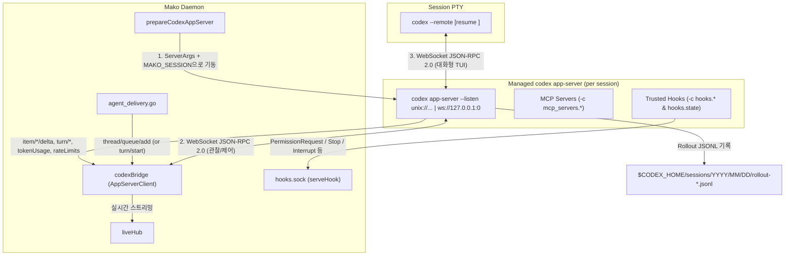
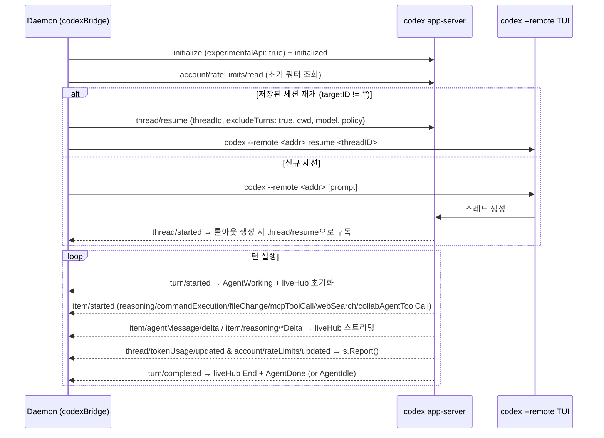

# Codex CLI (`codex`) 통합 상세

`internal/agent/codex` 드라이버와 `internal/daemon/codex_appserver*.go`는 OpenAI Codex CLI를 Mako에 통합합니다. 핵심은 세션마다 관리형 **`codex app-server`** 를 기동하고 TUI를 **`codex --remote`** 로 연결하는 **듀얼 클라이언트 브리지 아키텍처**이며, 여기에 **신뢰 해시 기반 `-c hooks.*` 주입**, **Rollout JSONL 디코딩**, **키스트로크 기반 질문 응답(`KeyedAnswers`)** 이 결합됩니다.

상위 공통 설계는 [공통 인터페이스 설계 문서](../README.md)를 참고하세요.

---

## 1. 통합 아키텍처 개요 (`app-server` + `--remote`)

---

## 2. 구현된 Capability 요약

| 인터페이스 | 구현 파일 | 핵심 동작 |
| --- | --- | --- |
| `Driver`, `Launcher`, `Prompter`, `DirTaker`, `ModelFlag`, `EffortFlag` | `codex.go` (`agent.Flags`) | `resume` 서브커맨드, `--no-daemon` 격리, `-c model_reasoning_effort=...`, `--add-dir` |
| `YoloFlag`, `OneShot` | `oneshot.go` | `--dangerously-bypass-approvals-and-sandbox`, `codex exec --ephemeral -o <file> --output-schema` |
| `Servers` | `codex.go` | `-c mcp_servers.<id>.*` (HTTP `bearer_token_env_var` 우선, stdio 지원) |
| `Hooks`, `HookGate` | `hooks.go` | `codex features list`의 `hooks` 프로빙 + `-c hooks.*` & `hooks.state` SHA-256 신뢰 해시 |
| `App-Server Bridge` | `appserver.go`, `daemon/codex_appserver*.go` | 세션별 `codex app-server` + `--remote`, 실시간 스트리밍·토큰/쿼터·네이티브 메시지 큐잉 |
| `Logs`, `LogStatus`, `Tools` | `log.go`, `items.go`, `tools.go` | Rollout JSONL 디코딩, `task_started`/`task_complete`/`turn_aborted`, Code Mode 필터링 |
| `SubAgents` | `subagents.go` | `spawn_agent` 반환 `agent_id`로 날짜별 Rollout 탐색 및 증분 스캔 |
| `Screen`, `Recaller`, `KeyedAnswers` | `screen.go`, `recall.go` | 타이틀 스피너/다이얼로그 감지, 오버레이 복귀(`q`/`Esc`/`Alt+Left`), `request_user_input` 키 입력 |
| `ModelCatalog` | `catalog.go`, `appserver.go` | `models_cache.json` 빠른 경로 + `codex app-server --stdio` `model/list` 페이징 |
| `Commands` | `commands.go` | 내장 60개 커맨드 + `prompts:` + `$CODEX_HOME/skills` + `.system` + `<project>/.agents/skills` |

---

## 3. `codex app-server` + `codex --remote` 브리지 상세

### 3.1 기능 프로빙 및 자동 폴백 (`prepareCodexAppServer`)
데몬은 네이티브 `codex` 세션 시작 시 다음 조건을 모두 만족할 때만 App-Server 모드를 활성화하며, 하나라도 실패하면 원래 명령어 그대로 **Direct PTY 모드**로 안전하게 폴백합니다:
1. `agents.Native("codex", cmd[0])` 통과 (사용자 커스텀 래퍼가 아님)
2. `SplitRemoteLaunch`가 `SkipRemote == false` 반환
   - 비대화형 서브커맨드(`exec`, `review`, `mcp`, `app-server`, `fork`, `doctor` 등), 인터랙티브 피커(`--last`, `--all`, `--fork`, 인자 없는 `codex resume`), 이미 명시된 `--remote`는 자동으로 건너뜁니다.
3. CLI 프로빙 캐시(`supportsCodexAppServer`):
   - `codex app-server --help` 출력에 `--listen` 포함
   - `codex --help` 출력에 `--remote` 포함

### 3.2 명령줄 분할 (`codex.SplitRemoteLaunch`)
하나의 해결된 `codex` CLI 명령줄을 서버용과 TUI용으로 정확히 분할합니다:
- **서버(`codex app-server`)로 이동하는 옵션**:
  - `-c` / `--config`, `--enable`, `--disable`, `--strict-config` (MCP 서버·훅·설정 오버라이드가 실제 턴 실행 측에 적용되도록)
  - `--add-dir <dir>` → `-c sandbox_workspace_write.writable_roots=[...]`
  - 권한/샌드박스 플래그(`-a`, `-s`, `--full-auto`, `--approve-for-me`, `--yolo`, `--dangerously-bypass-approvals-and-sandbox`) → 서버에는 `-c approval_policy=...`, `-c sandbox_mode=...`, `-c approvals_reviewer=...`로 전달합니다.
  - `MAKO_SESSION` 환경변수를 서버 프로세스에도 주입해 서버가 실행하는 훅이 올바른 세션으로 라우팅되도록 합니다.
- **TUI(`codex --remote`)에 유지되는 옵션**:
  - `--remote <addr>`, `--model`, `-C`/`--cd`, `-p`/`--profile`, `-i`/`--image`, 재개 시 `resume <threadID>`, 선택적 프롬프트(`--` 구분자 뒤에 배치해 `-`로 시작하는 프롬프트 오파싱 방지)
  - 신규 세션(`NewTUIArgs`)에는 권한/샌드박스 플래그(`--dangerously-bypass-approvals-and-sandbox`, `--approve-for-me`, `-a`/`-s`)도 함께 전달해 TUI의 `thread/start`가 서버의 `sandbox_mode`를 `read-only`로 덮어쓰지 않도록 합니다. 재개 세션(`resume`)에서는 `codex --remote ... resume`이 권한 오버라이드를 거부하므로 제외하고 `thread/resume` RPC로 적용합니다.
  - `--no-daemon`은 `--remote`와 충돌하므로 제거합니다.

### 3.3 OS별 전송 계층 및 보안
| 플랫폼 | 파일 | 리슨 주소 & 인증 | 프로세스 정리 |
| --- | --- | --- | --- |
| **macOS / Linux** | `codex_appserver_unix.go` | `unix://<runDir>/codex-<sessionID>.sock` (경로가 96바이트 초과 시 `os.TempDir()` / `/tmp`로 자동 단축해 104/108B 제한 회피) | `Setpgid: true`로 프로세스 그룹 생성 → `SIGTERM` (2s) → `SIGKILL` + 소켓 파일 삭제 |
| **Windows** | `codex_appserver_windows.go` | `ws://127.0.0.1:0` + 32B 랜덤 hex 토큰 파일(`codex-<id>.tok`, `0600`) + `--ws-auth capability-token --ws-token-file <tok>` + TUI에 `--remote-auth-token-env MAKO_CODEX_WS_TOKEN` | stderr에서 실제 바인딩된 `ws://127.0.0.1:<port>` 파싱 후 `Authorization: Bearer`로 다이얼, 종료 시 Kill + 토큰 파일 삭제 |

### 3.4 JSON-RPC 2.0 라이프사이클 & 알림 처리 (`codex_appserver.go`)

- **신규 세션 부트스트랩 설계**: 신규 세션에서 서버에 0-turn 스레드를 미리 만들고 TUI에 `resume <id>`를 넘기면 Codex가 `no rollout found for thread id (-32600)` 에러를 반환합니다. 따라서 신규 세션은 TUI가 직접 스레드를 생성하게 두고, 브리지가 `thread/started` 및 `thread/status/changed`를 수신해 `thread/resume`으로 구독하고 디스크 롤아웃 파일이 검증되면 `bindConversation`을 수행합니다.
- **인-TUI 대화 전환 추적 (`/new`, `/resume`)**:
  - `ephemeral`이거나 `IsSubagent()`(`parentThreadId != ""` 또는 `source`에 `"subagent"` 포함)인 스레드는 `ignored` 맵에 기록해 절대 메인 대화를 덮어쓰지 않습니다.
  - 사용자가 `/new`나 `/resume`으로 새 최상위 스레드로 전환하면 이전 스레드를 `abandoned`에 기록해, 이전 스레드가 뒤늦게 `idle`로 바뀌어도 되돌아가지 않습니다.
- **수동(Passive) ServerRequest 정책**: `AppServerClient.readLoop()`는 서버가 보내는 요청(`hasID && method != ""`, 예: 승인 요청)에 직접 응답하지 않습니다. 승인은 연결된 `--remote` TUI와 Mako의 `PermissionRequest` 훅이 일관되게 처리합니다.
- **네이티브 메시지 전달 (`deliverViaCodexBridge`)**:
  1. 현재 `tid`가 없으면 `thread/loaded/list`로 단일 활성 스레드 탐색 시도.
  2. `thread/queue/add` 호출(유휴 상태면 즉시 턴 시작, 작업 중이면 현재 턴 종료 후 FIFO 자동 드레인).
  3. JSON-RPC `-32600` (`InvalidRequest`, 예: 큐 미지원 또는 임시 스레드) 시 `turn/start`로 재시도.
  4. 모두 실패하면 PTY 프롬프트 타이핑으로 폴백합니다.

---

## 4. 신뢰 해시 기반 훅 주입 (`Hooks` + `HookGate`)

Codex는 `-c hooks.<Event>=...` 오버라이드로 훅을 받지만, 보안상 CLI에서 주입된 훅이라도 **`hooks.state`에 정확한 신뢰 해시(`trusted_hash`)가 없으면 실행하지 않습니다.**

- **`HookGate`**: `codex features list` 출력에 `hooks` 기능이 있을 때만 훅을 주입합니다.
- **신뢰 해시 계산 (`hooks.go`)**:
  - 소스 경로: Unix는 `/<session-flags>/config.toml`, Windows는 `C:\<session-flags>\config.toml`.
  - 키 형식: `<source>:<snake_case_event>:0:0` (예: `/<session-flags>/config.toml:permission_request:0:0`).
  - 해시 대상: `{"event_name":"...","hooks":[{"async":false,"command":"...","timeout":...,"type":"command"}]}` (HTML 이스케이프 없이 정렬된 JSON의 `sha256:<hex>`).
  - **타임아웃 주의**: Codex는 `Interrupt` 훅의 타임아웃을 신뢰 해시 계산 전에 3초로 클램핑하므로, Mako도 `Interrupt`(및 `SessionEnd`)의 타임아웃을 `3`으로 맞춰 해시 불일치를 방지합니다.
- **지원 이벤트 (11개)**:
  - `SessionStart`, `UserPromptSubmit`, `PostToolUse`, `PermissionRequest`(`ApprovalTimeout = 24h`), `PreCompact`, `Stop`, `SessionEnd` → `agent.CommonHooks`
  - `Interrupt` → `agent.Idle`
  - `PostCompact` → `trigger == "manual"`이면 `agent.Idle`, `auto`면 `agent.ToolDone`
  - `SubagentStart` / `SubagentStop` (`agent_id != ""`) → `ChildStarted` / `ChildStopped`

---

## 5. MCP 서버 주입 (`-c mcp_servers.*`)

`codex.WithServers`는 `l.Command[0]` 바로 뒤에 `-c` TOML 오버라이드를 추가합니다(`codex.go`):
- **HTTP 서버 (내장 `mako` MCP 포함)**:
  - `-c mcp_servers.<id>.url="<url>"`
  - 베어러 토큰은 프로세스 목록(`ps`)에 노출되지 않도록 환경변수 `MAKO_MCP_TOKEN_<ID>`에 저장하고 `-c mcp_servers.<id>.bearer_token_env_var="MAKO_MCP_TOKEN_<ID>"`로 참조합니다.
- **stdio 서버**: `command`, `args`, `env={...}`를 TOML 리터럴로 전달합니다.
- App-Server 모드에서는 `SplitRemoteLaunch`가 이 `-c` 플래그들을 모두 `codex app-server`로 넘겨 서버가 직접 MCP를 호스팅합니다.

---

## 6. Rollout 로그, Code Mode, 서브에이전트 & 사용량

### 6.1 Rollout 로그 & `LogStatus` (`log.go`, `items.go`)
- **경로**: `$CODEX_HOME/sessions/<yyyy>/<mm>/<dd>/rollout-<time>-<id>.jsonl` (`Place.RootEnv = "CODEX_HOME"`, `LogName = "rollout-*-<id>.jsonl"`).
- **소유자 식별 (`Identity`)**: `type: "session_meta"` 라인에서 `id`/`session_id`, `cwd`, `timestamp`를 읽되 `source`에 `"subagent"`가 포함되면 인터랙티브 메인 세션에서 제외합니다.
- **턴 상태 이벤트 (`LogStatus`)**: `event_msg`의 `task_started` → `AgentWorking`, `task_complete` → `AgentDone`, `turn_aborted` → `AgentIdle`.
- **Code Mode 배관 필터링**: Codex의 Code Mode에서 도구를 감싸 실행하는 `exec`, `js`, `wait` 호출은 `plumbing` 맵으로 숨기고, 실제 수행된 도구인 `event_msg`의 `item_completed` (`CommandExecution`, `FileChange` → `*** Begin Patch` 변환, `McpToolCall`, `WebSearch`, `ImageView`, `CollabAgentToolCall`)를 채팅 행으로 디코딩합니다.
- **사용량 & 권한 모드 (`Count`, `turnContext`)**:
  - `token_count`에서 누적(`total_token_usage`)과 현재 컨텍스트(`last_token_usage.input_tokens`), `model_context_window`, `rate_limits`(`primary`/`secondary`)를 읽습니다.
  - `turn_context`의 `collaboration_mode.mode`, `sandbox_policy.type`, `approval_policy`를 Mako UI의 표준 권한 모드(`plan`, `bypassPermissions`, `acceptEdits`, `readOnly`, `default`)로 정규화합니다.

### 6.2 서브에이전트 추적 (`subagents.go`)
- `spawn_agent` 도구 결과 JSON(`{"agent_id": "...", "nickname": "..."}`)에서 자식 스레드 ID를 추출합니다.
- 세션 날짜 폴더 → 오늘 날짜 폴더 → 전체 `sessions/*/*/*` 순으로 `rollout-*<id>*.jsonl`을 찾아 `agent.Tail`로 증분 스캔하며, `session_meta.agent_role`과 `turnStatus`로 실행 중 여부를 추적합니다.

---

## 7. 화면 감지, 오버레이 복귀(`Recaller`), 키 입력 응답(`KeyedAnswers`)

- **화면 규칙 (`screen.go`)**:
  - 터미널 타이틀의 `"Action Required"` (`Blocked`), 점자 스피너 (`Working`), 그 외 비어 있지 않은 타이틀 (`Idle`).
  - 화면 본문의 `trust_directory`, `startup_update`, `dialog`(`allow command?`, `enter to submit answer/all`), `question`(`y/n`), `turn_timer` (`(12s • esc to interrupt)`), `transcript_viewer`(`Hold: true`).
- **`Recaller` (`recall.go`)**: 프롬프트 위에 오버레이가 열려 있으면 자동으로 안전한 키를 보내 메인 프롬프트로 복귀합니다.
  - `transcript_viewer` (`ctrl+t`) → `q`
  - `command_center` / `shortcuts` → `Esc` (`\x1b`)
  - `sub_agent` (`Viewing sub-agent ... direct input is disabled`) → `Alt+Left` (`\x1b[1;3D`) (`Esc`는 서브에이전트를 인터럽트하므로 금지)
- **`KeyedAnswers` (`recall.go`)**: `request_user_input`은 훅으로 답변을 돌려줄 수 없으므로, `Asking(screen)`으로 다이얼로그를 감지한 뒤 `AnswerKeys`가 옵션 인덱스만큼 `↓` 키를 누르고(자유 입력 시 마지막 `"None of the above"` 선택 후 `Tab` + 텍스트), `Enter`로 다음 질문 또는 전체 제출을 자동 수행합니다.

---

## 8. 모델 카탈로그, 커맨드/스킬, OneShot

- **모델 카탈로그 (`catalog.go`, `appserver.go`)**:
  - `refresh == false`일 때 `$CODEX_HOME/models_cache.json`(없으면 `~/.codex/models_cache.json`)을 즉시 읽습니다.
  - `refresh == true`이거나 캐시가 비어 있으면 단기 `codex app-server --stdio` 서브프로세스를 띄워 NDJSON으로 `initialize` → `model/list` 페이징(최대 20페이지, `includeHidden: false`)을 조회하고 각 모델의 `supportedReasoningEfforts`를 수집합니다.
- **커맨드 & 스킬 (`commands.go`)**: 내장 60개 슬래시 커맨드, `$CODEX_HOME/prompts` (`prompts:` 접두사), `$CODEX_HOME/skills` (`user`), `$CODEX_HOME/skills/.system` (`system`), `<project>/.agents/skills` (`project`)를 재귀 탐색(심볼릭 링크 순환 방지, 최대 깊이 6, YAML frontmatter 및 `metadata.short-description` 지원)합니다.
- **OneShot (`oneshot.go`)**: `codex exec --ephemeral --skip-git-repo-check -o <tempOut> [--output-schema <tempSchema>] -` 형태로 프롬프트를 stdin으로 전달하고, 완료 후 `<tempOut>`(비어 있으면 stdout)에서 텍스트 또는 JSON을 파싱한 뒤 임시 파일을 정리합니다.
