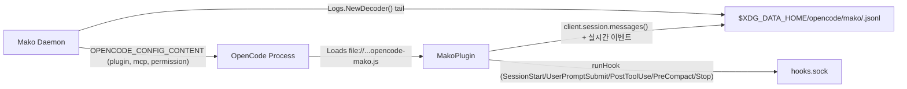

# 기타 에이전트 (`pi`, `omp`, `omo`, `opencode`) 통합 상세

Mako는 `claude`, `codex`, `agy` 외에도 확장(Extension) 및 플러그인(Plugin) 기반으로 동작하는 **`pi` 계열 (`pi`, `omp`, `omo`)** 과 **`opencode`** 드라이버를 지원합니다.

상위 공통 설계는 [공통 인터페이스 설계 문서](../README.md)를 참고하세요.

---

## 1. `pi` 계열 (`pi`, `omp`, `omo`) — `internal/agent/pi`

`pi`와 그 파생 에이전트인 `omp` (oh-my-pi), `omo` (OmO edition on senpi)는 동일한 세션 로그 구조와 확장 시스템을 공유하므로 `internal/agent/pi` 패키지에서 단일 베이스 구조체(`pi.Agent`)를 공유합니다.

### 1.1 변형별 차이점

| 항목 | `pi` (`pi.New()`) | `omo` (`pi.NewOMO()`) | `omp` (`pi.NewOMP()`) |
| --- | --- | --- | --- |
| **루트 환경변수** | `PI_CODING_AGENT_DIR` (`~/.pi/agent`) | `OMO_CODING_AGENT_DIR` (`~/.omo/agent`) | `PI_CODING_AGENT_DIR` (`~/.omp/agent`) |
| **세션 ID 선점 (`Pin`)** | `--session-id` 지원 | `--session-id` 지원 | 미지원 (자체 발급) |
| **재개 플래그 (`Resume`)** | `--session` | `--session` | `--resume`, `-r`, `--session` |
| **턴 완료 확장 이벤트** | `agent_settled` | `agent_settled` | `agent_end` |
| **MCP 주입 (`Servers`)** | 지원 (`pi.registerMcpServer`) | 지원 (`pi.registerMcpServer`) | 미지원 |
| **YOLO 플래그 (`YoloFlag`)** | — | — | `--yolo` (`--auto-approve` 인식) |
| **추가 디렉터리 (`DirTaker`)** | — | — | `--add-dir` |
| **내장 스킬 동기화** | `~/.pi/agent/skills` | — | — |

### 1.2 동적 JS 확장을 통한 훅 주입 (`hooks.go`)
`pi` 계열은 외부 훅 커맨드 설정 대신 `--extension <path>`로 JavaScript 확장을 로드합니다.
- `WithHooks`는 `<runDir>/<name>-hooks-<hash>.js`를 1회 생성(`agent.WriteOnce`)하고 `l.Command`에 `--extension <path>`를 추가합니다.
- 생성된 확장 스크립트는 `agent.HookScript` 헬퍼를 포함하며 다음 이벤트를 Claude Code 형식의 `CommonHooks` 페이로드(`session_id`, `transcript_path`, `tool_name`)로 변환해 `mako hook <hooks.sock>`을 비동기 실행합니다:
  - `session_start` → `SessionStart`
  - `agent_start` → `UserPromptSubmit`
  - `tool_execution_end` → `PostToolUse`
  - `session_before_compact` → `PreCompact`
  - `session_shutdown` → `SessionEnd`
  - `agent_settled` (`pi`/`omo`) 또는 `agent_end` (`omp`) → `Stop`

### 1.3 동적 JS 확장을 통한 MCP 서버 주입 (`servers.go`)
- `pi`와 `omo` (`*pi.Pi`)는 `WithServers`를 구현해 `<runDir>/pi-mcp-<session>.js` (`0600`)를 생성하고 `--extension`으로 로드합니다(세션 종료 시 파일 삭제).
- 확장 내부에서 `pi.registerMcpServer(name, {command, args, env})`를 호출하므로 **stdio 서버만 지원**합니다(내장 `mako` MCP는 자동으로 `mako agent-mcp <agents.sock>` stdio 브리지로 연결).

### 1.4 세션 로그, 도구 정규화, OneShot (`log.go`, `tools.go`, `pi.go`)
- **로그 경로**: `<root>/sessions/<dir>/<time>_<id>.jsonl` (`LogName = "*_<id>.jsonl"`).
- **레코드 디코딩**: 첫 줄 `type: "session"`에서 ID/Cwd/시간을 읽고, `message` (`user`, `assistant` `text`/`toolCall`, `toolResult`, 사용자가 `!`로 실행한 `bashExecution`)와 `compaction`/`branch_summary`를 채팅 메시지로 변환합니다.
- **도구 정규화**: `bash`/`powershell`, `read`/`edit`(단일 교체·`edits` 배열 MultiEdit·`input` 패치 모두 지원)/`write`, `grep`/`find`/`ls`/`glob`/`ast_grep`, `ask`, `task`/`call_omo_agent`를 정규화하며, 셸 출력 말미의 `"Command exited with code N"`에서 종료 코드를 파싱합니다.
- **OneShot**: `--no-session -p <prompt>`로 실행하고 ANSI 이스케이프를 제거한 뒤 텍스트 또는 JSON을 추출합니다.

---

## 2. OpenCode (`opencode`) — `internal/agent/opencode`

OpenCode(및 OpenCode 플러그인으로 동작하는 OmO)는 대화를 내부 데이터베이스에 저장하므로 Mako가 직접 DB를 읽지 않습니다. 대신 Mako가 **전용 JS 플러그인(`opencode-mako.js`)** 을 주입해 이벤트 보고와 JSONL 로그 미러링을 동시에 수행합니다.

### 2.1 환경변수 설정 병합 (`OPENCODE_CONFIG_CONTENT` — `opencode.go`)
OpenCode는 `OPENCODE_CONFIG_CONTENT` 환경변수의 JSON 설정을 사용자 설정 위에 병합합니다. Mako의 `withConfig()`는 기존 `OPENCODE_CONFIG_CONTENT`를 보존하면서 다음 항목을 안전하게 병합합니다:
- **`plugin`**: `WithHooks`가 생성한 `opencode-mako.js`의 `file://` URL 추가
- **`mcp`**: `WithServers`가 stdio 서버(`type: "local"`, `command: [cmd, ...args]`, `environment`, `enabled: true`) 등록
- **`permission`**: `WithYolo`가 `{"*": "allow"}` 주입

### 2.2 내장 미러링 플러그인 (`plugin.go`)
`WithHooks`가 `<runDir>/opencode-mako-<hash>.js`를 작성해 로드하면 `MakoPlugin`이 다음 역할을 수행합니다:
1. **대화 로그 미러링**:
   - 저장 경로: `<XDG_DATA_HOME 또는 ~/.local/share>/opencode/mako/<sessionID>.jsonl`.
   - 세션을 처음 열 때 기존 로그를 읽거나 헤더(`type: "session"`)를 기록한 뒤, `client.session.messages({path: {id}})`로 DB의 기존 히스토리를 백필합니다.
   - 이후 `message.updated` / `message.part.updated` 이벤트를 받아 완료된 텍스트, 요약(`summary`/`compaction`), 도구 호출+결과(`tool`), 어시스턴트 토큰 사용량(`usage`)을 `written` Set으로 중복 없이 append합니다.
   - `info.parentID`가 있는 서브에이전트 세션은 `children` Set에 기록해 미러링과 훅 보고에서 모두 제외합니다.
2. **라이프사이클 훅 보고**:
   - 세션 열림 → `SessionStart`
   - `session.status` 전이: `busy` → `UserPromptSubmit`, `idle` → `Stop`
   - `tool.execute.after` → `PostToolUse`
   - `experimental.session.compacting` → `PreCompact`

### 2.3 로그 디코딩, 도구, 스킬, OneShot (`log.go`, `tools.go`, `opencode.go`)
- **로그 및 격리 홈**: `Place{RootEnv: "XDG_DATA_HOME", HomeDir: ".local/share", Dirs: ["opencode", "mako"]}`, `LogName = "<id>.jsonl"`. 플러그인이 도구 호출과 결과를 완료 시점에 한 레코드로 기록하므로 `decoder`가 단일 행으로 디코딩합니다.
- **도구 정규화**: OpenCode와 OmO의 도구(`bash`/`interactive_bash`, `read`/`edit`/`write`/`apply_patch`, `glob`/`grep`, `webfetch`/`websearch`, `todowrite`, `task`/`call_omo_agent`, `question`)를 지원합니다.
- **스킬 동기화**: `~/.config/opencode/skills`에 내장 `mako-template`, `mako-plugin` 스킬이 자동 동기화됩니다.
- **OneShot**: `opencode run <flags...> <prompt>` 형태로 비대화형 실행 후 ANSI를 제거해 결과를 파싱합니다.
