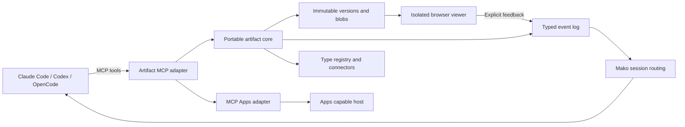

# 여러 에이전트가 공유하는 아티팩트 기능 조사와 구현 계획

조사 기준일: 2026년 11월 17일. 상태: 구현 전 설계안.

Claude Code의 최근 아티팩트 흐름을 참고해, Claude Code·Codex·OpenCode 등 서로 다른 에이전트가 같은 결과물을 만들고 수정하며 사용자 피드백을 받을 수 있는 기능을 제안한다. 공통 코어와 MCP 서버를 독립적으로 사용할 수 있게 만들고, Mako를 첫 호스트로 연결하는 방향이다.

핵심 구현 단위는 **버전이 있는 콘텐츠 저장소, 격리된 뷰어, 에이전트 공통 도구, 피드백 이벤트 경로**다. HTML 미리보기부터 제공하고, 타입 기반 디자인 캔버스와 외부 문서 연결을 순서대로 확장한다. Claude의 비공개 서비스나 타입 파일에 의존하지 않는다.

## 공식 문서와 로컬 관측의 범위

공식 문서에서 확인되는 제품 기능과 로컬 도구의 실제 동작을 구분한다. 특히 로컬에서 보인 필드를 공개 API의 완전한 JSON Schema로 간주하지 않는다.

| 구분 | 확인 내용 | 설계에 미치는 영향 |
| --- | --- | --- |
| 공식 Claude Artifacts | Claude Code 세션 결과를 비공개 URL의 인터랙티브 페이지로 발행·갱신·공유하며 디자인과 문서를 만들 수 있다 | Code의 결과물 발행을 별도 제품 흐름으로 다룬다 |
| 공식 일반 Artifacts | AI 호출과 영속 저장 기능을 설명한다. 해당 설명만으로 Code 생성 아티팩트에 같은 기능이 모두 적용된다고 단정할 수 없다 | AI·저장소는 개별 capability로 설계한다 |
| 로컬 Claude Code | `Artifact` 도구로 파일 발행, 타입 생성, 여러 파일 갱신, 버전 반환이 실제 수행되었다 | 공통 MCP 계약의 사용 흐름에 반영한다 |
| 로컬 도구 결과 | 타입의 고정 파일, 인스턴스 파일, runtime contract, capability, 구독·댓글 안내가 반환된다 | 확장 구조의 근거다. 안내만으로 해당 기능의 실제 실행까지 검증된 것은 아니다 |
| 공식 MCP Apps | MCP 도구에 인터랙티브 UI 리소스를 연결하는 확장이다. 지원 호스트가 필요하다 | 범용 에이전트 도구와 UI 호스트 지원을 별도 계층으로 둔다 |

Claude 제품 근거: [What are artifacts and how do I use them?](https://support.claude.com/en/articles/17153992-what-are-artifacts-and-how-do-i-use-them). 이 문서의 일반 storage·AI-powered 설명을 Code 전용 보장으로 확대하지 않는다.

### Claude Code 공식 문서에서 확인한 기능

[Share session output as artifacts](https://code.claude.com/docs/en/artifacts)는 일반 페이지 발행과 템플릿 기반 생성 두 경로를 설명한다. 계정의 Design·Docs 등 템플릿을 Code에서도 이용하고, `/design`으로 캔버스를 만들거나 문서 요청을 Claude Docs로 연결할 수 있다. 일반 페이지 게시 경로의 단일 페이지 제약을 템플릿 기반 결과물 전체에 적용하면 안 된다.

같은 문서는 v2.1.221 이상의 댓글 읽기·답변·해결과 v2.1.228 이상의 댓글 watch·자동 답변을 설명한다. 편집 권한자가 `Send to Claude` 또는 `@claude`로 활성화한 스레드가 대상이다. 자동 열기를 끄는 `CLAUDE_CODE_ARTIFACT_AUTO_OPEN=0`도 문서화되어 있다. 이 환경 변수와 아래 로컬 도구의 `after_first_write` 필드는 서로 다른 인터페이스다. [Code Artifacts](https://code.claude.com/docs/en/artifacts).

Claude Docs는 Code의 `/mcp`에 `claude.ai Claude Docs`로 나타나는 claude.ai 커넥터다. Docs·Sheets 템플릿의 커넥터 의존성이 문서에 설명된다. Docs 전용 안내는 Desktop의 패널과 터미널의 웹 링크, 문서 버전 기록도 설명한다. [Code Artifacts](https://code.claude.com/docs/en/artifacts), [Get started with Claude Docs](https://support.claude.com/en/articles/16923645-get-started-with-claude-docs).

[공식 TypeScript SDK reference](https://code.claude.com/docs/en/agent-sdk/typescript)의 `ArtifactInput`은 조사 시점에 `action: "publish" | "list"`, `file_path`, `url`, `title`, `contract`, `capabilities` 등 일부 인터페이스를 공개한다. `contract`는 런타임 버전 선택에, `capabilities`는 필요한 기능 선언에 사용된다. 다음 경계를 유지해야 한다.

| 로컬 관측 | 공개 문서와 대조한 결과 |
| --- | --- |
| quickstart, intent, design_systems | 템플릿 기능 자체는 문서화되어 있지만 이 호출 형식은 확인되지 않음 |
| type_url, auto_open=after_first_write | 공개 SDK 입력 타입에서 확인되지 않음 |
| root, files | 다중 파일 호출의 완전한 schema는 공개 reference에서 확인되지 않음 |
| type의 읽기 전용 파일과 project/ | 템플릿 기능의 내부 패키지 형식·상속 계약은 공개 reference로 확정할 수 없음 |
| contract 0.2.47·0.2.96 | contract 필드는 공개되어 있으나 이 runtime release들의 정의·차이는 확인되지 않음 |
| ArtifactComments | 댓글 기능은 공식 문서화. 이 정확한 도구명과 schema는 공개 reference로 확인되지 않음 |

공개 reference가 로컬에서 관측된 인터페이스 전체를 포괄하지 않는다. 원인이 문서 갱신 차이·SDK 범위·계정별 제공 차이 중 무엇인지는 확정하지 않는다. 자체 구현은 관측된 필드를 그대로 호환한다고 약속하지 않고 독립된 공개 계약을 정의한다.

### 최근 변경 기록

다음 날짜와 버전은 [공식 Claude Code changelog](https://code.claude.com/docs/en/changelog)에 명시된 항목이다. 로컬 로그의 실행 날짜와 구분한다.

| 날짜 | Code 버전 | 관련 변경 |
| --- | --- | --- |
| 2026년 9월 8일 | 2.1.265 | 타인이 작성한 아티팩트의 embedded instructions를 불신 콘텐츠로 취급하고 connector 도구명 검사 개선 |
| 2026년 9월 23일 | 2.1.281 | 목록·footer, 압축 업로드, Remote Control의 도구 누락 등 수정 |
| 2026년 11월 6일 | 2.1.319 | 아티팩트 DB 읽기·쓰기·파일 저장 관련 수정 |
| 2026년 11월 9일 | 2.1.321 | DB collection 조회·정렬 안내 수정 |
| 2026년 11월 12일 | 2.1.323 | .docx asset 업로드, 외부 공개 결과물 수정 승인 및 preview 수정 |
| 2026년 11월 13일 | 2.1.325 | Artifact 권한 규칙·hooks와 공개 결과물 변경·업로드 승인 수정 |
| 2026년 11월 16일 | 2.1.326 | background 임시 파일 발행, 하위 에이전트 금지 규칙, 링크와 공유 범위 설명 수정 |

DB 관련 Code 전용 변경이 존재하므로 Code 아티팩트에 플랫폼 저장 기능이 없다고 볼 수는 없다. 다만 전체 DB schema·한도와 일반 Artifacts storage의 적용 관계까지 확인된 것은 아니다. `.docx` asset 지원도 일반 페이지의 게시 원본 형식 지원과 다르다.

### 발행과 로컬 미리보기의 차이

Desktop Code 탭의 Browser pane은 로컬 파일·개발 서버 미리보기와 브라우저 검증을 제공한다. 미리보기를 열었다고 호스팅 아티팩트가 만들어지는 것은 아니다. Mako에서도 파일 preview, 개발 서버 preview, 버전이 저장된 아티팩트를 UI와 데이터 모델에서 구분한다. [Desktop application](https://code.claude.com/docs/en/desktop).

Code에서 발행한 페이지의 connector 호출은 관람자의 claude.ai 연결을 사용하며 로컬 `.mcp.json` 서버를 직접 호출하는 구조가 아니다. 자체 오픈소스 뷰어에서도 에이전트가 가진 모든 MCP 서버를 페이지에 자동 노출하지 않고, capability별로 좁힌 중계 계약을 둔다. [Code Artifacts](https://code.claude.com/docs/en/artifacts).

## 로컬 Claude Code 도구 호출 분석

설치된 실행 파일은 `~/.local/bin/claude`이며 `claude --version`은 `2.1.326 (Claude Code)`을 반환했다. 기록에 남은 실행 버전과 현재 설치 버전은 구분했다.

`~/.claude/projects/`의 JSONL 2,190개를 조사했다. 전체 기록의 timestamp 범위는 2026년 4월 20일~11월 17일 UTC다. `message.content[]`의 `type=tool_use`, `name=Artifact`만 호출로 집계하고 `tool_use.id`로 중복을 제거했다. 본문·명령어에 등장하는 artifact 문자열은 호출 수에 넣지 않았다.

| 항목 | 결과 |
| --- | --- |
| Artifact 호출이 있는 로그 | 8개 |
| 원시 tool_use 기록 | 164건 |
| 중복 제거 후 호출 ID | 98개 |
| Artifact 호출 시간 범위 | 2026년 10월 31일 05:15:54~11월 17일 08:40:42 UTC |
| 명시적 action | quickstart 11, publish 5, read 1 |
| action 생략 | 81건. 파일 발행·갱신 외에 type_url을 이용한 생성도 포함 |
| 호출 레코드의 버전 | 2.1.314 8건, 2.1.319 17건, 2.1.322 3건, 2.1.325 65건, 2.1.326 5건 |

일별 고유 호출 수는 UTC 기준 10월 31일 8건, 11월 9일 4건, 10일 7건, 11일 9건, 14일 9건, 15일 49건, 16일 7건, 17일 5건이다. 이 분포는 사용자 로컬 사용 내역이며 출시일이나 전체 사용자 보급률을 나타내지 않는다. 대응 결과에서 `is_error=true`인 호출은 발견하지 못했다. 성공률이나 오류 처리 전반을 검증한 실험은 아니다.

### 관측된 사용 흐름

다음 JSON은 실제 호출에서 확인한 필드 조합을 일반화한 것이다. 경로·제목·URL은 예시로 치환했다.

```json
{"file_path":"/workspace/prototype/index.html","icon":"sparkle","description":"인터랙티브 프로토타입"}
```

같은 대화에서 같은 파일 경로를 다시 발행하면 같은 URL의 버전이 증가했다. 다른 대화에서는 `url`을 명시해야 기존 결과물을 갱신한다는 안내가 있었다. 따라서 공통 프로토콜은 파일 경로 대신 명시적인 `artifact_id`를 정체성으로 삼는다.

```json
{"action":"quickstart","intent":"design","design_systems":false}
```

타입과 작성 방법을 발견한 뒤 인스턴스를 생성한다. `intent=document`도 관측되었다.

```json
{"action":"publish","type_url":"https://example.invalid/types/design","title":"탭 프로토타입","auto_open":"after_first_write"}
```

생성 결과에는 인스턴스 URL, 버전, 타입 release, 타입의 파일 목록과 작성 지침이 반환되었다. 최초 데이터가 저장된 뒤 화면을 여는 흐름이다.

```json
{"action":"publish","url":"https://example.invalid/artifacts/demo","root":"/workspace/prototype","file_path":"/workspace/prototype/project/canvas.json","files":{"project/Main.dc.html":"project/Main.dc.html"}}
```

11월 17일 디자인 사례에서 `project/canvas.json`과 `project/Main.dc.html`을 발행해 Version 2가 만들어졌다. 결과는 이번 호출에 포함하지 않은 기존 파일을 보존한다고 명시했다. 삭제는 누락과 구분해야 한다.

```json
{"file_path":"/workspace/prototype/index.html","capabilities":{"downloads":true},"label":"이미지 저장 추가"}
```

다운로드 capability를 선언한 호출과 이를 저장했다는 결과가 관측되었다. 사용자 브라우저에서 다운로드가 완료되었는지까지 재현한 것은 아니다.

### 타입과 콘텐츠 저장소의 분리

디자인 타입의 결과에는 읽기 전용 `index.html`, `SKILL.md`, `artifact-type/` 파일과 인스턴스가 쓰는 `project/` 파일이 구분되어 있었다. 캔버스 인덱스는 `v:3`, `boards`, `order` 등을 사용하는 것으로 안내되었다. 이 형식과 런타임은 Claude 구현의 관측값이며 공통 규격으로 채택하지 않는다.

문서 타입은 별도 구조였다. `Artifact` 생성 결과가 문서·탭·루트 식별자를 반환하고, 콘텐츠는 `mcp__claude_ai_Claude_Docs__batch`와 `update`로 수정했다. 실제 11월 16일 사례에서 이 MCP 도구 호출들을 확인했다. 파일 재발행으로 문서 본문을 바꾸는 구조가 아니다.

따라서 인스턴스는 `files` 또는 `connector` 콘텐츠 모드를 가진다. 모든 결과물을 HTML 파일로 변환하는 설계는 문서의 블록 편집·댓글·공동 편집을 표현하기 어렵다.

### 버전과 피드백 경로

결과에는 `contract 0.2.47`, `newest 0.2.96`, 타입 release가 별도로 등장했다. 타입의 실행 계약과 콘텐츠 버전은 서로 다르다. 타입 인스턴스가 capability를 상속하며 임의로 덮어쓸 수 없다는 안내도 있었다.

구독 안내는 연결 준비와 실제 연결을 구분했다. 외부에서 새 버전이 생겨도 새 에이전트 턴을 시작하지 않으며, Claude로 보내기를 선택한 댓글과 일반 댓글의 알림 동작도 구분했다. `ArtifactComments` 호출 자체는 이번 호출 집계에서 관측되지 않았다. 피드백 동작은 도구 결과에 설명된 계약으로만 확인했다.

문서 타입은 댓글과 선택 영역 수정을 해당 문서 커넥터로 처리하도록 안내했다. 이 차이 때문에 댓글·선택 영역의 정식 저장소를 타입별로 지정해야 한다.

### 로컬 근거 위치

아래는 로컬에서 재확인할 위치다. 원본 로그, 실제 결과물 URL, 본문, 사용자 파일은 공개 저장소에 복사하지 않는다. 줄 번호는 조사 시점 기준이다.

| 로그 파일명과 프로젝트 폴더 | 줄 | 근거 |
| --- | --- | --- |
| `-Users-ironpark-Projects-Personal-open-source-mako/d7c2d9f7-0e49-4707-ba6a-de2be3a8d882.jsonl` | 1197~1207 | quickstart, 타입 생성, 작성 지침 |
| 같은 파일 | 1249~1252 | 여러 파일 발행, 버전, 보존 규칙, contract |
| `-Users-ironpark-Projects-Personal-open-source-mako/31d6cf45-7ef2-461c-8f2f-d095839cb7b0.jsonl` | 9670~9675 | Docs 타입 생성과 커넥터 저장 방식 |
| `-Users-ironpark-Projects-Personal-stone-remaster-stone-age/db47e560-ef3d-4234-ab91-c38a0f07f299.jsonl` | 3994~3995 | downloads capability 선언·저장 |
| `-Users-ironpark-Projects-Personal-stone-remaster-stone-age/9a7791ca-b5f3-4c23-8841-463acc4a9601.jsonl` | 3406 이후 | 문서 생성 및 Claude Docs MCP를 이용한 편집 |

폴더는 모두 `~/.claude/projects/` 아래다. 공개 테스트 fixture는 이 형식을 참고해 가상의 데이터로 새로 작성한다.

## 상호운용 프로토콜 선택

에이전트가 결과물을 생성·수정하는 API는 표준 MCP tools로 제공한다. UI 렌더링은 브라우저 뷰어를 기본으로 하고 MCP Apps 어댑터를 추가한다. MCP tools 지원만으로 클라이언트 내 UI 표시까지 가능해지지는 않는다.

MCP Apps는 도구의 `_meta.ui.resourceUri`에서 `ui://` 리소스를 지정하고 `resources/read`로 `text/html;profile=mcp-app` 콘텐츠를 전달한다. UI가 없는 호스트를 위해 의미 있는 텍스트 결과도 반환해야 한다. [공식 개요](https://modelcontextprotocol.io/extensions/apps/overview), [Apps 규격](https://github.com/modelcontextprotocol/ext-apps/blob/main/specification/2026-01-26/apps.mdx).

앱과 호스트는 JSON-RPC와 postMessage로 초기화·도구 결과·메시지를 교환한다. `ui/message`, 컨텍스트 갱신, 서버 도구 호출은 각각 다른 동작이다. 후속 턴 시작 여부는 호스트 정책과 capability를 확인한다. 현재 타입/API의 `ui/message.params.content`는 배열인데 규격 서술 예제에는 객체가 남아 있어, 통합 시 SDK와 호스트 버전을 고정하고 schema 검증이 필요하다. [프로토콜 타입](https://github.com/modelcontextprotocol/ext-apps/blob/main/src/spec.types.ts), [메시지 API](https://apps.extensions.modelcontextprotocol.io/api/interfaces/app.McpUiMessageRequest.html).

core MCP 버전과 Apps UI 프로토콜 버전은 별개다. 최신 core의 확장 협상 방식과 기존 `initialize.capabilities.extensions` 방식도 구분해 구현한다. [MCP Extensions](https://modelcontextprotocol.io/extensions/overview).

## 제안 아키텍처



### 배포와 패키지 경계

공통 코어는 Mako의 `internal/protocol`, 세션 타입, GUI에 의존하지 않는 공개 Go 패키지로 둔다. 초기에는 `pkg/artifact`와 독립 MCP 어댑터를 같은 저장소에서 개발할 수 있다. 별도 저장소 추출은 첫 두 클라이언트의 연동이 안정된 뒤 결정한다. 이름은 아직 확정하지 않는다.

Mako 내장 서버는 현재 세션 인증·프로젝트 경계를 활용해 공통 서비스를 호출한다. 별도 CLI 호스트를 위한 `artifactd`는 같은 코어를 사용하는 선택적 실행 파일로 추가한다. 독립 실행에서는 세션 자격 증명 발급과 프로젝트 매핑을 자체 제공해야 하며 Mako 인증이 자동으로 생긴다고 가정하지 않는다.

타입 레지스트리는 `type_id`, 고정 release digest, manifest schema, entrypoint, 허용 콘텐츠 경로, 요구 capability, 작성 지침을 제공한다. 첫 버전은 자체 작성한 `html`과 `markdown`만 포함한다. 타입 파일은 불변이며 인스턴스 데이터와 별도 경로에 둔다. 타입 변경은 미리 검증한 명시적 migration으로 처리한다.

### 데이터 모델

| 객체 | 핵심 필드와 의미 |
| --- | --- |
| Artifact | ID, owning node, project scope, title, type ID와 고정 release, content mode, current version, 담당 세션 |
| Version | ID, parent version, 작성 세션, 생성 시간, 변경 이유, 파일 manifest hash 또는 커넥터 revision |
| File manifest | 정규화한 상대 경로 → blob digest, MIME, 크기. entrypoint를 명시 |
| Connector content | connector ID, document reference, revision. credential은 포함하지 않음 |
| Event | 단조 증가 sequence, event ID, artifact ID, base version, actor, 종류, target, payload |
| Feedback target | version과 안정적 block ID 또는 선택 영역. DOM selector만 있으면 stale 여부를 판정 |

파일 버전은 content-addressed blob과 원자적으로 교체하는 manifest로 구성한다. 메타데이터와 이벤트는 트랜잭션 저장소를 사용한다. SQLite를 우선 검토하되 Go 1.27·배포 대상과의 호환성 및 기존 프로젝트 의존성 정책을 0단계에서 확인한다. 저장소 인터페이스를 두어 구현 선택이 공개 API에 드러나지 않게 한다.

### 제안 MCP 도구

다음은 신규 API 초안이며 Claude 도구 스키마가 아니다. 프로젝트·작성자·노드 권한은 연결 인증에서 결정한다.

| 도구 | 주요 인자 | 결과 |
| --- | --- | --- |
| `artifact_types` | optional intent | 지원 타입·release·작성 방법·capability |
| `artifact_create` | type ID, title, optional idempotency key | artifact ID, 초기 version, 작성 규약, viewer URI |
| `artifact_publish` | artifact ID, base version, 변경 파일 또는 inline content, 삭제 경로, idempotency key | commit 여부, 새 version, 파일 요약, viewer URI |
| `artifact_read` | artifact ID, optional version/path, bounded limit | 메타데이터, 파일 목록 또는 요청 콘텐츠 |
| `artifact_list` | cursor, limit | 현재 인증 프로젝트의 결과물 목록 |
| `artifact_events` | artifact ID, after sequence, ack through, bounded wait | 이벤트·다음 cursor·전달 상태 |

코어 publish에는 정규화한 파일 집합을 전달한다. 로컬 파일 경로는 어댑터에서 인증된 작업 폴더 기준으로 읽고, 원격 서버에는 파일 내용·blob을 전송한다. 다른 머신의 절대 경로를 서버가 직접 열 수 있다고 가정하지 않는다. 파일 크기·수·전체 요청 크기에 제한을 둔다.

텍스트 결과와 `structuredContent`에 같은 artifact ID와 버전을 포함한다. Apps 지원 호스트에는 UI 리소스 메타데이터를 함께 제공하고, 미지원 호스트에는 뷰어 링크와 작업 결과를 반환한다. 삭제·공유·외부 공개는 초기 도구 범위에 넣지 않는다. `publish`는 로컬 결과물 버전 저장을 뜻하며 인터넷 공개와 구분해 설명한다.

### 여러 에이전트의 동시 편집

`base_version`을 필수로 하여 compare-and-swap으로 저장한다. A와 B가 v3을 읽고 각각 수정했을 때 A가 v4를 저장하면 B의 v3 기반 쓰기는 `VERSION_CONFLICT`와 현재 v4를 반환한다. B는 변경을 읽고 재적용한다. 초기 버전은 같은 파일·다른 파일 모두 artifact 단위로 충돌을 검출한다. 자동 병합은 이후 최적화다.

`idempotency_key`는 인증된 actor와 artifact 범위에서 요청 digest에 묶는다. 같은 키·같은 요청은 기존 commit을 반환하고 다른 내용은 거부한다. 파일 누락은 보존이고 삭제는 명시한다. 모든 파일 검증·blob 저장을 마친 다음 manifest를 commit하여 읽는 화면에 반쪽 버전을 노출하지 않는다.

라이브 편집은 staging preview와 committed version을 구분한다. 파일 watcher만으로 버전을 자동 생성하지 않는다. 첫 콘텐츠 commit 이후 자동 열기, 포커스 유지, 업데이트 표시를 각각 별도 UI 정책으로 둔다.

### 피드백 전달

일반 주석은 저장만 한다. 사용자가 명시적으로 에이전트에 보내면 `feedback.submitted` 이벤트를 만들고 담당 세션으로 라우팅한다. 작성 에이전트·마지막 편집자·현재 담당자를 따로 기록해 다른 에이전트로 넘길 수 있게 한다.

이벤트는 최소 한 번 전달을 기본으로 하고 event ID로 중복 실행을 방지한다. 전송 대기·전달·처리 완료를 구분하고, cursor 재접속과 유실 방지 저장을 제공한다. 종료된 세션의 피드백은 프로젝트 inbox에 남겨 사용자가 재할당한다. 에이전트가 사용자 질문을 기다리는 동안은 기존 Mako의 대기열 전달 정책을 따른다.

오래된 버전에 대한 피드백은 원래 버전과 target을 함께 표시한다. 선택 영역이 현재 버전에 매핑되지 않으면 자동 수정하지 않고 stale 상태로 돌린다. 브라우저가 보내는 문자열만으로 실제 사용자 승인이나 에이전트 실행 권한을 부여하지 않는다. 외부 호스트는 자기 메시지·도구 승인 정책을 유지한다.

## 렌더링과 권한 경계

Mako의 현재 GUI는 ggui 기반이며 확인한 코드에는 Markdown·이미지·다이어그램 렌더링이 있지만 범용 HTML 실행 뷰어는 없다. 따라서 첫 구현은 격리된 브라우저 뷰어를 열고, 내장 WebView는 macOS·Linux에서 렌더러 프로세스·입력·파일 접근 경계를 검증한 뒤 추가한다.

아티팩트 페이지는 daemon 관리 API와 다른 origin에서 실행하고 daemon 토큰을 페이지에 넣지 않는다. 네트워크 접근은 기본 차단하며 외부 리소스·연결은 capability와 호스트 정책의 교집합으로 허용한다. 다운로드도 페이지 요청과 실제 호스트 처리를 분리한다. 경로 탈출·심볼릭 링크·같은 파일을 바꾸는 경쟁 조건을 검증하고 `.env`나 작업 폴더 전체를 자동 업로드하지 않는다.

MCP Apps 어댑터는 규격의 sandbox proxy와 origin 분리, CSP, handshake를 따른다. 전용 뷰어의 격리 방식을 Apps 호환성으로 혼동하지 않는다. CSP/domain 메타데이터는 `resources/read` 결과의 각 콘텐츠 항목에 적용한다. [Apps 보안 규격](https://github.com/modelcontextprotocol/ext-apps/blob/main/specification/2026-01-26/apps.mdx), [CSP와 CORS](https://apps.extensions.modelcontextprotocol.io/api/documents/csp-and-cors.html).

타입의 작성 지침과 사용자가 만든 콘텐츠는 신뢰 수준을 구분한다. 타입 패키지·SKILL 문구가 프로젝트 밖 파일 접근이나 권한 변경을 허용하지 않는다. 일반 HTML에는 임의 shell 실행·임의 MCP 호출·daemon filesystem API를 노출하지 않는다. iframe만으로 CPU·메모리 남용까지 해결된다고 보지 않으며 렌더러 종료·복구 정책을 둔다.

## Mako 코드 연결 지점

| 현재 위치 | 변경 계획 |
| --- | --- |
| `internal/daemon/agent_mcp.go` | 세션 인증과 프로젝트 경계를 재사용해 artifact tools 등록. 실제 저장·버전 로직은 공통 코어 호출 |
| `docs/agent-mcp.md` | 각 도구의 사용법과 지원 드라이버, 설정을 문서화 |
| `internal/agent/claude/tools.go` | Claude native Artifact 호출을 UI에서 식별하는 선택적 읽기 어댑터 |
| `internal/agent/claude/log.go` | 기존 중복 제거 규칙을 유지. 호출 ID·원본 레코드의 관계를 보존 |
| `internal/agent/content.go` | 현재 알 수 없는 도구도 인자 JSON을 보존하는 경로 활용 |
| `proto/mako/v2/chat.proto` | 필요시 typed artifact reference 추가. 기존 필드를 덮어쓰지 않음 |
| `proto/mako/v2/`와 `internal/client/` | artifact 목록·메타데이터·파일·이벤트의 mesh 요청 및 버전 협상 |
| `internal/gui/chat.go`, `docs.go`, `mdview/` | 결과물 카드, 버전 선택, 프로젝트 목록, 뷰어 열기와 상태 표시 |

native Claude 로그를 읽는 어댑터는 기존 URL을 표시하는 용도로 제한한다. 원본을 로컬 공통 저장소로 자동 복제하거나 Claude 서비스와 자동 양방향 동기화하지 않는다. 타사 에이전트의 쓰기는 공통 MCP API를 통해 같은 ID로 수행한다.

원격 노드의 결과물은 소유 노드가 쓰기 권한과 현재 버전을 판정한다. Mako mesh 인증을 거쳐 blob과 이벤트를 요청하며 링크의 remote localhost를 그대로 열지 않는다. 단일 노드 MVP 이후 mesh 전달과 모바일 조회를 추가한다.

## 구현 순서와 완료 조건

기간은 전담 개발자 1명 기준의 계획용 추정치다. 렌더러 선택과 GUI 통합 비용에 따라 조정한다.

| 단계 | 예상 | 범위 | 완료 조건 |
| --- | --- | --- | --- |
| 0 | 2~3일 | 공개 API 초안, 저장소 선택, 브라우저 격리 실험, 라이선스 결정 | 파일·권한·버전 계약과 지원 플랫폼 결정. 두 MCP 클라이언트에서 tools/resources 응답 확인 |
| 1 | 4~6일 | 코어 저장소와 HTML/Markdown, create/publish/read/list/types, Mako MCP 연결 | Claude Code가 만든 같은 ID를 Codex가 수정. 재시작 후 복구, 충돌·재시도·원자성 검증 |
| 2 | 4~6일 | 독립 브라우저 뷰어, Mako 카드·목록·버전, 제한된 export | 외부 네트워크 없이 HTML 동작. 버전 비교·재열기·크기 제한·경로 격리 확인 |
| 3 | 4~6일 | 영속 이벤트·선택 영역·사용자 전송·담당자 변경 | 피드백 재접속·중복 제거·세션 종료 후 재할당. 자동 턴은 명시적 사용자 전송에서만 시작 |
| 4 | 4~7일 | MCP Apps adapter, 독립 실행 패키지, 타입 release 고정 | 지원 호스트 하나에서 UI handshake·메시지·CSP 검증. UI 미지원 클라이언트도 같은 결과물 수정 |
| 후속 | 별도 산정 | mesh·모바일, 디자인 캔버스, 문서 커넥터, AI·DB capability | 각 capability별 계약과 테스트를 추가한 뒤 활성화 |

1차 사용 가능 목표는 1~2단계로 약 2~3주다. 피드백·Apps·독립 배포까지는 약 4~6주를 계획한다. 문서 공동 편집·호스팅 서비스·AI 프록시·범용 앱 마켓·임의 npm 빌드 실행은 이 견적에 포함하지 않는다.

### 필수 검증 시나리오

1. Claude Code 생성 → Codex 읽기·수정 → OpenCode 조회를 같은 artifact ID로 실행한다. 설치·설정 방식과 실제 UI 지원 여부를 각각 기록한다.
2. 두 작성자의 동시 쓰기에서 하나만 commit되고 다른 작성자에게 충돌이 반환된다. 같은 요청 재전송은 새 버전을 만들지 않는다.
3. 파일 업로드 도중 중단·daemon 종료 후에도 직전 commit이 열리고 부분 버전은 보이지 않는다.
4. 상위 경로·심볼릭 링크·다른 프로젝트 접근과 브라우저의 daemon 토큰 접근을 거부한다. CSP로 막힌 외부 요청도 확인한다.
5. 피드백을 보내지 않은 주석은 턴을 시작하지 않는다. 재연결 후 동일 피드백을 두 번 실행하지 않는다.
6. Apps 지원 호스트에서 초기화 완료 전 메시지를 전달하지 않고, 미지원 capability와 app-only 도구 경계를 지킨다. 일반 MCP 클라이언트에는 텍스트 결과가 남는다.

## 오픈소스 배포

공통 프로토콜 JSON Schema, 가상의 예시 artifact, Go 코어, MCP 서버, 브라우저 뷰어, 클라이언트 연결 예시를 함께 제공한다. MIT 또는 Apache-2.0 중 프로젝트 방침에 맞춰 선택하고, 새 의존성과 뷰어 번들의 라이선스를 기록한다. Claude 타입의 소스·폰트·아이콘·브랜드 자산은 배포물에 포함하지 않는다.

초기 공개 기준은 MCP 클라이언트 두 개 이상에서 동일 결과물 편집이 재현되고, 버전 충돌·재시도·데이터 복구·뷰어 격리 테스트가 통과하는 것이다. 구현의 출발점은 **공통 저장소와 쓰기 계약**으로 잡는다. 디자인 캔버스·DB·AI 런타임은 이 계약 위에 추가한다.

공식 웹문서와 GitHub main은 조사 시점의 가변 자료다. 구현을 시작할 때 실제 사용할 MCP·Apps SDK release와 규격 commit을 고정하고, 로컬 도구 관측은 호환성 테스트의 참고 자료로 유지한다.
