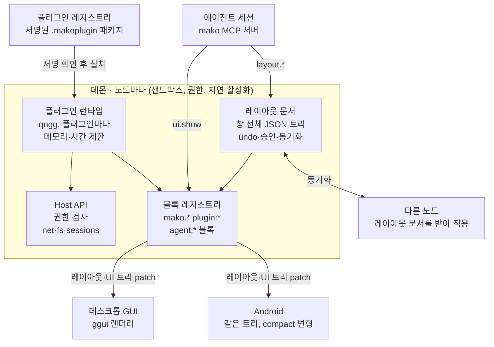

# mako 플러그인·레이아웃 시스템 설계

mako 창 전체를 레이아웃 문서 하나로 표현하고, 내장 UI와 플러그인·에이전트가
만든 UI를 같은 블록 레지스트리에 올린다. 플러그인은 데몬의 qngg 샌드박스에서
돌고, 선언형 UI 트리만 GUI와 Android로 보낸다. 에이전트는 MCP로 이 문서를 읽고
바꿔 화면을 완전히 재구성할 수 있다.

## 결정 사항

제3자 배포를 전제로 설계한다. 그래서 샌드박스와 권한을 처음부터 넣고, 플러그인을
신뢰 코드로 두는 방식은 쓰지 않는다.

| 항목 | 선택 | 이유 |
| --- | --- | --- |
| 배포 대상 | 제3자 배포까지 | 권한, 서명, 격리, UI 위장 방지를 1단계부터 설계에 넣는다 |
| 실행 위치 | 데몬 | 데이터(세션, 에이전트, 프로젝트)가 데몬에 있고 노드가 여러 개다. 한 플러그인이 데스크톱, Android, 원격 노드에서 모두 동작한다 |
| UI 모델 | Elm식 `render(state)` + `on` 메시지 | 트리를 직렬화하고 diff하기 단순하다. 상태는 플러그인 런타임에 있다 |
| 위젯 표현 | 고정된 선언형 어휘 | ggui를 직접 노출하지 않는다. 경계를 넘는 비용, 샌드박스, 테마 일관성 때문이다 |
| 1차 런타임 | qngg (QuickJS on Wasmtime) | 템플릿에서 이미 쓰고 있다. 메모리·시간 제한과 파일·네트워크 없는 샌드박스가 있다 |
| 2차 런타임 | wasm 컴포넌트 (`internal/zedhost` 인프라) | 같은 Host API 스키마를 공유한다. 필요해질 때 붙인다 |
| 레이아웃 | 창 전체를 문서 하나로 | 에이전트가 화면을 완전히 재구성할 수 있다. 내장 UI도 블록으로 등록한다 |
| 에이전트 제어 | 기존 mako MCP 서버에 툴 추가 | 에이전트가 이미 쓰고 있는 경로다 |

참고로 [herdr](https://github.com/herdrdev/herdr-app)도 창 전체를 JSON
트리(`row`/`column`/`stack`/`block`)로 두고 `layout.set` 같은 명령을 제공한다.
다만 herdr의 mod는 샌드박스가 없는 신뢰 코드여서, 제3자 배포에는 그대로 쓸 수 없다.

## 전체 구조



플러그인 코드와 에이전트의 요청은 모두 데몬으로 들어오고, GUI와 Android는
레이아웃과 UI 트리 patch만 받아 그린다. 플러그인 런타임은 Host API를 거쳐서만
밖에 접근한다.

## 레이아웃 문서와 블록 레지스트리

창 전체는 JSON 문서 하나이고, 문서의 리프는 레지스트리에 등록된 블록을
가리킨다. 지금은 가운데 패인 영역만 트리(`layoutNode`,
[`internal/gui/layout.go`](../internal/gui/layout.go))이고 사이드바·오른쪽
패널·타이틀바는 코드에 고정되어 있다.

```json
{
  "version": 1,
  "root": { "row": [
    { "block": "mako.sidebar", "size": 260 },
    { "column": [
      { "panes": "main", "grow": 1 },
      { "block": "plugin:ci-status/ci", "size": 180, "collapsible": true }
    ]},
    { "stack": ["mako.git", "mako.files", "plugin:notes/board"], "size": 320, "active": 0 }
  ]}
}
```

| 노드 | 뜻 | 주요 속성 |
| --- | --- | --- |
| `row` / `column` | 자식을 가로 / 세로로 배치 | `size`(px), `grow`, `gap` |
| `stack` | 자식을 탭처럼 겹침 | `active` |
| `block` | 레지스트리의 블록 하나 | `props`, `collapsible`, `size` |
| `panes` | 지금의 탭 그룹 split 트리를 그대로 담는 영역 | 이름 (예: `main`) |

모든 노드에는 안정적인 `id`가 붙는다. 에이전트의 `layout.patch`, 크기 조절,
사용자가 클릭한 상태가 모두 이 id를 기준으로 한다.

**블록 레지스트리**

- 내장 UI(사이드바, git, files, chat, terminal, composer, 상태바)를 Go로 쓴
  1st-party 블록으로 등록한다. 플러그인 블록과 같은 레지스트리를 쓴다.
- 블록 이름은 `mako.<이름>`, `plugin:<플러그인 id>/<블록>`, `agent:<세션>/<id>`
  세 가지 네임스페이스로 나눈다.
- 블록은 props를 JSON Schema로 선언한다. 예: `mako.chat {session}`,
  `mako.terminal {session}`, `mako.files {root}`.
- 레이아웃 문서에 레지스트리에 없는 블록이 있으면 지우지 않고 "없는 블록"
  플레이스홀더를 그린다. 플러그인을 다시 설치하면 제자리로 돌아온다.

**저장과 동기화**

저장과 노드 간 동기화는 [workspace-sync-plan.md](workspace-sync-plan.md)의 CRDT
워크스페이스 상태를 쓴다(그 문서 §6에 두 계획이 겹치는 지점의 결정이 있다).
지금의 edit version 방식은 그 계획에서 없어진다.

- 이름 있는 창 레이아웃 문서를 여러 개 두고, 문서 하나가
  `WorkspaceState.window_layouts[name]`의 LWW 엔트리 하나다. 두 노드가 같은
  문서를 동시에 바꾸면 나중 것이 통째로 이긴다. 트리 단위 병합은 하지 않는다.
- 스페이스마다 쓸 문서는 `SpaceEntry.layout` 레지스터가 가리킨다. 문서와 따로
  병합되므로, 한 기기에서 문서를 고치고 다른 기기에서 스페이스의 문서를 바꿔도
  둘 다 남는다.
- `panes` 영역 안의 탭 그룹 split 트리는 창 문서에 넣지 않는다. 지금처럼
  `layouts["spaceID|context"]`에 따로 있고, 탭을 여닫는 것이 창 문서의 편집이
  되지 않는다.
- 문서의 리비전은 그 엔트리의 HLC다. 편집은 GUI, Android, MCP 툴, 플러그인
  모두 같은 경로로 데몬에 Delta를 주고, 시계는 데몬이 찍는다.
- 화면 폭이 다른 기기(Android)는 같은 문서의 `variants.compact`를 쓴다. 없으면
  호스트가 기본 모바일 배치로 접는다.
- 노드에만 두고 동기화하지 않는 것:
    - 블록의 px 크기와 접힘. 문서의 `size`는 기본값이고, 기기가 바꾼 값은 노드
      id별 덮어쓰기로 둔다. 다른 기기의 창 크기가 동기화로 덮이지 않게 하기
      위해서다.
    - `agent:*` 블록의 배치. 세션은 한 노드의 것이고 곧 끝나므로, 동기화되는
      문서가 아니라 노드 로컬 오버레이에 놓는다. 사용자가 고정하면 문서로
      옮긴다.
    - undo 기록, 승인 대기 중이거나 "유지할까요?"를 기다리는 변경.

## 플러그인

플러그인은 폴더 하나(`plugin.toml` + JS)이고, 데몬에서 플러그인마다 따로 두는
qngg 런타임에서 돈다. Host API는 권한별로 막혔다가 manifest에 선언하고 사용자가
승인한 것만 열린다.

### Manifest

```toml
id = "ci-status"
version = "0.1.0"
publisher = "ironpark"
api = 1
entry = "main.js"
permissions = ["sessions:read", "net:api.github.com", "storage"]

[[contributes.block]]
id = "ci"
title = "CI"
slots = ["right", "bottom"]   # 기본 레이아웃에서 제안할 자리

[[contributes.command]]
id = "rerun"
title = "CI: 다시 실행"

[contributes.settings]   # 스키마만 주면 설정 UI는 호스트가 만든다
token = { type = "secret", label = "GitHub token" }
```

### 확장 지점

| 종류 | 예 |
| --- | --- |
| 블록 | 레이아웃 문서에 놓일 패널, 상태바 아이템, 세션 헤더 배지 |
| 커맨드 | 커맨드 팔레트, 단축키, 컴포저 액션 |
| 이벤트 | 세션 시작·종료·sleep, 에이전트 메시지, 툴 호출, 기존 hook 이벤트 |
| 렌더러 | 특정 툴 호출이나 코드블록 언어용 채팅 뷰 (`toolview.go` 확장) |
| 템플릿 | prompttmpl에서 플러그인 함수나 builtin 변수 호출 |
| 에이전트 | agentspec 프로필, MCP 툴 노출 |
| 설정 | 스키마로 자동 생성되는 설정 페이지 |

### 런타임

- 플러그인마다 QuickJS 런타임을 하나씩 둔다. 메모리 상한을 두고, 호출마다 CPU
  시간 제한(interrupt)을 건다.
- 지연 활성화: 기여한 블록이 화면에 보이거나, 커맨드가 실행되거나, 구독한
  이벤트가 올 때만 런타임을 띄운다. 오래 쉬면 상태를 저장하고 내린다. 비활성
  에이전트 정리와 같은 방식이다.
- 호출이 연속으로 실패하거나 한도를 넘으면 플러그인을 비활성화하고, 블록 자리에
  오류를 표시한다.
- 개발 모드에서는 폴더를 감시해 hot reload한다. 잘못된 코드는 마지막으로 성공한
  버전을 유지하고 오류만 보여 준다.
- Host API는 proto 한 곳에 정의하고 나머지를 모두 생성한다.
    - 원본: `proto/mako/plugin/v1`의 service(메서드마다 필요한 권한을 옵션으로
      적는다)와 메시지.
    - 생성물: 권한 검사가 들어간 Go 호스트 디스패처, JS 바인딩과 타입
      정의(`mako.d.ts`), wasm 런타임용 WIT.
    - 방향은 proto → WIT 한쪽이다. 기존 buf 파이프라인과 Android 코드 생성을
      그대로 쓰고, WIT의 resource·borrow처럼 proto로 되돌릴 수 없는 것을
      원본에 두지 않기 위해서다.
    - 생성기는 WIT로 옮길 수 있는 부분집합만 받는다(스트리밍 rpc, `Any`,
      `map`의 메시지 키 등은 거절). 그래서 스키마를 고칠 때마다 WIT 호환이
      깨지지 않았는지 검사된다.
    - 맞추는 것은 스키마이지 전송 형식이 아니다. QuickJS 경계는 JSON으로,
      wasm 컴포넌트는 canonical ABI로 넘긴다.
    - 생성된 파일은 커밋하고, 원본과 어긋나면 테스트가 실패한다.

### Host API (권한별)

| 권한 | 여는 API |
| --- | --- |
| (없음) | `ui`, 플러그인 자신의 설정 읽기, `log` |
| `storage` | 플러그인별 KV (쿼터 있음, 노드 간 동기화는 선택. 동기화할 때는 워크스페이스 상태가 아니라 플러그인별 문서에 `internal/crdt`의 LWW 맵을 쓴다) |
| `sessions:read` | 세션 목록, 상태, 트랜스크립트 읽기, 이벤트 구독 |
| `sessions:write` | 메시지 보내기, 에이전트 띄우기·멈추기 |
| `net:<host>` | 지정한 호스트에만 HTTP |
| `fs:project` | 현재 프로젝트 폴더 읽기 (쓰기는 `fs:project:write`) |
| `layout:write` | 레이아웃 문서 변경 (사용자 승인 거침) |
| `secrets` | OS 키체인에 둔 자신의 secret |

### UI 트리 모델

플러그인은 `render(state)`로 트리를 돌려주고, 이벤트는 `on`에 메시지로
돌아온다. 호스트는 `key` 기준으로 diff해서 patch만 GUI와 Android에 보낸다.

```js
export default {
  activate(mako) {
    mako.blocks.register("ci", {
      state: { runs: [] },
      async load(s) { s.runs = await mako.http.json("https://api.github.com/…/runs") },
      render: (s, ui) => ui.column([
        ui.text("최근 빌드").weight("medium"),
        ui.list(s.runs, r => ui.row([ui.pill(r.status), ui.text(r.name)],
          { key: r.id, onTap: ["open", r.id] })),
      ]),
      on: { open: (s, id) => mako.commands.run("mako.openUrl", s.runs.find(r => r.id === id).url) },
    })
  },
}
```

- 어휘는 고정한다: Column, Row, Stack, Text, Icon, Pill, Chip, Button, List,
  Input, Toggle, Select, Markdown, Code, Progress, Chart, Divider. 각각
  `panelkit.go`의 기존 컴포넌트에 매핑해 mako 테마를 따르게 한다.
- 색은 임의 값이 아니라 토큰(`accent`, `danger`, `muted` …)으로만 지정한다.
  테마가 바뀌어도 자연스럽고, 시스템 UI를 흉내 내기 어렵다.
- 자유 드로잉이 꼭 필요하면 나중에 `canvas`(벡터 명령 목록) 하나만 추가한다.
- 트리와 patch의 직렬화 형식은 protocol에 메시지로 정의해, GUI와 Android가 같은
  형식을 받는다.

## 에이전트 제어

에이전트는 이미 연결된 mako MCP 서버의 새 툴로 레이아웃을 읽고 바꾸며,
플러그인을 설치하지 않고도 UI를 띄울 수 있다.

| 툴 | 역할 |
| --- | --- |
| `blocks.list` | 쓸 수 있는 블록과 각 props 스키마. 에이전트가 문서를 만들 때 보는 카탈로그 |
| `layout.get` | 현재 레이아웃 문서와 리비전(그 문서 엔트리의 HLC) |
| `layout.set` | 문서 전체 교체. `ifRev`가 요청받은 데몬이 가진 리비전과 다르면 거절한다. 통과한 뒤 다른 노드의 동시 편집과는 나중 것이 이긴다 |
| `layout.patch` | 노드 id 기준 `insert` / `remove` / `move` / `resize` / `select`. 작은 변경용 |
| `layout.undo` | 직전 변경 되돌리기. 기록은 노드에만 있고, 이전 문서를 새 편집으로 다시 쓴다 |
| `ui.show` | 에이전트가 UI 트리를 직접 띄움. `agent:<세션>/<id>` 블록이 된다 |
| `ui.update` / `ui.close` | 띄운 UI의 트리 교체, 닫기 |

**`ui.show`: 에이전트가 즉석에서 만드는 UI**

- 트리 형식은 플러그인의 `render` 결과와 같다. 버튼 같은 이벤트는 기존
  `send_message` 경로로 그 에이전트에게 메시지로 돌아간다.
- 쓰임새: 진행 대시보드, 선택지 폼, 리뷰 보드, 서브에이전트 현황판.
- 에이전트 세션이 끝나면 블록도 닫히거나 읽기 전용으로 남는다.
- 허용되는 자리는 기본적으로 그 에이전트 탭 옆이나 오른쪽 패널이다. 다른 곳에
  놓으려면 `layout:write` 승인이 필요하다.
- 블록의 자리는 노드 로컬 오버레이에 둔다. 동기화되는 문서에 넣으면 그 세션이
  없는 다른 노드에 빈 자리가 생긴다.

**오래 쓸 UI는 플러그인으로**

개발 모드에서 에이전트가 로컬 플러그인 폴더에 manifest와 코드를 쓰면 hot
reload로 바로 뜬다. manifest의 권한은 사용자가 한 번 승인해야 활성화된다.
에이전트가 쓴 플러그인도 제3자 플러그인과 같은 샌드박스에서 돈다.

**변경 승인**

에이전트의 `layout.set` / `layout.patch`는 기존 approval 흐름을 탄다: 이번만 /
이 스페이스에서 허용 / 항상. 보류하는 동안 변경안을 미리보기로 보여 준다.

승인을 기다리는 변경과, `layout.set` 뒤 "유지할까요?"를 기다리는 변경은 그
노드의 화면에만 적용한다. 확정된 뒤에야 워크스페이스 상태에 써서 다른 노드로
보낸다. 먼저 보내면 자동 복구될 때 다른 기기의 화면까지 두 번 바뀐다. 허용
범위(이 스페이스에서 / 항상)도 노드에만 둔다.

## 보안과 제3자 배포

플러그인과 에이전트는 모두 신뢰하지 않는 코드로 다룬다. 권한은 사용자가 승인한
만큼만 열리고, 어떤 레이아웃을 넣어도 사용자가 빠져나올 길은 항상 남는다.

| 위협 | 대응 |
| --- | --- |
| 권한 남용 | 권한별 Host API. 설치할 때 권한 목록을 보여주고 승인받는다. 1차에는 `exec` 권한을 두지 않는다 |
| 네트워크로 데이터 유출 | `net:<host>` allowlist. 요청은 호스트가 대행하고, 플러그인별로 기록한다 |
| 자원 고갈 | 런타임별 메모리 상한, 호출별 CPU 시간 제한, 저장소 쿼터. 넘으면 비활성화한다 |
| UI 위장 | 플러그인·에이전트 블록에는 출처(프레임과 이름)를 붙인다. 승인 다이얼로그·시스템 프롬프트는 호스트만 그린다. 색은 토큰만 쓴다 |
| 레이아웃 파괴 | 변경마다 history에 쌓아 undo한다. `layout.set`은 "유지할까요?" 10초 후 자동 복구한다. 커맨드 팔레트와 "레이아웃 초기화" 단축키는 문서 바깥에 고정한다 |
| 변조된 패키지 | 퍼블리셔 ed25519 서명과 패키지 해시를 검증한다. 퍼블리셔 키가 바뀌면 업데이트를 막는다 |
| 업데이트로 권한 확대 | 권한이 늘어난 업데이트는 늘어난 부분을 보여주고 다시 승인받는다 |
| 악성으로 밝혀진 플러그인 | 각 레지스트리의 차단 목록(kill-switch)을 데몬이 주기적으로 받아 합쳐서 비활성화한다. 심사가 없으므로 이것과 권한 승인이 방어선이다 |
| secret 노출 | secret은 OS 키체인에 두고, 노드 간에 동기화하지 않는다 |

**배포 형식**

- 패키지는 `.makoplugin`(zip) 안에 manifest, 코드, 자산, 서명을 담는다.
- 레지스트리는 git 저장소의 인덱스다. 항목마다 id, 버전, 다운로드 URL, 해시,
  퍼블리셔 키를 담는다. Zed 확장 스토어 화면(`extensions.go`)을 본떠
  검색·설치 UI를 만든다.
- 운영 주체도 심사도 없다. 누구나 레지스트리 저장소를 만들어 공유하고,
  사용자가 자기 노드에 레지스트리 URL을 더한다. 기본으로 들어 있는
  레지스트리 하나는 프로젝트 관리자가 직접 관리하지만, 거기 올라온 것도
  심사를 거친 것이 아니다.
- 심사가 없으므로 안전은 레지스트리가 아니라 노드에서 지킨다.
    - 설치 화면은 어느 레지스트리의 누구 것인지와 요구 권한을 보여 주고,
      검증된 것처럼 보이게 하는 표시는 두지 않는다.
    - 퍼블리셔 키는 처음 설치할 때 고정한다(TOFU). 같은 id가 다른 키로
      서명되어 오면, 다른 레지스트리에서 왔더라도 업데이트로 받지 않는다.
    - 같은 id가 여러 레지스트리에 있으면 설치할 때 고른 레지스트리와 고정된
      키를 따른다. 레지스트리의 순서로 조용히 바뀌지 않는다.
    - 차단 목록(kill-switch)은 레지스트리마다 자기 인덱스에 두고, 노드는
      더해 둔 모든 레지스트리의 목록을 합쳐 적용한다. 레지스트리를 빼면 그
      목록도 빠진다.
- manifest의 `api` 버전으로 호환성을 확인하고, 맞지 않는 플러그인은 설치하지
  않는다.
- 설치는 노드마다 따로 한다. 다른 노드에 없는 플러그인의 블록은 플레이스홀더에
  "이 노드에 설치" 버튼으로 보인다.

## 진행 단계

첫 단계는 동작 변화 없이 현재 화면을 레이아웃 문서로 옮기는 것이다. 이후 단계는
모두 이 구조 위에 올라간다.

워크스페이스 동기화 계획과의 순서: 동기화 Phase 1~3(CRDT 코어, 데몬 병합기, GUI
전환)을 먼저 끝낸다. 2단계가 데몬이 가진 타입 있는 워크스페이스 상태를
전제하고, 1단계와 동기화 Phase 3이 같은 파일(`internal/gui/workspace.go`,
`layout.go`)을 고치기 때문이다. 동기화 Phase 4(Android의 스페이스·프로젝트)는
2단계 뒤, 5단계의 Android 렌더러보다 먼저다.

1. **블록 레지스트리와 창 레이아웃 문서 렌더러** (구현 완료, 미커밋. 형식은
   `docs/protocol.md`의 "Layout documents")
    - 내장 UI를 `mako.*` 블록으로 등록하고, 현재 화면을 기본 문서로 표현한다.
    - 문서는 이 단계에서 창의 로컬 파일에만 둔다.
    - 완료 기준: 기본 문서로 그린 화면이 지금과 같다(프리뷰 비교). 문서를 손으로
      바꾸면 화면이 따라 바뀐다.
    - 구현하며 정해진 것: 등록된 블록은 `mako.sidebar`, `mako.header`,
      `mako.files`, `mako.git`, `mako.agents`, `mako.forge`이고 채팅·터미널·
      컴포저는 `panes` 안의 탭이라 블록이 아니다. 기기별 크기는 기존 설정
      (`sidebar_width`, `details_width`)과 `layout_sizes`(노드 id별)에 둔다.
      문서 파서는 모르는 필드를 거절하므로, `variants.compact` 같은 필드를
      더하기 전에 버전·허용 정책을 정해야 한다.
2. **문서 동기화와 MCP 툴** (전제: 동기화 Phase 2·3. 구현 완료. 툴과 흐름은
   `docs/agent-mcp.md`의 "The window's layout", 형식은 `docs/protocol.md`)
    - 문서를 `window_layouts`에 두고 노드 간 동기화한다. `blocks.list`,
      `layout.get` / `set` / `patch` / `undo`를 추가한다. 창 문서 JSON의 형식을
      `docs/protocol.md`에 적는다.
    - 완료 기준: 에이전트가 승인을 거쳐 레이아웃을 바꾸고, undo와 자동 복구가
      동작한다. 복구되는 변경이 다른 노드에 나타나지 않는다.
    - 구현하며 정해진 것:
        - MCP 서버의 기존 툴이 `verb_noun`이고 툴 이름에 점을 쓸 수 없어, 툴은
          `list_blocks`, `get_layout`, `set_layout`, `patch_layout`,
          `undo_layout`이다. 이 문서의 `blocks.list` / `layout.*`는 이들을
          가리킨다.
        - 보류 중인 변경은 데몬 메모리에 한 번에 하나만 둔다. 창이 하나도
          보고 있지 않으면 승인이 필요한 변경은 바로 거절한다.
        - "이 스페이스에서 허용"은 그 스페이스가 쓰는 문서에 대한 허용이다.
          허용은 데몬 폴더의 `layout-allow.json`에 두고 동기화하지 않는다.
        - 문서 버전 정책: 자기 버전의 문서는 엄격하게, 더 높은 버전은 모르는
          필드를 버리고 모르는 노드를 "없는 블록"으로 읽는다. 노드는 자기
          버전만 쓰고 더 높은 버전은 patch하지 않는다.
        - 문서 형식은 `internal/layoutdoc`에 있고, 플러그인 블록은 그
          `Catalog` 인터페이스로 들어온다(3단계).
3. **플러그인 런타임** (구현 완료. 작성법과 한도는 `docs/plugins.md`)
    - 데몬의 qngg 런타임, manifest 로더, 권한, Host API, UI 트리·patch protocol,
      ggui 렌더러.
    - 완료 기준: 로컬 폴더의 예제 플러그인(CI 상태)이 블록, 커맨드, 설정을
      기여하고 hot reload된다.
    - 구현하며 정해진 것:
        - 플러그인은 `$MAKO_HOME/plugins/<id>/`에 두고 1초마다 폴링해 다시
          읽는다. 허용과 데이터는 `plugin-data/`에 노드별로 둔다.
        - 구현된 Host API: `log`, 설정, `storage`, `sessions:read`(목록·상태),
          `net:<host>`, `commands`. 이후 `sessions:read`에 트랜스크립트
          (페이지 단위, 한도 있음)와 이벤트 구독을 더했다. 생성기가 스트리밍
          rpc를 받지 않으므로 구독은 `subscribe`/`unsubscribe` 메서드이고,
          이벤트는 블록의 `on`처럼 호스트가 플러그인 기본 export의 `on`
          핸들러를 부르는 방식이다. 구독은 노드의 데이터 폴더에 남고, 자고
          있는 플러그인은 이벤트가 오면 띄운다.
        - `fs:project`와 `fs:project:write`도 열었다. "현재 프로젝트"는
          창마다 다르고 창이 없을 수도 있어 쓰지 않는다. 플러그인이
          `listProjects`가 주는 프로젝트 ID와 그 폴더 하나를 명시하고,
          경로는 그 폴더 기준의 상대 경로다. `os.Root`로 열어 심볼릭 링크로도
          밖에 닿지 않고, 일반 파일만 읽고 쓰며, 쓰기는 원자적이고 `.git`
          아래에는 쓰지 않는다.
        - `sessions:write`도 열었다. 메시지는 에이전트 메일함 경로로 가고
          플러그인 이름을 머리에 달아 사용자나 mako의 말로 보이지 않는다.
          에이전트 시작은 `spawn_agent`와 같은 경로이고 부모가 플러그인으로
          저장되어, 플러그인은 자기가 띄운 것만 멈춘다. 처음 시작은 창의
          바(또는 CLI)로 사용자에게 묻고(이번만 / 이 플러그인은 항상), 노드에만
          둔다. 승인과 시작은 30초 호출 한도보다 길 수 있어 호출은 바로
          돌아오고 결과는 `on.agentStarted` / `on.agentRefused` 이벤트로 간다.
        - `layout:write`도 열었다. 에이전트의 `patch_layout`과 같은 스테이지
          흐름(미리보기, 승인, 허용 범위)을 타고 출처로 플러그인 이름이
          보인다. 세션이 없으므로 승인은 창의 바가 `LayoutDecision`으로
          답한다. 허용 범위는 플러그인마다 따로 두고, `variants`는 쓰지
          않는다. 이것으로 `exec`만 선언만 남았다(manifest에서 계속 거절).
        - UI 어휘에 `chart`(line / bar / sparkline, 숫자 시리즈와 라벨, 색은
          토큰만, 점 수 상한)를 더했다(리비전 33). 데스크톱은 ggui의 차트로
          그리고, Android는 모르는 종류를 빈 자리로 두므로 깨지지 않지만 차트
          뷰는 아직 없다.
        - 스토어와 플러그인 동작의 오류에 안정적인 코드와 인자를 붙였다(리비전
          34). 창은 코드를 사용자 언어의 문장으로 보여 주고, CLI와 모르는
          코드는 데몬의 영어 메시지를 그대로 쓴다.
        - 들인 피어(폰)가 컴퓨터의 패널을 열기 전에 이름으로 보여 줄 수 있게
          `list_panels`를 더했다(리비전 35). 레이아웃 문서가 놓는 블록과
          에이전트 블록의 이름, 제목, 종류만 주고, 권한·설정·레지스트리나
          문서가 놓지 않은 플러그인은 말하지 않는다. Android가 쓰는 쪽은 아직
          없다.
        - 데스크톱 설정 ▸ 스페이스의 "폰에서"가 보이는 스페이스 문서의 페이지를
          폰이 보여 줄 순서대로 그리고, 순서 바꾸기·숨기기·다시 보이기를
          `variants.compact`로 쓴다(사용자의 워크스페이스 편집 경로). `sessions:write`, `fs:project`, `secrets`,
          `layout:write`, `exec`는 스키마에 선언만 있고 "not available"로
          답한다. manifest의 `exec`는 거절한다.
        - 권한 승인은 세션이 없어 기존 approval 대신 레이아웃 변경과 같은
          방식(데몬이 상태를 들고 창이 바를 그림)을 쓴다. `mako plugins
          grant|deny`로도 답한다.
        - 생성된 WIT는 처음에 실제 WIT 도구로 검증하지 못했다. 이후 한 번
          `wasm-tools` 1.263(공식 릴리스, 체크섬 확인)으로 `component wit`과
          `world`로 만든 더미 컴포넌트의 검증까지 통과시켰다. 그때 찾은 두
          가지(새 키워드 `map`의 이스케이프, 인터페이스에서 쓰는 타입과 같은
          이름의 함수)를 생성기가 거절·처리하고 저장소의 WIT 검사 테스트도
          확인한다. 도구는 저장소나 빌드에 들이지 않았다.
        - secret 설정은 처음에는 0600 파일에 있었다. 지금은 시스템 키체인
          (macOS Keychain은 purego로 Security 프레임워크, Linux는 D-Bus의
          Secret Service, Windows는 자격 증명 관리자)에 두고, 키체인이 없는
          노드는 플러그인마다 0600 파일(`secrets.json`)에 두며 설정과 CLI에
          그렇게 밝힌다. 예전 파일의 secret은 키체인이 생기면 한 번 옮긴다.
          `secrets` 그룹도 같은 곳을 쓴다(리비전 32).
        - 창은 갱신마다 블록 전체를 다시 그린다. patch는 전송에서만 쓴다.
        - 프로토콜 리비전 26.
4. **에이전트 생성형 UI** (구현 완료. 툴과 이벤트 형식은 `docs/agent-mcp.md`의
   "UI of your own")
    - `ui.show` / `update` / `close`와, 에이전트가 직접 쓰는 플러그인(개발 모드).
    - 완료 기준: 에이전트가 폼을 띄우고, 사용자의 선택을 메시지로 돌려받는다.
    - 구현하며 정해진 것:
        - 툴은 `show_ui`, `update_ui`, `close_ui`다. 세션당 블록 4개, 초당
          갱신 10회, 트리 한도는 플러그인과 같다.
        - 이벤트는 `window`가 보낸 메시지로 그 에이전트에 간다. 폼의 모든
          필드 값이 이벤트마다 함께 간다. 사용자가 친 글자는 JSON 문자열
          안에만 있다.
        - 오버레이는 데몬 메모리에 둔다(창을 다시 열어도 남고, 데몬을 다시
          띄우면 사라진다). 기본 자리는 오른쪽 패널 스택의 마지막 탭이다.
        - 세션이 끝나면 블록을 닫는다. 읽기 전용으로 남기는 모드는 없다.
        - 플러그인 블록과 에이전트 블록은 데몬의 `blockSource` 하나로
          서빙된다. 새 네임스페이스는 새 source다.
        - 에이전트가 플러그인 폴더를 알 수 있게 `list_blocks`가 `plugin_dir`을
          돌려준다.
        - 프로토콜 리비전 27.
5. **배포 체계와 Android** (전제: 동기화 Phase 4. 구현 완료. 패키지와 인덱스
   형식은 `docs/plugins.md`)
    - 레지스트리, 서명, 권한 diff, kill-switch, Android 렌더러와
      `variants.compact`.
    - 완료 기준: 서명된 플러그인을 설치하고 업데이트할 수 있다. 같은 블록이
      Android에서도 보인다.
    - 구현하며 정해진 것:
        - 인덱스는 저장소 루트의 `mako-registry.json` 한 파일이고, git이 아니라
          HTTPS로 그 파일만 읽는다(clone은 크기 상한을 걸 수 없다).
        - 업데이트는 고정된 키로 서명되고 더 새 버전이어야 한다. 내려가려면
          지우고 다시 설치한다. 같은 id가 여러 레지스트리에 있으면 설치할 때
          레지스트리를 지정해야 한다.
        - 차단 목록은 합쳐서 노드의 모든 플러그인에 적용한다. 한 레지스트리가
          다른 레지스트리의 플러그인도 막을 수 있고, 그 레지스트리를 빼면
          풀린다.
        - 들인 피어는 블록을 보고 누를 수 있다(리비전 30). 플러그인 목록,
          권한 승인, 레이아웃 승인, 스토어 요청은 여전히 그 컴퓨터의 것이다.
        - `variants.compact`가 있는 문서는 `version: 2`로 쓴다. 이전 창은
          느슨하게 읽어 `root`를 그린다. 폰은 compact 루트(없으면 기본 루트)를
          깊이 우선으로 걸어 블록을 페이지로 늘어놓는다.
        - 기본 레지스트리는 `https://github.com/ironpark/mako-plugins`이다
          (`internal/plugin/store`의 `DefaultRegistry`). 아직 올라온 플러그인은
          없다.
        - 프로토콜 리비전 29(스토어), 30(피어의 블록).

## 열린 질문

- [x] Host API 스키마를 proto로 쓸지 WIT로 쓸지. → proto를 원본으로 두고 WIT,
      JS 바인딩, 호스트 디스패처를 생성한다("런타임").
- [x] 레이아웃 문서를 노드 간에 통째로 동기화할지, 스페이스별 레이아웃만
      동기화할지. → 이름 있는 문서 단위로 동기화하고, 스페이스는 문서 이름을
      가리킨다("저장과 동기화").
- [ ] 플러그인을 GUI 쪽에서 돌리는 예외를 둘지. 예: 지연에 민감한 입력 위젯.
- [x] `exec` 권한을 언제, 어떤 조건으로 열지 (예: 검증된 퍼블리셔만). → 일단 열지
      않는다. 심사가 없어 "검증된 퍼블리셔"라는 조건이 성립하지 않는다. manifest의
      `exec`는 계속 거절한다. 필요해지면 사용자가 플러그인별로 직접 켜는 별도
      스위치로 따로 설계한다.
- [x] 레지스트리를 누가 운영하고, 등록 심사를 할지. → 운영도 심사도 없다. git
      기반 레지스트리를 사용자들이 알아서 공유하고, 기본 레지스트리만 프로젝트
      관리자가 관리한다("배포 형식").
