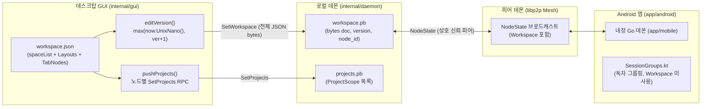
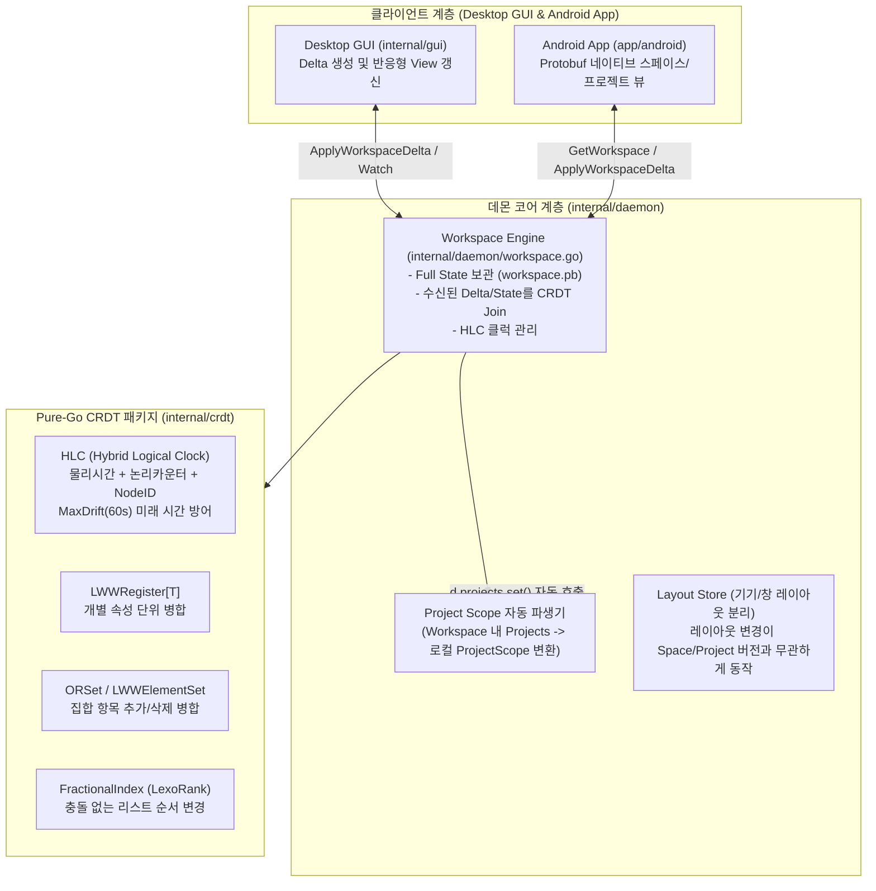
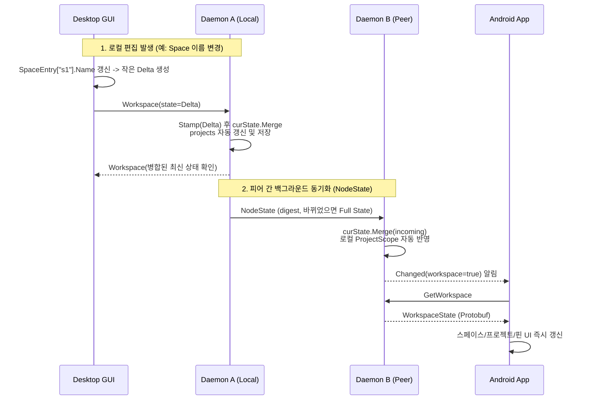

# 스페이스·프로젝트·워크스페이스 동기화 아키텍처 개선 및 Pure-Go Delta CRDT 설계안

작성 기준일: 2026년 11월 17일. 개정: 2026년 11월 18일 ([plugins-plan.md](plugins-plan.md)와의 정합 검토 반영, §6). 상태: Phase 1~4 구현 완료. Tombstone GC는 남아 있다. 구현하며 정해진 세부는 `docs/protocol.md`의 Workspaces 절이 기준이다.

Mako의 다중 노드(데스크탑 GUI, 백그라운드 데몬, Android 모바일 앱) 간 워크스페이스·스페이스·프로젝트·레이아웃 동기화 구조를 진단하고, 물리적 수정 시간(`UnixNano`) 기반 전체 덮어쓰기(Blind LWW)가 야기하는 데이터 유실과 동시 편집 충돌 문제를 근본적으로 해결하기 위한 **Pure-Go (Zero-CGO) 기반 HLC + Delta-State CRDT 아키텍처**와 단계별 구현 계획을 정의한다.

---

## 1. 현황 분석 및 핵심 문제점 진단

### 1.1 현재 동기화 데이터 흐름

현재 Mako의 워크스페이스 동기화는 다음 4개 지점을 통해 동작한다.



* **프로토콜 정의** (`proto/mako/v2/mesh.proto`):
  `Workspace` 메시지는 데몬이 해석하지 않는 불투명 바이트(`bytes doc = 1`), 물리 시간 버전(`int64 version = 2`), 생성 노드(`string node_id = 3`) 3개 필드로만 구성된다.
* **버전 부여** (`internal/gui/workspace.go`):
  GUI에서 변경 후 400ms 디바운스(`workspaceSave`)가 지나면 `editVersion(version, time.Now())`로 `max(now.UnixNano(), version+1)`을 부여하고 전체 JSON을 직렬화해 데몬에 전달한다.
* **우선순위 판정** (`internal/protocol/protocol.go`, `internal/daemon/workspace.go`):
  `Newer(v, node, w, other)` 함수가 `v > w || (v == w && node > other)` 조건으로 승자를 판정해, 패배한 쪽의 문서를 통째로 버린다.

### 1.2 발견된 8가지 구조적 문제점

| 번호 | 문제 영역 | 현상 및 발생 원인 | 피해 영향도 |
| :--- | :--- | :--- | :--- |
| **P1** | **미래 시간 오염**<br/>(Future Clock Poisoning) | 특정 노드의 시계가 NTP 오차나 수동 설정으로 미래(예: +1시간)로 튀면, `max(now, version+1)`을 통해 오염된 타임스탬프가 전체 메쉬에 전파됨 | 정상 시계를 가진 다른 노드가 오프라인에서 작업한 모든 변경사항이 온라인 복귀 시 과거 버전으로 판정되어 **무조건 증발**함 |
| **P2** | **거대 단일 문서 LWW**<br/>(Coarse-grained Lost Update) | `Spaces`, `Projects`, `Names`, `Looks`, `Pinned`, `Layouts`, `TabNodes`가 단일 JSON 블롭(`workspaceDoc`)으로 묶여 통째로 교체됨 | 노트북에서 새 스페이스/프로젝트를 구성하는 동안 데스크탑에서 탭 하나만 닫아도 한쪽 변경사항 **전체가 유실**됨 |
| **P3** | **레이아웃과 메타데이터 강결합** | 창 분할 비율 조절이나 탭 이동(`m.Layout` 변경)이 `m.Spaces`와 동일한 `version` 카운터를 올림 | 가장 빈번하게 일어나는 로컬 창 조작이 전역 스페이스/프로젝트 정의를 덮어쓰는 트리거가 됨 |
| **P4** | **자동 부수효과에 의한 덮어쓰기** | `joinClones()`(`internal/gui/projects.go`) 등 세션을 보고 자동으로 프로젝트 루트를 채우는 로직이 `m.Spaces.Update`를 호출해 새 버전을 발행함 | 가만히 켜져 있던 유휴 기기가 새 세션을 감지해 버전을 올리면서 다른 기기의 수동 편집을 덮어씀 |
| **P5** | **노드 ID 타이브레이킹 편향** | `v == w`이거나 논리 카운터 경합 시 `node > other` 사전순 비교로 결정함 | 노드 ID가 큰 기기가 동시 편집 경합에서 영구적으로 승리함 |
| **P6** | **GUI 의존적 프로젝트 전파** | 데몬은 `Workspace.doc`을 열지 못하므로, GUI가 `m.Spaces`를 감시하다가 각 노드에 `SetProjects` RPC(`pushProjects`)를 따로 쏴야 함 | 데스크탑 GUI가 꺼진 환경(헤드리스 데몬, 모바일 단독 사용)에서는 워크스페이스가 동기화되어도 데몬의 `projectStore`가 갱신되지 않음 |
| **P7** | **모바일(Android) 동기화 단절** | Android 앱은 내장 데몬을 통해 `Workspace`를 수신하지만, `doc`이 데스크탑 GUI 내부 JSON 포맷이라 읽지 못하고 `SessionGroups.kt`에서 자체 그룹핑만 수행함 | 데스크탑에서 만든 스페이스, 다중 폴더 프로젝트, 커스텀 이름, 아이콘/색상, 핀 고정이 모바일에 전혀 반영되지 않음 |
| **P8** | **동시 편집 확장 불가** | 배열 인덱스 기반 조작(`reorderSpace`, `deleteSpace`, `Roots` 슬라이스 교체)으로 구현되어 있음 | 두 기기에서 동시에 항목 순서를 바꾸거나 서로 다른 속성을 수정할 때 부분 병합(Field-level Merge)이 불가능함 |

---

## 2. 기술 선정 및 설계 원칙

### 2.1 핵심 제약 사항: 왜 Pure-Go (Zero-CGO) 직접 구현인가?

Mako 프로젝트는 크로스 플랫폼 단일 바이너리 배포와 `gomobile` 기반 Android 바인딩(`app/mobile`)을 위해 CGO를 철저히 배제하고 있다(`purego`, `wasmtime-pure-go` 채택). 외부 라이브러리를 검토한 결과는 다음과 같다.

| 후보 기술 | 검토 결과 | 배제/채택 사유 |
| :--- | :--- | :--- |
| **`ipfs/go-ds-crdt`** | **배제** | 1. IPLD, Bitswap, DAGService, Blockstore 등 IPFS 전체 스택 의존성 유입.<br/>2. 수정마다 Merkle-DAG 블록이 누적되어 모바일 메모리/배터리 및 디스크 GC 부담 심각.<br/>3. **Key-Value 수준의 LWW**일 뿐, 문서 내부 필드 병합이나 동시 편집을 지원하지 않음. |
| **`automerge-go` / `loro`** | **배제** | Rust 코어를 C FFI(CGO)로 바인딩하므로 Mako의 Pure-Go 빌드 원칙 및 `gomobile` 파이프라인과 충돌함. |
| **범용 Text CRDT (`ygo` 등)** | **배제 (현 단계)** | 글자 단위 Sequence CRDT(YATA)는 메타데이터·트리 구조 동기화에는 불필요한 메모리 오버헤드를 가짐. (추후 실시간 공동 노트 기능 도입 시에만 텍스트 필드에 한해 부분 도입 가능) |
| **Pure-Go Delta-State CRDT 직접 구현 (`internal/crdt`)** | **채택** | 1. **외부 의존성 0** (표준 라이브러리와 `protobuf`만 사용).<br/>2. 코드 규모 500~700줄 내외로 완벽한 통제 및 테스트 가능.<br/>3. Mako의 도메인(Map, Set, LWW-Register, Fractional Ordering)에 정확히 맞춘 필드 단위 동시 편집 병합 보장. |

### 2.2 왜 Delta-State CRDT ($\delta$-CRDT)인가?

CRDT는 크게 **Operation-based (CmRDT)**와 **State-based (CvRDT)**로 나뉜다.
* **Operation-based**: 변경 연산(Op)만 전송하므로 가볍지만, 네트워크 계층이 **모든 연산을 유실 없이 인과 순서대로 정확히 한 번(Exactly-once Causal Delivery)** 전달해야만 상태가 수렴한다. 오프라인 전환과 재연결이 잦은 P2P/모바일 환경에서는 별도의 연산 로그 재전송 프로토콜이 필요하다.
* **State-based**: 상태 전체를 합집합(Semilattice Join, $\sqcup$)하므로 순서가 바뀌거나 중복 수신되어도 **교환법칙·결합법칙·멱등성**에 의해 100% 수렴한다. 단, 매번 전체 상태를 보내는 것이 단점이다.
* **Delta-State CRDT ($\delta$-CRDT)**: State-based의 수학적 안전성을 그대로 유지하면서, 상태 변경 시 **변경된 조각(Delta-state, 역시 동일한 CRDT 구조체)**만 잘라내어 전송한다.
  * **Delta는 프런트엔드 → 자기 데몬 구간에서만 쓴다.** GUI·Android·MCP 툴·플러그인은 바뀐 조각만 데몬에 보내고, 데몬이 HLC를 찍어 Join한다(§3.2 규칙 4).
  * **데몬 ↔ 데몬은 전체 State를 교환한다.** 지금도 `NodeState`가 워크스페이스 전체를 싣고 있고(`internal/daemon/mesh.go`), 상태는 수십 KB를 넘지 않는다. 순서가 바뀌거나 중복·유실되어도 Join($S_{local} \sqcup S_{remote}$) 한 번으로 수렴하므로 Delta 재전송·ack 추적이 필요 없다.
  * 피어 간 Delta 전송은 같은 Join 위에 나중에 얹을 수 있는 최적화로 미룬다(§3.7).

---

## 3. 세부 타깃 아키텍처 설계

### 3.1 전체 아키텍처 개요



---

### 3.2 계층 1: 하이브리드 논리 시계 (HLC) 설계 (`internal/crdt/hlc.go`)

물리적 시계(`time.Now()`)의 직관성과 Lamport 논리 시계의 인과성 보장, 그리고 **시계 오차 방어(Drift Bounding)**를 결합한다.

#### 데이터 구조
```go
package crdt

// HLC represents a Hybrid Logical Clock timestamp.
// Ordering: WallTime -> Logical -> NodeID
type HLC struct {
    WallTime int64  // Unix milliseconds (or nanoseconds capped to ms resolution)
    Logical  uint32 // Monotonic counter for same-millisecond or drifted events
    NodeID   string // Tie-breaker (hashed with field key to avoid permanent node bias)
}
```

#### 핵심 동작 규칙
1. **로컬 이벤트 발생 (`Now(physNow int64)`)**:
   * $pt = \text{physNow}$
   * 만약 $pt > l.WallTime$ 이면: $l.WallTime = pt,\; l.Logical = 0$
   * 그렇지 않으면(시계가 역행했거나 같은 밀리초 내 연속 수정): $l.Logical = l.Logical + 1$ (물리 시간이 따라잡을 때까지 논리 카운터로 전진)
2. **원격 상태 수신과 미래 시간 오염 방어 (`Observe(remote HLC, physNow int64)`)**:
   * `const MaxClockDrift = 60 * time.Second`
   * **받은 타임스탬프는 절대 고쳐 쓰지 않는다.** 수신 측이 원격 스탬프를 클램핑·정규화하면 노드마다 다른 값이 되어 Join의 교환법칙·멱등성이 깨지고 상태가 수렴하지 않는다.
   * $remote.WallTime \le \text{physNow} + \text{MaxClockDrift}$ 이면 로컬 시계를 $\max(l, remote)$로 전진시킨다.
   * 그보다 미래인 스탬프를 가진 **엔트리는 격리(quarantine)한다**: 병합하지도 저장하지도 않고 로컬 시계도 전진시키지 않는다. 같은 메시지의 나머지 엔트리는 정상 병합한다. 전체 State가 주기적으로 다시 오므로, 실제 시간이 그 스탬프를 따라잡으면 그때 병합된다(P1 차단).
   * **시계가 틀렸던 노드의 자가 복구**: `Now()`에서 $l.WallTime > \text{physNow} + \text{MaxClockDrift}$ 임을 발견하면(시계가 고쳐진 것) 로컬 시계를 `physNow`로 되돌리고, 자기 `NodeID`로 찍힌 미래 스탬프 엔트리를 현재 값 그대로 새 스탬프로 다시 찍는다. 정상 피어는 그 엔트리를 격리해 두었으므로 내려간 스탬프와 충돌하지 않는다. 같은 방향으로 시계가 틀린 피어가 이미 받아 간 경우는 그 피어의 값이 스탬프가 지날 때까지 이기는 한계가 있고, 이는 감수한다.
3. **공정한 타이브레이킹 (P5 해결)**:
   * 동일 `(WallTime, Logical)`에서 `fnv64a(entityKey + NodeID)`를 비교해 엔티티별로 승자를 분산한다. 해시까지 같으면 `NodeID` 사전순으로 떨어뜨려 **전순서**를 보장한다(비교가 반대칭이 아니면 수렴하지 않는다).
4. **HLC는 데몬만 발급한다**:
   * 한 노드에서 편집을 만드는 주체는 GUI 창 여러 개, Android 화면, 에이전트 MCP 툴, 플러그인(`layout:write`), 데몬 자신의 파생 로직까지 여럿이다. 이들이 같은 `NodeID`로 각자 시계를 돌리면 단조성이 깨진다.
   * 프런트엔드가 보내는 Delta의 시계 값은 **무시하고 데몬이 한 번의 tick으로 다시 찍는다(`Stamp`)**. 0이 아닌 `added_at`/`removed_at`/`deleted_at`/`created_at`은 "이 동작을 하라"는 표시일 뿐이다.
   * 효과: Kotlin에 HLC 구현이 필요 없고, 프런트엔드가 미래 스탬프를 주입할 수 없다.
5. **메쉬에 합류하기 전의 편집은 세어 매긴다 (unanchored)**:
   * 지금의 `editVersion`은 아무것도 없이 시작한 워크스페이스의 편집을 시간이 아니라 횟수로 매겨(`countedEdits`), 새 노드가 메쉬에 들어오기 전에 연 탭 한두 개가 기존 노드들의 워크스페이스를 밀어내지 못하게 한다. CRDT에서도 `no_all`, `names`, `looks`, `layouts["all|"]`처럼 **키가 고정된 레지스터**는 같은 문제가 생긴다.
   * 피어 상태를 한 번도 병합하지 않은 데몬은 `WallTime = 0`, `Logical`만 증가시키는 스탬프를 찍는다. 시간 기반 스탬프는 항상 이보다 크므로 합류 순간 기존 메쉬의 값이 이긴다. 첫 병합 뒤부터 시간 기반으로 전환한다(상태 파일에 `anchored` 기록).

---

### 3.3 계층 2: 필드 단위 Delta-State CRDT 모델 (`internal/crdt`)

기존의 `workspaceDoc`을 **독립적으로 병합 가능한 원자적 필드와 엔티티 맵**으로 분해한다.

#### 1) `LWWRegister[T]` (필드 단위 레지스터)
객체 전체가 아닌 **개별 속성(Field)**마다 고유한 `HLC`를 부여한다.
```go
type Register[T any] struct {
    Value T
    Clock HLC
}

func (r *Register[T]) Merge(other Register[T], key string) (changed bool) {
    if other.Clock.After(r.Clock, key) {
        *r = other
        return true
    }
    return false
}
```
* **효과**: 기기 A에서 `Space["s1"].Name`을 `"Backend"`로 수정하고, 동시에 기기 B에서 `Space["s1"]`에 프로젝트를 추가해도 서로의 `Clock`이 분리되어 있어 **두 변경사항이 모두 유지**된다.

#### 2) `ElementSet` (LWW-Element-Set: 집합 병합)
`Space.Owners`, `Space.Projects`, `Space.Hidden`, `ProjectRoot.Locations`, `ProjectRoot.Declined`, `Pinned` 등 집합형 데이터에 사용된다.
```go
type ElementMeta struct {
    AddedAt   HLC  // 마지막 추가 시점
    RemovedAt HLC  // 마지막 삭제 시점 (Tombstone)
    Rank      string // 순서가 있는 집합(Pinned 등)일 경우 Fractional Index
}
```
* **병합 규칙 (LWW, 동률이면 추가 우선)**: 관측-삭제 집합(OR-Set)이 아니다. 더 늦은 삭제는 동시 추가를 이긴다. 이 도메인의 집합 원소는 값이 없는 식별자라 이것으로 충분하다.
  * 두 상태를 합칠 때 각 원소 $e$에 대해:
    $$\text{Merged}[e].AddedAt = \max(A[e].AddedAt, B[e].AddedAt)$$
    $$\text{Merged}[e].RemovedAt = \max(A[e].RemovedAt, B[e].RemovedAt)$$
  * 원소 $e$의 활성 여부(Active): $AddedAt \ge RemovedAt$ 일 때 집합에 존재하는 것으로 판정한다(스탬프가 완전히 같을 때만 추가가 우선).
* **효과**: 기기 A에서 오프라인으로 Owner `"alice"`를 추가하고 기기 B에서 `"bob"`을 추가하면, 온라인 연결 시 `["alice", "bob"]`으로 손실 없이 합쳐진다.

#### 3) `FractionalIndex` (배열 인덱스 없는 순서 정렬, P8 해결)
기존에는 `Spaces`나 `Pinned`가 Go 슬라이스(`[]space`)여서 순서를 바꾸면 슬라이스 전체를 덮어썼다. 이를 **LexoRank / Fractional Indexing** 문자열로 대체한다.
* 각 항목은 `Rank Register[string]` (예: `"a0"`, `"a1"`, `"a2"`)을 가진다.
* 항목 B를 항목 A(`"a0"`)와 항목 C(`"a1"`) 사이로 이동하면, B의 `Rank` 레지스터만 중간값인 `"a0V"`로 갱신하는 **단일 필드 Delta**만 발생한다.
* 두 기기에서 동시에 서로 다른 스페이스의 순서를 바꾸거나 새 스페이스를 추가해도 배열 인덱스가 밀리거나 덮어써지지 않고 `Rank` 기준 정렬(` cmp.Or(cmp.Compare(a.Rank, b.Rank), cmp.Compare(a.ID, b.ID))`)로 모든 노드에서 동일한 순서로 수렴한다.

#### 4) 엔티티 삭제 규칙 (Remove-Wins, 명시적 복원만 되살림)
`SpaceEntry`, `ProjectEntry`, `ProjectRootEntry`는 `created_at`과 `deleted_at`을 둘 다 최댓값 병합하고, **`created_at > deleted_at`일 때만 보인다.**
* 삭제된 엔티티에 대한 동시 필드 수정은 병합은 되지만 보이지 않는다. 삭제를 되돌리기(undo)는 `created_at`을 새 스탬프로 올리는 것이고, 그러면 병합되어 있던 필드가 그대로 돌아온다.
* "하위 필드의 최신 시각과 비교"하는 방식은 쓰지 않는다. 유휴 기기의 자동 편집(`joinClones`)이 지운 프로젝트를 되살리게 되기 때문이다.
* 지워진 엔티티를 가리키는 참조(스페이스의 `projects`, 핀, `looks`, `names`, 그 스페이스의 `layouts`)는 지우지 않고 **조회 시 걸러낸다.**

---

### 3.4 계층 3: 도메인 분리 (메타데이터 vs 레이아웃 vs 로컬 설정)

성격이 다른 데이터를 하나의 버전으로 묶던 구조(P2, P3)를 3개의 독립 트랙으로 분리한다.

| 구분 | 포함 데이터 | 동기화 범위 및 방식 | 변경 빈도 |
| :--- | :--- | :--- | :--- |
| **1. 공유 워크스페이스 상태**<br/>(`WorkspaceState`) | `Spaces`, `Projects`, `Names`, `Looks`, `PinnedProjects`, `Pinned`, `NoAll` | **전역 메쉬 동기화** (Desktop + Daemon + Android)<br/>필드/엔티티 단위 Delta-State CRDT | 낮음<br/>(사용자 명시적 편집 시) |
| **2a. 패인 레이아웃**<br/>(`layouts`) | 탭 그룹 분할 트리, `TabNodes` | **전역 메쉬 동기화**<br/>`layoutKey` (`spaceID\|context`) 단위의 독립된 LWW 엔트리. 분할 **비율**은 트리에 포함(비율이라 화면 크기와 무관) | 높음<br/>(탭 열기/닫기, 분할선 드래그) |
| **2b. 창 레이아웃 문서**<br/>(`window_layouts`) | 창 전체 블록 배치([plugins-plan.md](plugins-plan.md)의 레이아웃 문서) | **전역 메쉬 동기화**<br/>이름 있는 문서 하나가 LWW 엔트리 하나. 스페이스가 쓸 문서는 `SpaceEntry.layout` 레지스터 | 낮음<br/>(사용자·에이전트의 재구성) |
| **3. 로컬 창 컨텍스트**<br/>(`LocalWindowState`) | `Contexts` (현재 선택된 프로젝트 탭), `ShownSpace`, 창 크기, 블록의 px 크기·접힘, `agent:*` 블록 배치, 레이아웃 undo 기록 | **로컬 전용 (비동기화)**<br/>각 기기/창의 `gui.json` 및 `workspace.local.json`에 보관 | 매우 높음<br/>(클릭/포커스 전환마다) |

> **동기화 스위치의 위치**: 지금은 `SyncWorkspace`가 창의 설정이고, 꺼진 창은 데몬에 아무것도 주지 않는다. 그러면 데몬이 `ProjectScope`를 파생할 수 없고(P6), 에이전트·플러그인·Android가 읽을 상태도 없다. 그래서 **프런트엔드는 항상 자기 데몬에 편집을 준다.** 스위치는 데몬의 노드 설정으로 옮겨, 꺼져 있으면 데몬이 `NodeState`에 상태를 싣지 않고 피어의 것도 받지 않는다.

> **핵심 개선점**:
> 1. 사용자가 데스크탑에서 탭을 열고 닫거나 창 분할선을 드래그하면 **`Layouts[shownKey]` 엔티티 하나만** 갱신될 뿐, `Spaces`나 `Projects`의 CRDT 상태는 전혀 건드리지 않는다.
> 2. `joinClones()`(`internal/gui/projects.go`)가 새로운 클론 폴더를 감지해 추가할 때도 전체 문서를 덮어쓰지 않고, 해당 `ProjectRoot.Locations` 집합에 원소 1개를 추가하는 **미세 Delta**만 발생시킨다(P4 해결).

---

### 3.5 계층 4: Protobuf 스키마 설계 (`proto/mako/v2/workspace.proto`)

데몬과 Android 클라이언트가 JSON 파싱 없이 워크스페이스 상태를 직접 이해하고 병합할 수 있도록 불투명 `bytes doc`을 명시적 Protobuf 스키마로 승격한다.

```proto
syntax = "proto3";

package mako.v2;

option go_package = "github.com/ironpark/mako/internal/protocol";

// HLC is a Hybrid Logical Clock timestamp for deterministic conflict resolution.
message HLC {
  int64 wall_time = 1; // Unix milliseconds
  uint32 logical = 2;  // Monotonic logical counter
  string node_id = 3;  // Origin node ID
}

// ElementMeta tracks membership and ordering in a CRDT set.
message ElementMeta {
  HLC added_at = 1;
  HLC removed_at = 2;
  string rank = 3;     // Optional fractional index for ordered sets
  HLC rank_clock = 4;
}

// StringReg is a Last-Write-Wins Register holding a string.
message StringReg {
  string value = 1;
  HLC clock = 2;
}

// BoolReg is a Last-Write-Wins Register holding a bool.
message BoolReg {
  bool value = 1;
  HLC clock = 2;
}

// SpaceEntry is a CRDT-backed space definition. It shows while
// created_at > deleted_at.
message SpaceEntry {
  string id = 1;
  HLC created_at = 2;
  HLC deleted_at = 3;
  StringReg name = 4;
  StringReg rank = 5;                 // Fractional index for space ordering
  map<string, ElementMeta> owners = 6;   // owner -> set membership
  map<string, ElementMeta> projects = 7; // project ID -> explicitly shown
  map<string, ElementMeta> hidden = 8;   // project ID -> explicitly hidden
  StringReg color = 9;                // among the look colours, by name
  StringReg layout = 10;              // name of the window layout it uses; "" for the default
}

// ProjectRootEntry is one repository or folder root inside a project.
message ProjectRootEntry {
  // id is the root's remote, or without one its first location's key; it
  // is derived once, when the root is made, and does not change after.
  string id = 1;
  HLC created_at = 2;
  HLC deleted_at = 3;
  StringReg rank = 4;
  StringReg label = 5;
  StringReg remote = 6;
  StringReg owner = 7;
  // key: node_id + "\x00" + path (a path may hold a colon)
  map<string, ElementMeta> locations = 8;
  map<string, ElementMeta> declined = 9;
}

// ProjectEntry is a CRDT-backed multi-folder project definition.
message ProjectEntry {
  string id = 1;
  HLC created_at = 2;
  HLC deleted_at = 3;
  StringReg name = 4;
  BoolReg no_join = 5;
  BoolReg give_dirs = 6;
  map<string, ProjectRootEntry> roots = 7;
  StringReg rank = 8;                 // the projects' order
}

// LookEntry holds the icon and colour of a project section; "" for none.
message LookEntry {
  StringReg icon = 1;
  StringReg color = 2;                // among the look colours, by name
}

// LayoutEntry is one whole document, the later edit of which wins: the
// pane tree of one (space|context), or a named window layout. Its JSON is
// described in protocol.md, for every front-end to read.
message LayoutEntry {
  bytes doc = 1;
  map<string, string> tab_nodes = 2;  // pane trees: tabID -> nodeID
  HLC clock = 3;                      // also the document's revision (ifRev)
  bool deleted = 4;
}

// WorkspaceState is the workspace's CRDT state, whole or in part: a delta
// is the same message carrying only the entries that changed.
message WorkspaceState {
  reserved 1;
  BoolReg no_all = 2;
  map<string, SpaceEntry> spaces = 3;
  map<string, ProjectEntry> projects = 4;
  map<string, StringReg> names = 5;             // sectionKey -> custom name
  map<string, LookEntry> looks = 6;             // sectionKey -> icon & color
  map<string, ElementMeta> pinned_projects = 7; // "section\x00root" -> ordered set
  map<string, ElementMeta> pinned_sessions = 8; // sessionID -> ordered set
  map<string, LayoutEntry> layouts = 9;         // "spaceID|context" -> pane tree
  StringReg default_space = 10;                 // where a section nothing places goes
  map<string, LayoutEntry> window_layouts = 11; // name -> window layout document
}
```

스키마는 지금의 `space`, `spaceList`, `project`, `projectRoot`, `projectLook`(`internal/gui`)의 모든 필드를 덮는다. 초안에서 빠져 있던 `space.Color`, `spaceList.Default`, 프로젝트 순서를 넣었고, `LookEntry.color`는 코드대로 색 이름(string)이다.

#### 구버전과의 관계 (`mesh.proto`의 `Workspace`)
`Workspace`에 `WorkspaceState state = 4;`와 `bytes digest = 5;`를 추가한다. **구버전과 섞어 병합하지 않는다.**
* 신버전 데몬은 `state`만 채우고 `doc`·`version`은 비워 보낸다. 구버전 `workspaces.put`은 `version == 0`을 버리므로 구버전 노드는 영향받지 않는다.
* 신버전 데몬은 피어가 보낸 `doc`만 있는 `Workspace`를 병합하지 않는다. 통째 LWW 문서에서는 "항목이 없음"이 삭제인지 낡은 것인지 구분할 수 없어, 어댑터로 병합하면 Blind LWW(P2)가 CRDT 안으로 들어오거나 삭제가 영영 전파되지 않는다. 자기 상태가 비어 있을 때 한 번 가져오는 것만 허용한다.
* 따라서 워크스페이스 동기화는 모든 노드가 `RevisionWorkspaceCRDT` 이상일 때만 이어진다. GUI는 그보다 낮은 피어에 "업데이트 필요"를 표시한다.

#### 결정적 마이그레이션
각 노드는 자기 `workspace.json`/`workspace.pb`를 독립적으로 `WorkspaceState`로 올린다. 같은 문서에서 출발한 두 노드가 **바이트까지 같은 상태**를 만들어야 첫 병합이 아무것도 바꾸지 않는다.
* 모든 엔트리의 스탬프는 `HLC{WallTime: legacyVersion / 1e6, Logical: 0, NodeID: legacyNodeID}`. 세어 매긴 버전(`< countedEdits`)은 `WallTime: 0, Logical: min(version, MaxUint32)`. `countedEdits`는 1e18이라 `uint32`에 그대로 담기지 않지만, 편집마다 1씩 오르는 값이라 실제로 넘을 일은 없다.
* `rank`는 슬라이스 인덱스에서 결정적으로 만든다. 루트 ID는 위 규칙(remote, 없으면 첫 location 키)으로 만든다.
* 변환 코드는 데몬·GUI·모바일이 함께 쓰도록 `internal/workspace`에 둔다(`internal/gui` 타입에 의존하지 않는다).

---

### 3.6 계층 5: 데몬 중심 병합 및 `ProjectScope` 자동 파생 (P6 해결)

기존에는 데몬이 `Workspace`를 단순 파일로만 들고 있었으나, 이제 **데몬(`internal/daemon/workspace.go`)이 CRDT 상태 머신의 주체**가 된다.

1. **데몬 내 CRDT Join**:
   * 로컬 프런트엔드의 Delta(`TypeWorkspace`)는 `workspace.Stamp`로 시계를 다시 찍은 뒤, 피어가 `NodeState`로 보낸 전체 `WorkspaceState`는 그대로(미래 스탬프 엔트리만 격리하고) `workspace.Merge(d.workspace.cur, incoming)`한다.
   * `Merge`가 `changed == true`를 반환하면 디스크(`workspace.pb`)에 원자적으로 저장하고 `d.changes.fireWorkspace()`를 호출한다.
2. **데몬 자체 `ProjectScope` 파생 (GUI `pushProjects` 제거 가능)**:
   * 데몬은 병합된 `WorkspaceState.Projects`를 순회하며 자신의 `d.cfg.NodeID`에 해당하는 활성 `locations`(`added_at >= removed_at`)를 추출해 `[]*protocol.ProjectScope`를 즉시 구성하고 `d.projects.set(scopes)`를 스스로 호출한다.
   * 데몬이 프로젝트가 있는 CRDT 상태를 가진 뒤로는 파생 결과가 기준이다. 구버전 GUI의 `SetProjects`는 덮어쓰지 않고 현재 값으로 답한다.
   * **효과**: 데스크탑 GUI가 닫혀 있거나, 모바일 앱에서 프로젝트를 수정했거나, 데몬이 단독으로 재시작되었을 때도 모든 노드의 데몬이 항상 정확한 `ProjectScope`를 유지한다.

---

### 3.7 Delta 전파 및 Anti-Entropy 동기화 프로토콜



1. **다이제스트 기반 변경 감지**:
   * 기존 `GetVersion()` 비교를 상태의 다이제스트(결정적 직렬화의 해시) 비교로 대체한다. 상태가 바뀌면 `NodeState`에 전체 State를 싣고, 주기 전송(`stateEvery`)에는 다이제스트만 싣는다. 받은 다이제스트가 자기 것과 다르면 `GetWorkspace{node_id}`로 전체를 가져와 Join한다.
   * 초안의 `version_vector`(노드별 최고 HLC)는 쓰지 않는다. LWW 레지스터 상태에서는 "X의 HLC 10을 봤다"가 "X의 HLC 5도 봤다"를 뜻하지 않아(중간 Delta 유실), 동기화 생략이나 GC의 근거로 쓰면 안전하지 않다.
   * 다이제스트는 "다르면 다시 보낸다"는 힌트일 뿐이라, 직렬화가 버전 간에 달라져도 한 번 더 보내는 것으로 끝난다.
2. **Tombstone GC는 1차 범위에서 뺀다**:
   * 스페이스·프로젝트는 수십~수백 개이고 Tombstone은 엔트리당 수십 바이트다.
   * TTL로 지우면, 그보다 오래 떨어져 있던 피어의 낡은 `added_at`이 Tombstone 없는 상태와 만나 **지운 항목이 되살아난다.** "모든 피어가 넘어섰다"를 판정하려면 피어 집합의 합의가 필요하고, 위에서 보았듯 최고 HLC 벡터로는 판정할 수 없다.
   * 필요해지면 신뢰 피어 집합을 고정한 epoch 단위 압축으로 따로 설계한다.

---

## 4. 동시 편집 시나리오별 해결 검증

설계된 아키텍처가 실제 동시 편집 및 오프라인 충돌 상황을 어떻게 해결하는지 검증한다.

| 시나리오 | 기기 A 동작 | 기기 B 동작 (동시/오프라인) | 기존 동작 (버그) | 신규 Delta CRDT 동작 (해결) |
| :--- | :--- | :--- | :--- | :--- |
| **1. 레이아웃 vs 스페이스 수정** | 탭 분할 및 위치 이동 | 새 스페이스 `"Work"` 추가 | 나중에 저장된 쪽이 상대방 변경을 통째로 날림 | `Layouts[key]`와 `Spaces["work"]`는 서로 다른 맵 엔트리이므로 **100% 둘 다 보존** |
| **2. 같은 스페이스의 다른 속성 수정** | `"Work"` 스페이스 이름을 `"Backend"`로 변경 | `"Work"` 스페이스에 프로젝트 `"mako"` 추가 | 한쪽이 덮어써짐 | `Name`(`StringReg`)과 `Projects["mako"]`(`ElementMeta`)가 개별 HLC를 가지므로 **이름 변경과 프로젝트 추가 모두 반영** |
| **3. 스페이스 순서 동시 변경** | 스페이스 1을 맨 뒤로 이동 | 새 스페이스 4를 맨 앞에 추가 | 배열 전체가 교체되어 스페이스 4가 증발하거나 순서 꼬임 | Fractional Index(`Rank`)가 각각 `"z0"`, `"00"`으로 갱신되어 **두 작업 모두 의도한 위치에 배치** |
| **4. 시계가 2시간 빠른 피어** | 시계가 +2시간인 상태에서 핀 1개 추가 | 정상 시계로 프로젝트 3개 생성 | 기기 B의 모든 편집이 2시간 동안 무시됨 | 기기 B는 A의 미래 스탬프 엔트리를 격리하고 시계를 전진시키지 않으므로 **기기 B의 편집 정상 반영**. A의 핀은 A의 시계가 고쳐져 다시 찍히거나 실제 시간이 따라잡으면 전파 |
| **5. 오프라인 삭제 vs 속성 수정** | 스페이스 X 삭제 (`deleted_at = T2`) | 스페이스 X 이름 수정 (`name.clock = T1`) | 전체 문서 LWW | **삭제가 이긴다**(`created_at > deleted_at`일 때만 보임). 이름 수정은 병합되어 있다가 삭제를 되돌리면 함께 돌아온다 |
| **6. 새 기기 합류** | 오래 쓴 워크스페이스 | 메쉬에 들어오기 전 탭 2개를 엶 | 버전을 세어 매겨 기존 것이 이김 | 합류 전 스탬프는 `WallTime = 0`이라 `layouts["all\|"]` 등 같은 키에서 **기존 메쉬의 값이 이기고**, 새 기기에만 있던 엔트리는 합쳐짐 |

---

## 5. 단계별 구현 및 마이그레이션 계획

기존 사용자의 `workspace.json`과 `workspace.pb` 데이터를 유실 없이 승격하고, 구버전 데몬과의 호환성을 유지하기 위해 4단계로 나누어 구현한다.

### Phase 1: CRDT 코어, 스키마, 워크스페이스 병합기 (`internal/crdt`, `internal/workspace`)
* **목표**: 동작 변화 없이, 이후 단계가 모두 올라설 순수 Go 엔진과 스키마를 만들고 불변식을 검증한다. 데몬·GUI는 건드리지 않는다.
* **작업 파일**:
  * `internal/crdt` (`protocol`을 import하지 않는 범용 기본형):
    * `hlc.go`: `HLC`, `Clock`(`Now`, `Observe`, 격리 판정, unanchored 모드, 자가 복구 감지), `After(other, key)` 전순서 비교.
    * `register.go`: 제네릭 `Register[T]`.
    * `set.go`: LWW-Element-Set 병합과 활성 원소 조회.
    * `rank.go`: `Between(prev, next string) string`, 인덱스에서 결정적으로 만드는 `Initial(i, n int)`.
  * `proto/mako/v2/workspace.proto` 신설, `mesh.proto`의 `Workspace`에 `state`·`digest` 추가 (`make proto`). 추가만 하므로 기존 동작은 그대로다.
  * `internal/workspace` (도메인):
    * `merge.go`: `Merge(dst, src) (changed bool)`, 미래 스탬프 엔트리 격리.
    * `stamp.go`: 프런트엔드 Delta의 시계를 한 tick으로 다시 찍는 `Stamp`.
    * `digest.go`: 결정적 직렬화의 해시.
    * `view.go`: 보이는 스페이스·프로젝트(삭제·참조 걸러내기, rank 정렬), 노드별 `ProjectScope` 파생.
* **검증**:
  * 무작위로 만든 편집 Delta 100개를 노드 3개 이상에 임의의 순서·중복·누락 후 전체 병합으로 적용했을 때 최종 상태가 `proto.Equal`하고 다이제스트가 같은지 확인하는 **교환법칙·결합법칙·멱등성 테스트**. (proto map 직렬화는 비결정적이므로 바이트 비교는 `Deterministic` 마샬로만 한다.)
  * §4의 시나리오 1~6을 각각 테스트로 고정한다.

### Phase 2: 데몬 상태 병합기와 마이그레이션
* **목표**: 데몬이 `WorkspaceState`를 직접 병합하고 로컬 `ProjectScope`를 자동 파생하도록 전환.
* **작업 파일**:
  * `internal/workspace/legacy.go`: 레거시 JSON → `WorkspaceState` 결정적 변환(§3.5). 지금 `internal/gui`에 있는 문서 타입 중 변환에 필요한 것을 이 패키지로 옮긴다.
  * `internal/daemon/workspace.go`: `workspaces.put()`을 `workspace.Merge()`로 바꾸고, 프런트엔드 Delta는 `Stamp` 후 병합. 시작 시 `workspace.pb`의 레거시 `doc`을 한 번 변환. 병합되면 `d.syncWorkspaceProjects()`로 `d.projects.set()` 갱신.
  * `internal/daemon/mesh.go`: `watchState`의 변경 감지를 다이제스트로, 동기화 스위치를 노드 설정으로.
  * Phase 1 구현에서 정해져 데몬이 지켜야 할 호출 규약:
    * 시계는 `anchored` 여부만 저장한다. 시작할 때 `workspace.Observe(state, clock, now)`로 나머지를 되살린다.
    * 자가 복구는 `workspace.Heal`이 한다. 로드 직후와 `Stamp` 직전에 부른다.
    * `Merge`는 시계를 anchor하지 않는다. 피어 상태를 처음 병합한 뒤 데몬이 `clock.Anchor()`를 부르고 저장한다.
    * 프런트엔드 Delta에서 빈 `HLC{}`는 표시가 아니다. 추가·삭제·생성을 뜻하려면 필드를 채워 보낸다(예: `logical = 1`).
  * 경로가 UTF-8이 아니면(Linux에서 가능) proto3 `string`인 location 키 때문에 상태 전체가 직렬화되지 않는다. 데몬은 그런 location을 상태에 넣기 전에 거른다.
  * `internal/protocol/agent.go`: `RevisionWorkspaceCRDT = 23`.
* **검증**:
  * `internal/daemon/mesh_test.go`: 두 데몬이 서로 다른 스페이스와 프로젝트를 동시에 수정한 뒤 연결되었을 때 양쪽 모두 합쳐진 상태를 보유하고 `d.projects`가 자동 갱신되는지.
  * 같은 레거시 문서를 두 노드에서 각각 변환한 결과의 다이제스트가 같은지.

### Phase 3: 데스크탑 GUI 전환 (`internal/gui`)
* **목표**: GUI가 통째 문서 대신 Delta를 내고, 레이아웃 변경이 메타데이터와 분리되게 한다.
* **방식**: `m.Spaces`(`spaceList`)는 **`WorkspaceState`의 투영(view)** 으로 남긴다. 편집 호출부(`m.Spaces.Update(...)`, `reorderSpace`, `deleteSpace`, `joinClones` 등)는 그대로 두고, 저장 시점에 `workspace.Diff(이전 view, 지금 view)`가 바뀐 필드·집합 원소·rank만 담은 Delta를 만든다. 순서 변경은 옮겨진 항목의 `rank`만 바뀐다. 두 노드가 같은 자리에 끼워 넣어 rank가 같아진 이웃 사이에 놓아야 할 때는 이웃 하나의 rank도 함께 다시 쓴다. 호출부 수십 곳을 Delta 생성 코드로 고치는 것보다 변경 범위와 회귀 위험이 작고, `joinClones`도 자연히 `locations` 원소 하나의 Delta가 된다(P4).
* **작업 파일**:
  * `internal/workspace/diff.go`: view 두 개의 차이 → Delta.
  * `internal/gui/workspace.go`: `saveWorkspace`가 `SyncWorkspace`와 무관하게 Delta를 데몬에 주고, `takeWorkspace`가 병합된 상태를 view로 받아 적용. 레이아웃은 바뀐 `layoutKey`의 `LayoutEntry`만 싣는다. `editVersion`/`countedEdits` 제거(§3.2 규칙 5가 대신한다).
  * `internal/gui/projects.go`: 데몬이 `RevisionWorkspaceCRDT` 이상이면 `pushProjects` 생략.
* **검증**:
  * GUI 단위 테스트로 오프라인 동시 수정, 탭 이동 중 원격 스페이스 추가, 미래 시간 피어 수신 시나리오.

### Phase 4: Android 모바일 클라이언트 연동 (`app/android`)
* **구현하며 바뀐 전제**: 폰은 컴퓨터에 들여질 뿐 컴퓨터를 들이지 않아(단방향), 폰의 내장 데몬은 워크스페이스를 병합할 상대가 없다. 폰의 신뢰 범위는 그대로 두고 다음으로 풀었다.
  * 읽기: 앱이 자기를 들인 컴퓨터의 워크스페이스를 `get_workspace{node_id}`로 가져온다. 각 데몬이 노드 레코드에 다이제스트(`Node.workspace_digest`)를 실어, 들인 노드가 바뀐 것을 알고 다시 가져온다.
  * 쓰기: 노드가 들인 피어는 Delta를 줄 수 있다(`Workspace.to_node`, 리비전 25 `RevisionPeerWorkspace`). 들인 피어는 이미 그 노드에서 세션을 시작할 수 있으므로 권한이 늘지 않는다. 레거시 `doc`은 피어에게서 받지 않는다.
  * 컴퓨터가 여럿이면 노드 ID 순으로 첫 번째, 비어 있지 않은 워크스페이스를 보여 준다. Kotlin에는 병합이 없다.
  * Kotlin 투영·그룹핑·핀 Delta는 Go가 만든 픽스처와 대조한다(`MAKO_ANDROID_FIXTURES=1 go test ./internal/workspace ./internal/gui`로 다시 만든다).
* **목표**: 모바일 앱에서도 데스크탑과 동일한 스페이스, 다중 폴더 프로젝트, 커스텀 이름, 핀 고정, 아이콘/색상을 공유.
* **작업 파일**:
  * `app/android/app/src/main/java/dev/ironpark/mako/net/Daemon.kt`:
    * `workspace(): WorkspaceState` 및 `updateWorkspace(delta: WorkspaceState)` API 추가. 시계는 데몬이 찍으므로 Kotlin에 HLC 구현은 두지 않는다.
    * `Watch` 스트림에서 `changed.workspace` 수신 시 상태 갱신 Flow 연결.
  * `app/android/app/src/main/java/dev/ironpark/mako/ui/SessionGroups.kt` 및 `SessionsScreen.kt`:
    * `WorkspaceState`의 `Spaces`, `Projects`, `Names`, `Looks`, `Pinned`를 반영하여 데스크탑 사이드바와 동일한 프로젝트 그룹핑 및 스페이스 필터 탭 제공.
* **검증**:
  * `SessionGroupsTest.kt`에 `WorkspaceState` 기반 다중 루트 프로젝트 병합 및 스페이스 필터링 유닛 테스트 추가.

---

## 6. 플러그인·레이아웃 계획과의 정합

[plugins-plan.md](plugins-plan.md)는 창 전체를 레이아웃 문서로 만들어 데몬에 두고, 에이전트가 MCP로 바꾸게 한다. 두 계획이 같은 워크스페이스 상태를 건드리므로 다음을 맞춘다.

| 겹치는 지점 | 충돌 | 결정 |
| :--- | :--- | :--- |
| 레이아웃의 정체 | 이 문서의 `layouts`는 패인 분할 트리, 플러그인 계획은 창 전체 문서 | 둘은 다른 것이다. 패인 트리는 `layouts["spaceID\|context"]`, 창 문서는 `window_layouts[name]`. 창 문서의 `panes` 리프가 패인 트리를 가리킨다 |
| 동기화 방식 | 플러그인 계획은 "스페이스와 같은 방식(edit version)" | edit version은 없어진다. 창 문서 하나가 LWW `LayoutEntry` 하나다. 트리 CRDT는 쓰지 않는다 |
| `layout.get`의 리비전, `layout.set`의 `ifRev` | CRDT에는 선형 리비전이 없다 | 리비전은 그 엔트리의 `clock`이다. `ifRev`는 **요청받은 데몬에서만** 비교하고, 통과한 뒤 다른 노드의 동시 편집과는 LWW로 정한다 |
| undo, "유지할까요?" 10초 복구, 승인 미리보기 | 되돌릴 변경이 먼저 피어로 퍼지면 다른 기기 화면이 출렁인다 | 보류·미리보기 중인 변경은 **그 노드에만** 둔다. 유지가 확정될 때 CRDT에 쓴다. undo 기록은 노드 로컬이고, undo는 이전 문서를 새 스탬프로 다시 쓰는 편집이다 |
| 기기별 상태 | 플러그인 계획은 분할 비율·접힘이 로컬, 이 문서는 패인 트리의 `Ratio`를 동기화 | 창 문서의 px 크기·접힘은 로컬 덮어쓰기(문서의 값은 기본값). 패인 트리의 비율은 지금처럼 동기화 |
| `agent:<세션>/<id>` 블록 | 세션은 한 노드의 것이고 곧 끝난다 | 동기화되는 창 문서에 넣지 않고 노드 로컬 오버레이에 둔다. 사용자가 고정하면 문서로 옮긴다 |
| 편집 주체 | GUI, Android, MCP 툴, 플러그인이 모두 쓴다 | 모두 같은 경로(Delta → 데몬 `Stamp` → `Merge`)를 쓴다. HLC는 데몬만 발급 |
| 동기화 스위치 | 창의 설정이면 데몬에 문서가 없을 수 있다 | 데몬은 항상 상태를 가진다. 스위치는 노드 설정(§3.4) |
| Android | 패인 트리 JSON이 "GUI 내부 형식"이면 P7이 레이아웃에서 되풀이된다 | 두 레이아웃 JSON 모두 `docs/protocol.md`에 형식을 적는다 |
| 플러그인 KV 저장소의 노드 간 동기화 | `WorkspaceState`에 넣을지 | 넣지 않는다. 플러그인별 문서를 따로 두고 `internal/crdt` 기본형만 재사용한다 |

### 두 계획을 합친 구현 순서

1. **동기화 Phase 1** (CRDT 코어·스키마·병합기). 의존하는 것이 없고 나머지 전부가 이 위에 선다.
2. **동기화 Phase 2** (데몬 병합기). 플러그인 2단계(문서 동기화·MCP 툴)의 전제다.
3. **동기화 Phase 3** (GUI 전환). `internal/gui/workspace.go`와 레이아웃 저장 경로를 고치므로 플러그인 1단계보다 먼저 끝낸다.
4. **플러그인 1단계** (블록 레지스트리, 창 레이아웃 문서 렌더러). 동기화와 무관한 GUI 리팩터링이지만 같은 파일을 건드려 3과 겹치지 않게 순서를 둔다.
5. **플러그인 2단계** → **동기화 Phase 4** (Android가 스페이스·프로젝트를 읽음) → 플러그인 3~5단계.
